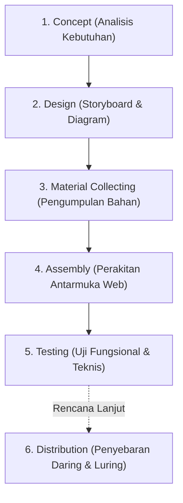

# LAPORAN PENGEMBANGAN MULTIMEDIA PEMBELAJARAN

## PENGEMBANGAN MULTIMEDIA PEMBELAJARAN INTERAKTIF BERBASIS WEBMOBILE SEBAGAI PENDAMPING MEDIA PEMBELAJARAN KONVENSIONAL PADA MATA PELAJARAN IPA SMP NEGERI 1 TANDUKKALUA MENGGUNAKAN MODEL MDLC

 

### IDENTITAS PENYUSUN

- **Nama Lengkap :** Nurun Nisa Ahmad
- **Nomor Induk Mahasiswa (NIM) :** 240209501049
- **Kelas / Angkatan :** Pendidikan Teknik Informatika dan Komputer (PTIK) E 2024
- **Mata Kuliah :** Multimedia Pembelajaran (MULPED)
- **Dosen Pengampu :** Dr. Udin Sidik Sidin, S.Pd., M.T. (Nomor Induk Dosen Nasional (NIDN) 0015067407)
- **Dosen Mitra :** Ir. H. Muhammad Riska, S.Pd., M.Pd. (Nomor Induk Dosen Nasional (NIDN) 0020098503)
- **Program Studi :** Pendidikan Teknik Informatika dan Komputer
- **Jurusan :** Jurusan Teknik Informatika dan Komputer
- **Fakultas :** Fakultas Teknik
- **Perguruan Tinggi :** Universitas Negeri Makassar (UNM)
- **Kota & Waktu :** Makassar, November 2026
- **Tautan Repositori :** `https://github.com/Nurun05/Website_multimedia-pembelajaran`
- **Tautan Publikasi Web :** `https://nurun05.github.io/Website_multimedia-pembelajaran/`

---

\newpage

# KATA PENGANTAR

Puji syukur penulis panjatkan ke hadirat Tuhan Yang Maha Esa atas selesainya penyusunan laporan ini. Laporan ini mendokumentasikan karya berjudul **"Pengembangan Multimedia Pembelajaran Interaktif Berbasis Webmobile Sebagai Pendamping Media Pembelajaran Konvensional Pada Mata Pelajaran Ilmu Pengetahuan Alam (IPA) SMP Negeri 1 Tandukkalua Menggunakan Model MDLC"**. Di dalamnya tersaji proses analisis kebutuhan, perancangan media, perakitan modul, hingga pengujian perangkat lunak. Modul interaktif ini memuat materi Ekologi dan Keanekaragaman Hayati Indonesia untuk peserta didik kelas VII sekolah menengah pertama (SMP) Negeri 1 Tandukkalua.

Penyusunan laporan dan pengembangan produk ini berjalan lancar berkat bimbingan, arahan, dan dukungan dari berbagai pihak. Penulis menyampaikan terima kasih yang tulus kepada:

1. **Dr. Udin Sidik Sidin, S.Pd., M.T.**, selaku Dosen Pengampu mata kuliah Multimedia Pembelajaran, yang telah membimbing perancangan media berbasis teori belajar multimedia;
2. **Ir. H. Muhammad Riska, S.Pd., M.Pd.**, selaku Dosen Mitra, yang telah memberikan masukan berharga mengenai tata letak visual dan kepraktisan media pembelajaran;
3. **Pimpinan Jurusan Teknik Informatika dan Komputer serta Fakultas Teknik Universitas Negeri Makassar**, yang telah memfasilitasi sarana akademik selama perkuliahan;
4. **Kepala Sekolah, Guru IPA, dan Peserta Didik Kelas VII SMP Negeri 1 Tandukkalua**, yang telah memberikan informasi permasalahan belajar di kelas;
5. **Keluarga dan rekan-rekan mahasiswa PTIK E 2024**, yang senantiasa memberikan semangat dan bantuan selama menyelesaikan proyek ini.

Penulis menyadari bahwa naskah laporan dan produk media ini masih memiliki keterbatasan. Oleh karena itu, penulis terbuka menerima kritik dan saran membangun demi penyempurnaan karya ini pada masa mendatang. Semoga laporan ini memberi manfaat nyata bagi kemajuan pembelajaran IPA di sekolah.

 

Makassar, November 2026  
  
**Nurun Nisa Ahmad**  
Nomor Induk Mahasiswa (NIM) 240209501049

---

\newpage

# DAFTAR ISI

- **KATA PENGANTAR**
- **DAFTAR ISI**
- **DAFTAR TABEL**
- **DAFTAR GAMBAR**
 

- **BAB I PENDAHULUAN**
  - **A. Latar Belakang**
  - **B. Tujuan Pengembangan**
  - **C. Manfaat Pengembangan**
    - 1. Manfaat Teoretis
    - 2. Manfaat Praktis
  - **D. Gambaran Produk yang Dikembangkan**
 

- **BAB II PEMBAHASAN**
  - **A. Metode Pengembangan (Model MDLC hingga Tahap Testing)**
    - 1. Alasan Pemilihan Model MDLC
    - 2. Tahap Concept (Konsep dan Analisis Kebutuhan)
      - a. Analisis Kebutuhan dari Tiga Aspek
      - b. Studi Kelayakan Lima Aspek (Feasibility Study)
    - 3. Tahap Design (Perancangan)
      - a. Rasional Desain Visual dan Pedagogis
      - b. Pemodelan Interaksi Sistem
      - c. Pembaruan Rancangan dari Proposal Awal
    - 4. Tahap Material Collecting (Pengumpulan Bahan)
      - a. Pemetaan Capaian Pembelajaran (CP) dan Alur Tujuan Pembelajaran (ATP)
      - b. Identifikasi Miskonsepsi Kritis dan Strategi Klarifikasi
      - c. Penerapan 12 Prinsip Pembelajaran Multimedia Mayer (2021)
      - d. Kisi-Kisi Soal Evaluasi Kuis Akhir
    - 5. Tahap Assembly (Perakitan Produk)
    - 6. Tahap Testing (Pengujian)
  - **B. Hasil Pengembangan Produk**
    - 1. Gambaran Produk Jadi dan Cakupan Materi
    - 2. Kesesuaian Implementasi dengan Rencana Proposal
    - 3. Penambahan dan Pengembangan Fitur dari Proposal Awal
    - 4. Hasil Pengujian
  - **C. Kekurangan Produk dan Tindak Lanjut**
 

- **BAB III KESIMPULAN**
  - **A. Kesimpulan**
  - **B. Rencana Validasi Ahli, Uji Coba Pengguna, dan Tahap Distribusi**
  - **C. Saran Pengembangan Selanjutnya**
 

- **DAFTAR PUSTAKA**
- **LAMPIRAN**

---

\newpage

# DAFTAR TABEL

- **Tabel 2.1** Sintesis Analisis Masalah Pembelajaran, Kebutuhan Belajar, dan Solusi Desain Media
- **Tabel 2.2** Pemetaan Capaian Pembelajaran (CP) dan Alur Tujuan Pembelajaran (ATP)
- **Tabel 2.3** Peta Identifikasi Miskonsepsi Kritis dan Strategi Klarifikasi Pedagogis
- **Tabel 2.4** Penerapan 12 Prinsip Pembelajaran Multimedia Mayer (2021) pada Antarmuka Media
- **Tabel 2.5** Kisi-Kisi Butir Soal Kuis Akhir Berdasarkan Indikator Tujuan Pembelajaran
- **Tabel 2.6** Cakupan Materi Pembelajaran, Kegiatan Interaktif, dan Sebaran Butir Asesmen
- **Tabel 2.7** Matriks Kesesuaian Rencana Awal Proposal dengan Hasil Implementasi Aktual
- **Tabel 2.8** Penambahan Fitur Mutakhir Melampaui Proposal Awal dan Rasional Pedagogisnya
- **Tabel 2.9** Hasil Pengujian Fungsionalitas Kotak Hitam (Black-Box Testing) Antarmuka Belajar
- **Tabel 2.10** Hasil Pengujian Verifikasi Teknis Kompilasi dan Kinerja Eksekusi Sistem

---

\newpage

# DAFTAR GAMBAR

- **Gambar 2.1** Use Case Diagram: Pemodelan Interaksi Peran Siswa dan Guru IPA
- **Gambar 2.2** Activity Diagram: Alur Pengalaman Belajar Mandiri Peserta Didik
- **Gambar 2.3** Flowchart Alur Navigasi Sistem dan Ambang Kelulusan Nilai 70
- **Gambar 2.4** Tangkapan Layar Halaman Beranda Sambutan dan Pemilihan Akses Peran
- **Gambar 2.5** Tangkapan Layar Halaman Petunjuk Belajar dan Capaian Tujuan Pembelajaran
- **Gambar 2.6** Tangkapan Layar Dasbor Menu Utama Pembelajaran Berbasis Kartu
- **Gambar 2.7** Tangkapan Layar Kegiatan Belajar 1: Konsep Kunci dan Latihan Formatif
- **Gambar 2.8** Tangkapan Layar Kegiatan Belajar 2: Tabulasi Visual Tiga Tingkat Kehati
- **Gambar 2.9** Tangkapan Layar Kegiatan Belajar 3: Simulasi Observasi dan Peta Wallace-Weber
- **Gambar 2.10** Tangkapan Layar Halaman Kuis Akhir Berproteksi Verifikasi Wajah Siswa
- **Gambar 2.11** Tangkapan Layar Halaman Hasil Skor, Pemetaan Indikator Belajar, dan Rekomendasi
- **Gambar 2.12** Tangkapan Layar Halaman Rangkuman dan Cetak Lembar Catatan Mandiri
- **Gambar 2.13** Tangkapan Layar Dasbor Pengelolaan Guru dan Rekapitulasi Kelas

---

\newpage

# BAB I PENDAHULUAN

## A. Latar Belakang

Berdasarkan pengalaman dan pengamatan penulis saat menempuh pendidikan di SMP Negeri 1 Tandukkalua, pembelajaran IPA di kelas hanya menggunakan dua media, yaitu buku pelajaran dan papan tulis. Guru menjelaskan materi dengan bantuan papan tulis. Apabila materi memuat gambar di dalam buku, guru biasanya menggambar ulang gambar tersebut di papan tulis, kemudian menjelaskannya kepada siswa. Siswa juga diarahkan untuk melihat buku sebagai visualisasi materi.

Cara belajar seperti ini berlaku juga pada materi keanekaragaman hayati, yang memuat banyak jenis makhluk hidup dengan bentuk dan ciri yang berbeda-beda. Hal ini membuat visualisasi materi bergantung pada dua sumber, yaitu gambar tangan guru di papan tulis dan gambar diam di dalam buku. Keduanya hanya menampilkan satu keadaan pada satu waktu. Padahal pada materi keanekaragaman hayati, jumlah jenis makhluk hidup yang perlu ditunjukkan sangat banyak, sedangkan gambar diam di buku hanya memuat beberapa contoh saja.

Perbedaan tingkat gen, tingkat jenis, dan tingkat ekosistem juga harus dibayangkan sendiri oleh siswa dari penjelasan dan gambar yang terbatas itu. Gambar di papan tulis juga lekas hilang setelah dihapus saat pergantian jam pelajaran. Akibatnya, siswa hanya dapat mengulang belajar melalui buku dan catatan yang ada. Persoalan lain muncul ketika guru berhalangan hadir di sekolah. Pada saat itu siswa biasanya diminta mencatat sebagai persiapan untuk pertemuan berikutnya. Kegiatan mencatat ini tidak disertai penjelasan, visualisasi, maupun umpan balik. Siswa dapat saja menyalin isi buku tanpa mengetahui apakah pemahamannya sudah benar atau belum. Kondisi ini belum tentu menyiapkan siswa dengan baik untuk pertemuan berikutnya.

Buku dan papan tulis tetap penting dalam kegiatan belajar mengajar. Keduanya tersedia di hampir setiap kelas, tidak membutuhkan listrik maupun internet, dan memungkinkan guru menyesuaikan penjelasan ketika siswa bertanya langsung. Yang belum tersedia di sekolah adalah media pendamping yang menghadirkan visualisasi lebih jelas, dapat dibuka berulang kali, serta menyediakan panduan belajar mandiri saat guru berhalangan hadir.

Kajian teori pembelajaran multimedia dari Mayer menunjukkan bahwa gambar dan kata yang saling mendukung lebih membantu siswa memahami materi pelajaran daripada kata saja (Mayer, 2021). Materi yang dipelajari pada modul ini adalah topik Ekologi dan Keanekaragaman Hayati Indonesia pada mata pelajaran IPA kelas VII SMP Fase D. Sesuai Keputusan Kepala Badan Standar, Kurikulum, dan Asesmen Pendidikan (BSKAP) Kemendikbudristek Nomor 008/H/2022, siswa dituntut mampu mengklasifikasikan makhluk hidup berdasarkan karakteristik yang diamati, menganalisis interaksi lingkungan, serta merumuskan upaya pelestariannya (Kemendikbudristek, 2022). Materi ini berkaitan erat dengan penumbuhan literasi konservasi siswa (Purnama et al., 2024; Ristanto et al., 2024).

Berdasarkan kondisi tersebut, penulis memilih mengembangkan modul multimedia interaktif berbasis web-mobile yang ringan dan dapat dibuka melalui peramban ponsel pintar (*smartphone*). Modul ini diposisikan murni sebagai pendamping media konvensional (Yanto & Setiawan, 2024). Buku, papan tulis, dan peran guru tetap dipertahankan. Modul hadir memberikan nilai tambah berupa galeri foto berbagai jenis makhluk hidup, diagram tiga tingkat keanekaragaman, animasi langkah pengamatan sains, latihan interaktif dengan umpan balik langsung, kuis evaluasi berfoto wajah, serta lembar rangkuman terpandu. Dengan media ini, siswa dapat belajar mandiri secara terarah di kelas maupun di rumah.

## B. Tujuan Pengembangan

Berdasarkan permasalahan yang telah diuraikan, tujuan pengembangan multimedia pembelajaran ini dirumuskan sebagai berikut:

1. Mengembangkan modul multimedia interaktif berbasis web-mobile yang ringan dan mudah diakses melalui peramban ponsel pintar siswa tanpa memerlukan instalasi aplikasi yang rumit;
2. Menyediakan media pendamping buku dan papan tulis yang menghadirkan visualisasi foto nyata, kartu akordeon istilah, dan simulasi alur langkah pengamatan sains pada materi Keanekaragaman Hayati Indonesia;
3. Menyediakan sarana latihan interaktif dengan umpan balik langsung dan kuis evaluasi mandiri yang dilengkapi fitur foto wajah (*selfie camera*) serta diagnostik ketuntasan per tujuan pembelajaran;
4. Menyediakan portal guru mandiri yang memudahkan guru memantau hasil nilai siswa, melihat bukti foto pengerjaan, mengelola daftar nama siswa, dan mengekspor rekapitulasi data kelas.

## C. Manfaat Pengembangan

Pengembangan multimedia pembelajaran ini diharapkan memberikan manfaat teoretis dan praktis sebagai berikut:

### 1. Manfaat Teoretis
Secara teoretis, produk ini menjadi contoh penerapan prinsip teori pembelajaran multimedia (*Cognitive Theory of Multimedia Learning*) dari Richard E. Mayer pada pembelajaran sains jenjang SMP. Produk ini menunjukkan bahwa perpaduan teks ringkas, foto nyata, dan latihan bertahap dapat mengurangi beban memori kerja siswa serta memperjelas pemahaman konsep biologi yang abstrak.

### 2. Manfaat Praktis
a. **Bagi Peserta Didik:** Memperoleh pengalaman belajar mandiri yang menarik dan mudah dipahami melalui ponsel masing-masing. Siswa mendapatkan visualisasi materi yang jelas, umpan balik seketika saat berlatih, dan catatan terpandu saat guru berhalangan hadir;  
b. **Bagi Guru IPA:** Memperoleh media pendamping mengajar yang praktis dan fleksibel. Guru terbantu dalam menghadirkan contoh flora dan fauna tanpa harus menggambar ulang di papan tulis, serta mudah memantau kemajuan belajar siswa melalui portal guru;  
c. **Bagi Sekolah (SMP Negeri 1 Tandukkalua):** Memberikan alternatif inovasi media ajar digital yang hemat biaya dan ramah kuota. Media ini dapat dimanfaatkan secara daring maupun luring di laboratorium komputer dan ruang kelas.

## D. Gambaran Produk yang Dikembangkan

Produk yang dihasilkan berupa modul multimedia interaktif berbasis web-mobile bernama **"Keanekaragaman Hayati Indonesia"**. Media ini dirancang khusus untuk peserta didik kelas VII SMP Negeri 1 Tandukkalua. Tampilan antarmuka berorientasi potret tegak (*portrait*) agar nyaman digunakan dengan satu tangan pada layar ponsel pintar.

Aplikasi ini memiliki keunggulan operasional berupa ukuran berkas yang sangat ringan, yakni hanya sekitar 2,2 megabita (MB). Karena berbasis web standar (HTML, CSS, dan JavaScript), aplikasi ini dapat dimuat seketika melalui peramban web tanpa proses instalasi aplikasi tambahan. Modul ini terdiri atas 12 halaman yang tersusun berurutan:
1. **Halaman 1 (Beranda):** Menyajikan judul materi, identitas sekolah, foto pemandangan alam Indonesia, serta pilihan tombol peran masuk bagi Siswa dan Guru IPA;
2. **Halaman 2 (Petunjuk & Tujuan):** Memuat petunjuk cara belajar mandiri dan rincian tiga Tujuan Pembelajaran (TP) yang harus dicapai siswa;
3. **Halaman 3 (Menu Utama):** Dasbor navigasi berbasis kartu yang memuat menu Kegiatan 1, Kegiatan 2, Kegiatan 3, Kuis Akhir, dan Rangkuman;
4. **Halaman 4 (Kegiatan 1 - Konsep & Istilah):** Pertanyaan pemantik lingkungan sekitar dan enam kartu akordeon istilah penting (Biodiversitas, Spesies, Habitat, Ekosistem, Endemik, Konservasi);
5. **Halaman 5 (Latihan Formatif 1):** Tiga soal pilihan ganda interaktif dengan penjelasan jawaban seketika;
6. **Halaman 6 (Kegiatan 2 - Tiga Tingkat Kehati):** Tabulasi visual interaktif dan galeri foto tingkat gen (mangga), jenis (kucing-harimau), dan ekosistem (hutan hujan-terumbu karang);
7. **Halaman 7 (Latihan Formatif 2):** Permainan memasangkan enam contoh organisme ke dalam kolom tingkat keanekaragamannya;
8. **Halaman 8 (Kegiatan 3 - Indonesia, Ancaman & Pelestarian):** Peta persebaran fauna Asiatis, Wallacea, Australis, lima faktor ancaman, serta pelestarian *in situ* dan *ex situ*;
9. **Halaman 9 (Latihan Formatif 3):** Latihan menyusun urutan lima kartu tahapan observasi sains secara logis;
10. **Halaman 10 (Kuis Akhir Evaluasi Resmi):** Asesmen sumatif 10 butir soal pilihan ganda berbatas waktu 15 menit, dilengkapi verifikasi foto wajah siswa (*selfie camera*) sebelum soal terbuka;
11. **Halaman 11 (Hasil Nilai & Diagnostik):** Menampilkan diagram lingkaran perolehan skor total, patokan Kriteria Ketuntasan Minimal (KKM) bernilai 70, capaian per indikator tujuan pembelajaran, dan rekomendasi tindak lanjut;
12. **Halaman 12 (Rangkuman & Lembar Catatan):** Ringkasan materi lengkap, glosarium sains, dan tombol cetak lembar kerja mandiri (*print-ready layout*).

Selain halaman modul siswa, media ini dilengkapi **Portal Guru** yang dilindungi sandi rahasia (*personal identification number* atau PIN). Pada portal ini, guru dapat memantau rekapitulasi nilai kelas dan memeriksa foto pengerjaan siswa. Guru juga dapat mengelola daftar nama kelas serta mengunduh berkas nilai berformat *comma-separated values* (CSV). Pengulangan kuis dikendalikan secara otomatis oleh sistem evaluasi berbasis batas Kriteria Ketuntasan Minimal (KKM). Aplikasi ini dapat diakses secara daring melalui GitHub Pages serta tersedia dalam paket luring mandiri menggunakan peladen lokal mini.

---

\newpage

# BAB II PEMBAHASAN

## A. Metode Pengembangan (Model MDLC hingga Tahap Testing)

Pengembangan media pembelajaran interaktif ini menerapkan metodologi **Multimedia Development Life Cycle (MDLC)** menurut Luther (Torondek et al., 2025). Model MDLC terdiri atas enam tahap berurutan: *Concept*, *Design*, *Material Collecting*, *Assembly*, *Testing*, dan *Distribution*. Pada laporan proyek akhir mata kuliah ini, tahapan dilaksanakan secara utuh hingga tahap **Testing** (pengujian), sedangkan tahap *Distribution* direncanakan pada Bab III.

### 1. Alasan Pemilihan Model MDLC
Model MDLC dipilih sebagai metodologi pengembangan karena beberapa pertimbangan mendasar:
Pertama, MDLC memang disusun khusus untuk produk multimedia pembelajaran. Tahapannya mengikuti kebutuhan produk yang memadukan teks, gambar, animasi, latihan, dan kuis interaktif (Torondek et al., 2025).
Kedua, keluaran setiap tahap bersifat jelas dan terukur. Tahap *Concept* menghasilkan spesifikasi kebutuhan media, diikuti tahap *Design* untuk merancang alur interaksi dan layar. Selanjutnya, tahap *Material Collecting* menghimpun bank materi dan soal, tahap *Assembly* merakit modul fungsional, dan tahap *Testing* menguji sistem melalui uji kotak hitam (Samalukang et al., 2022).
Ketiga, tahapannya berurutan secara logis. Keputusan perancangan selalu bertumpu pada hasil analisis sebelumnya.
Keempat, model ini memisahkan tahap pengumpulan bahan (*Material Collecting*) dari perakitan (*Assembly*). Pemisahan ini sangat tepat untuk materi biologi yang membutuhkan kurasi foto nyata dan validasi kunci jawaban sebelum diintegrasikan ke kode antarmuka.
Kelima, model MDLC bersifat fleksibel terkendali. Jika pada tahap pengujian ditemukan kendala tombol atau susunan visual, pengembang dapat meninjau kembali tahap perancangan tanpa harus merombak struktur sistem secara menyeluruh.

### 2. Tahap Concept (Konsep dan Analisis Kebutuhan)
Tahap *Concept* bertujuan menentukan tujuan media, sasaran pengguna, cakupan materi, serta menganalisis kelayakan pengembangan.

#### a. Analisis Kebutuhan dari Tiga Aspek
Analisis kebutuhan dilakukan terhadap tiga aspek utama:
1) **Aspek Proses Pembelajaran:** Pembelajaran IPA di SMP Negeri 1 Tandukkalua selama ini mengandalkan buku cetak dan papan tulis. Guru harus menggambar manual bagan dan organ satwa di papan tulis, yang menyita waktu dan kualitas gambarnya terbatas. Saat guru berhalangan hadir, siswa hanya diminta mencatat materi tanpa penjelasan konsep dan tanpa umpan balik. Oleh karena itu, dibutuhkan media pendamping yang menyajikan visual foto nyata dan menuntun belajar mandiri secara terstruktur.
2) **Aspek Karakteristik Siswa:** Sasaran pengguna adalah peserta didik kelas VII SMP berusia 12 sampai 15 tahun. Siswa pada usia ini berada pada masa peralihan dari berpikir konkret ke penalaran abstrak (Zunidar et al., 2026). Konsep tingkat gen dan ekosistem sulit dipahami bila hanya dibayangkan dari tulisan. Siswa memerlukan sajian visual nyata, bahasa yang ringkas, dan latihan yang langsung memberi tahu jawaban benar atau salah.
3) **Aspek Materi, Kurikulum, dan Tujuan Belajar:** Materi difokuskan pada Keanekaragaman Hayati Indonesia pada elemen Pemahaman IPA Fase D Kurikulum Merdeka (Kemendikbudristek, 2022). Materi dibagi menjadi tiga kegiatan belajar berjenjang agar mudah dipelajari siswa.

Sintesis analisis masalah, kebutuhan, dan solusi desain media disajikan pada Tabel 2.1.

**Tabel 2.1**  
*Sintesis Analisis Masalah Pembelajaran, Kebutuhan Belajar, dan Solusi Desain Media*

| Masalah Nyata di Kelas | Kebutuhan Solusi Belajar | Implementasi pada Media Web |
| :--- | :--- | :--- |
| Visualisasi bergantung pada gambar tangan guru di papan tulis dan gambar diam buku. | Visualisasi foto nyata yang jelas, konsisten, dan dapat dibuka berulang kali. | Galeri foto berlabel resolusi tinggi dan kartu akordeon definisi istilah ilmiah. |
| Perbedaan tingkat gen, jenis, dan ekosistem sulit dibayangkan dari penjelasan lisan. | Contoh perbandingan konkret yang dapat diamati secara berdampingan. | Tabulasi visual komparatif (mangga, kucing, hutan) disertai latihan memasangkan. |
| Siswa hanya mencatat saat guru tidak hadir tanpa penjelasan dan umpan balik. | Panduan belajar mandiri yang runtut dengan pemeriksaan pemahaman seketika. | Alur navigasi bertahap, latihan berumpan balik instan, kuis akhir 10 butir, dan lembar catatan. |
| Keterbatasan jaringan internet dan variasi gawai yang dibawa siswa ke sekolah. | Media yang ringan, hemat kuota, dan dapat berjalan luring tanpa instalasi. | Aplikasi web-mobile 2,2 MB, kompatibel peramban HP, serta paket peladen lokal *offline*. |

#### b. Studi Kelayakan Lima Aspek (Feasibility Study)
Studi kelayakan dilakukan untuk memastikan rencana media dapat diwujudkan secara nyata:
1) **Kelayakan Pembelajaran (*Instructional*):** Materi keanekaragaman hayati sangat cocok disajikan lewat perpaduan foto dan teks interaktif. Siswa dapat belajar mandiri tanpa kehilangan arah materi;
2) **Kelayakan Pengguna (*User*):** Antarmuka dirancang sederhana dengan tombol navigasi konsisten di bilah bawah. Ukuran tombol dibuat besar sehingga mudah diketuk pada layar ponsel;
3) **Kelayakan Teknis (*Technical*):** Dibangun menggunakan standar web terbuka (HTML5, CSS3, JavaScript modern) tanpa pustaka berat sehingga ringan dijalankan pada ponsel berspesifikasi rendah;
4) **Kelayakan Fasilitas (*Operational*):** Media dapat berjalan melalui tautan peramban web daring maupun peladen mini lokal saat kelas tidak memiliki jaringan internet;
5) **Kelayakan Waktu dan Sumber Daya (*Development*):** Cakupan tiga kegiatan belajar dan sepuluh soal kuis dapat diselesaikan tepat waktu sesuai jadwal perkuliahan.

### 3. Tahap Design (Perancangan)
Tahap *Design* menerjemahkan hasil analisis kebutuhan ke dalam rancangan arsitektur, diagram alur, dan antarmuka visual.

#### a. Rasional Desain Visual dan Pedagogis
Perancangan antarmuka visual mengutamakan orientasi potret (*portrait layout*) yang pas di tangan siswa saat memegang ponsel pintar. Desain ini menerapkan tata letak adaptif *mobile-first* dengan tombol navigasi bertumpuk dan target sentuh minimal 44 piksel agar ramah jari. Warna biru tua digunakan pada bilah atas untuk suasana akademik yang tenang, warna oranye pada tombol tindakan utama, serta hijau dan merah untuk penanda jawaban kuis.

#### b. Pemodelan Interaksi Sistem
Interaksi sistem dimodelkan melalui tiga diagram utama:

1) **Use Case Diagram (Gambar 2.1):**  
Use Case Diagram memodelkan interaksi dua aktor utama, yakni Siswa dan Guru IPA. Siswa dapat mengakses materi kegiatan 1–3, mengerjakan latihan, memverifikasi foto wajah, menempuh kuis akhir, melihat nilai, dan mencetak rangkuman. Sementara itu, Guru IPA menggunakan sandi rahasia PIN untuk memantau nilai kuis dan memeriksa foto siswa. Guru juga dapat mengelola daftar nama kelas serta mengunduh rekapitulasi data berformat CSV, sementara pengulangan kuis diarahkan otomatis oleh ambang kelulusan KKM.

  
**Gambar 2.1** *Use Case Diagram: Pemodelan Interaksi Peran Siswa dan Guru IPA pada Media Pembelajaran*

2) **Activity Diagram (Gambar 2.2):**  
Activity Diagram memodelkan urutan kegiatan belajar siswa. Siswa membuka Beranda, membaca panduan di Halaman Petunjuk, masuk ke Menu Utama, lalu menuntaskan Kegiatan 1, 2, dan 3. Setiap kegiatan memuat materi dan latihan formatif berumpan balik instan. Setelah ketiga kegiatan tuntas, siswa membuka Halaman 10, mengambil foto wajah, mengerjakan Kuis Akhir, melihat diagnostik nilai di Halaman 11, dan mencetak catatan di Halaman 12.

  
**Gambar 2.2** *Activity Diagram: Alur Pengalaman Belajar Mandiri Peserta Didik*

3) **Flowchart Sistem (Gambar 2.3):**  
Bagan alir ini menggambarkan alur logika navigasi sistem dan aturan kelulusan KKM bernilai 70. Jika nilai akhir siswa mencapai 70 atau lebih, siswa dinyatakan tuntas dan diarahkan mencetak rangkuman. Jika nilai kurang dari 70, sistem merekomendasikan siswa untuk meninjau kembali modul kegiatan yang belum tuntas.

  
**Gambar 2.3** *Flowchart Alur Navigasi Sistem dan Ambang Kelulusan Nilai 70*

#### c. Pembaruan Rancangan dari Proposal Awal
Pada proposal awal, rancangan hanya mencakup modul belajar siswa dengan penyimpanan lokal. Pada implementasi aktual, rancangan dikembangkan dengan menambahkan Portal Guru mandiri, sistem verifikasi kamera wajah, penguncian status pengerjaan kuis, serta arsitektur sinkronisasi data real-time antarperangkat.

### 4. Tahap Material Collecting (Pengumpulan Bahan)
Tahap *Material Collecting* mengumpulkan dan menyusun seluruh aset bahan pembelajaran sebelum dirakit.

#### a. Pemetaan Capaian Pembelajaran (CP) dan Alur Tujuan Pembelajaran (ATP)
Bahan ajar diturunkan dari Capaian Pembelajaran (CP) IPA Fase D dan dipetakan ke dalam tiga Tujuan Pembelajaran (TP) terukur (Tabel 2.2).

**Tabel 2.2**  
*Pemetaan Capaian Pembelajaran (CP) dan Alur Tujuan Pembelajaran (ATP)*

| Capaian Pembelajaran (CP) Elemen Pemahaman IPA | Tujuan Pembelajaran (TP) yang Diturunkan | Ruang Lingkup Materi pada Modul |
| :--- | :--- | :--- |
| Peserta didik mampu mengklasifikasikan makhluk hidup berdasarkan karakteristik yang diamati. | **TP 1:** Peserta didik mampu menjelaskan konsep keanekaragaman hayati dan enam istilah ilmiah penting. | Definisi biodiversitas, spesies, habitat, ekosistem, endemik, konservasi (Kegiatan 1). |
| Peserta didik memahami keanekaragaman hayati dan peranannya dalam menjaga keseimbangan alam. | **TP 2:** Peserta didik mampu membedakan tingkat gen, jenis, dan ekosistem melalui contoh konkret. | Tiga tingkat keanekaragaman hayati, perbandingan morfologi, dan habitat (Kegiatan 2). |
| Peserta didik menganalisis interaksi lingkungan dan merancang upaya pencegahan kerusakan alam. | **TP 3:** Peserta didik mampu mengidentifikasi fauna endemik, menganalisis 5 ancaman, dan upaya pelestarian. | Garis Wallace-Weber, fauna endemik, ancaman kepunahan, pelestarian *in situ/ex situ* (Kegiatan 3). |

#### b. Identifikasi Miskonsepsi Kritis dan Strategi Klarifikasi
Pengumpulan materi juga mengidentifikasi miskonsepsi yang sering dialami siswa SMP pada materi ini (Tabel 2.3).

**Tabel 2.3**  
*Peta Identifikasi Miskonsepsi Kritis dan Strategi Klarifikasi Pedagogis*

| Konsep Materi | Miskonsepsi Umum Siswa SMP | Klarifikasi Ilmiah yang Disajikan pada Media |
| :--- | :--- | :--- |
| **Tingkat Gen vs Jenis** | Mengira variasi warna pada mangga atau kucing merupakan perbedaan spesies. | Menegaskan bahwa perbedaan varietas dalam satu perkawinan subur adalah tingkat gen. |
| **Spesies Endemik** | Mengira satwa langka pasti endemik di seluruh wilayah Indonesia. | Menjelaskan bahwa satwa endemik hanya mendiami satu wilayah geografis tertentu (anoa di Sulawesi). |
| **Pelestarian In Situ & Ex Situ** | Menganggap kebun binatang sebagai pelestarian di habitat aslinya. | Membedakan tegas pelestarian di habitat asli (*in situ*) dengan di luar habitat asli (*ex situ*). |

#### c. Penerapan 12 Prinsip Pembelajaran Multimedia Mayer (2021)
Perancangan modul menerapkan 12 prinsip pembelajaran multimedia Richard E. Mayer untuk memastikan efektivitas penyampaian materi (Tabel 2.4).

**Tabel 2.4**  
*Penerapan 12 Prinsip Pembelajaran Multimedia Mayer (2021) pada Antarmuka Media*

| Prinsip CTML Mayer | Makna Pedagogis Prinsip | Implementasi Nyata pada Antarmuka Modul |
| :--- | :--- | :--- |
| **1. Coherence** | Menghilangkan materi atau hiasan yang tidak relevan. | Tidak memasang musik latar yang bising dan menghapus dekorasi yang tidak penting. |
| **2. Signaling** | Memberikan penanda visual pada kata kunci. | Menyorot istilah penting dengan warna oranye dan cetak tebal pada kartu akordeon. |
| **3. Redundancy** | Menghindari tampilan teks narasi berlebih bersamaan. | Menggunakan teks ringkas berbutir tanpa mengulang kata yang sama pada gambar. |
| **4. Spatial Contiguity**| Menaruh teks keterangan dekat dengan objek gambar. | Menempatkan label nama satwa tepat di samping gambar spesimen fauna. |
| **5. Temporal Contiguity**| Menampilkan gambar dan teks penjelasan secara serempak. | Teks penjelasan kartu akordeon muncul seketika saat tombol kartu diketuk. |
| **6. Segmenting** | Membagi materi ke dalam bagian-bagian kecil bertahap. | Membagi materi ke dalam 3 kegiatan belajar pendek yang berurutan. |
| **7. Pre-training** | Mengenalkan nama dan karakteristik istilah kunci di awal. | Halaman Kegiatan 1 khusus mengenalkan 6 istilah dasar sains sebelum masuk ke tingkat kehati. |
| **8. Modality** | Mengoptimalkan saluran visual dan auditori secara seimbang. | Memadukan sajian visual foto nyata dengan aktivitas latihan berpikir mandiri. |
| **9. Multimedia** | Siswa belajar lebih baik melalui kata dan gambar daripada kata saja. | Menyajikan teks ilmiah yang selalu didampingi foto beresolusi tinggi. |
| **10. Personalization** | Memakai gaya bahasa percakapan yang santai dan bersahabat. | Menggunakan sapaan hangat ("Halo Pelajar Hebat") pada petunjuk dan umpan balik. |
| **11. Voice** | Memakai intonasi manusiawi yang ramah dan memotivasi. | Memberikan petunjuk belajar bernada membimbing tanpa menghakimi kesalahan siswa. |
| **12. Image** | Menghindari penampakan wajah penyaji yang mengalihkan fokus. | Mengutamakan tampilan objek biologi asli daripada avatar bergerak di layar. |

#### d. Kisi-Kisi Soal Evaluasi Kuis Akhir
Instrumen evaluasi terdiri atas 10 butir pilihan ganda yang mewakili ketiga Tujuan Pembelajaran (Tabel 2.5).

**Tabel 2.5**  
*Kisi-Kisi Butir Soal Kuis Akhir Berdasarkan Indikator Tujuan Pembelajaran*

| No | Indikator Soal yang Diukur | Target TP | Kunci | Bobot |
| :-: | :--- | :-: | :-: | :-: |
| 1 | Menentukan pengertian keanekaragaman hayati dengan benar | TP 1 | B | 10 |
| 2 | Menemukan istilah biologis tempat hidup alami suatu makhluk hidup | TP 1 | B | 10 |
| 3 | Mengidentifikasi tingkat keanekaragaman hayati pada varietas buah mangga | TP 2 | A | 10 |
| 4 | Menganalisis perbedaan keanekaragaman tingkat jenis pada hewan felidae | TP 2 | C | 10 |
| 5 | Mengategorikan ciri ekosistem hutan hujan tropis Indonesia | TP 2 | C | 10 |
| 6 | Membedakan karakteristik fauna tipe Asiatis dan tipe Australis | TP 3 | B | 10 |
| 7 | Mengidentifikasi satwa endemik pulau Sulawesi (anoa) | TP 3 | B | 10 |
| 8 | Menentukan bentuk pelestarian keanekaragaman hayati secara *in situ* | TP 3 | C | 10 |
| 9 | Menganalisis faktor ancaman utama terhadap kelestarian orangutan | TP 3 | B | 10 |
| 10 | Merumuskan tindakan nyata siswa dalam mendukung konservasi lingkungan | TP 3 | B | 10 |

### 5. Tahap Assembly (Perakitan Produk)
Tahap *Assembly* adalah proses merangkai seluruh bahan teks, gambar, tata letak, dan interaksi menjadi aplikasi web yang utuh. Perakitan dilakukan dengan menyusun berkas HTML untuk struktur halaman, CSS untuk tampilan visual responsif, dan JavaScript untuk logika interaksi. Penulis merakit 12 halaman modul, sistem latihan berumpan balik instan, modul kamera wajah, sistem penilaian kuis, serta Portal Guru dalam satu kesatuan arsitektur yang ringan.

### 6. Tahap Testing (Pengujian)
Tahap *Testing* bertujuan memastikan fungsi pembelajaran dan kestabilan teknis media berjalan sesuai harapan:
a. **Pengujian Kotak Hitam (*Black-Box Testing*):** Memastikan seluruh tombol navigasi, latihan interaktif, kamera foto, perhitungan nilai, dan fitur cetak bekerja tepat sesuai masukan dan keluaran yang diharapkan;
b. **Pengujian Sinkronisasi Lintas Perangkat:** Menguji ketepatan pengiriman data nilai dan foto dari ponsel siswa ke laptop guru secara waktu nyata;
c. **Pengujian Operasional Luring (*Offline-First Verification*):** Memastikan media dapat berjalan lancar tanpa jaringan internet menggunakan peladen mini lokal Python dan paket berkas portabel;
d. **Pengujian Responsivitas Layar Ponsel:** Menguji kenyamanan tampilan adaptif pada berbagai resolusi layar ponsel pintar (lebar 360–430 piksel) hingga komputer jinjing.

---

## B. Hasil Pengembangan Produk

### 1. Gambaran Produk Jadi dan Cakupan Materi
Produk akhir berupa aplikasi web bergerak yang memuat materi lengkap topik Ekologi dan Keanekaragaman Hayati Indonesia kelas VII SMP. Rincian materi, bentuk interaktivitas, dan evaluasinya disajikan pada Tabel 2.6.

**Tabel 2.6**  
*Cakupan Materi Pembelajaran, Kegiatan Interaktif, dan Sebaran Butir Asesmen*

| Modul Belajar | Pokok Bahasan Keilmuan | Bentuk Interaktivitas dan Media | Instrumen Asesmen / Evaluasi |
| :--- | :--- | :--- | :--- |
| **Kegiatan 1** | Konsep dasar biodiversitas, spesies, habitat, ekosistem, endemik, konservasi. | Pertanyaan pemantik kontekstual dan 6 kartu akordeon interaktif. | 3 butir kuis formatif reflektif dengan diagnostik seketika tanpa penalti. |
| **Kegiatan 2** | Tiga tingkat kehati (Gen, Jenis, Ekosistem) dan peringatan miskonsepsi. | Tabulasi 3 tombol interaktif, galeri foto komparatif (mangga, kucing, hutan). | Permainan mencocokkan pasangan 2 kolom (6 contoh organisme). |
| **Kegiatan 3** | Garis Wallace-Weber, fauna endemik, 5 ancaman, konservasi *in situ/ex situ*. | Pemutar kontrol simulasi 5 tahap observasi dan eksplorasi peta biogeografi. | Latihan pengurutan alur kerja 5 kartu observasi sains secara logis. |
| **Kuis Akhir** | Evaluasi sumatif terpadu mengukur ketercapaian seluruh tujuan pembelajaran. | Verifikasi kamera wajah mandiri, timer mundur 15 menit, dan kunci jawaban. | 10 butir soal pilihan ganda berbobot 10 poin dengan pemetaan 3 indikator TP. |
| **Rangkuman** | Intisari materi, glosarium ilmiah sains, dan unduh ringkasan materi. | Kartu akordeon rangkuman materi dan cetak lembar catatan siswa. | Lembar kerja catatan mandiri berformat hemat tinta (*print-ready layout*). |

Untuk memberikan gambaran nyata antarmuka modul, disajikan dokumentasi tangkapan layar 12 halaman modul dan portal guru pada Gambar 2.4 sampai Gambar 2.13.

  
**Gambar 2.4** *Tangkapan Layar Halaman Beranda Sambutan dan Pemilihan Akses Peran*

  
**Gambar 2.5** *Tangkapan Layar Halaman Petunjuk Belajar dan Capaian Tujuan Pembelajaran*

  
**Gambar 2.6** *Tangkapan Layar Dasbor Menu Utama Pembelajaran Berbasis Kartu*

  
**Gambar 2.7** *Tangkapan Layar Kegiatan Belajar 1: Konsep Kunci dan Latihan Formatif*

  
**Gambar 2.8** *Tangkapan Layar Kegiatan Belajar 2: Tabulasi Visual Tiga Tingkat Kehati*

  
**Gambar 2.9** *Tangkapan Layar Kegiatan Belajar 3: Simulasi Observasi dan Peta Wallace-Weber*

  
**Gambar 2.10** *Tangkapan Layar Halaman Kuis Akhir Berproteksi Verifikasi Wajah Siswa*

  
**Gambar 2.11** *Tangkapan Layar Halaman Hasil Skor, Pemetaan Indikator Belajar, dan Rekomendasi*

  
**Gambar 2.12** *Tangkapan Layar Halaman Rangkuman dan Cetak Lembar Catatan Mandiri*

  
**Gambar 2.13** *Tangkapan Layar Dasbor Pengelolaan Guru dan Rekapitulasi Kelas*

### 2. Kesesuaian Implementasi dengan Rencana Proposal
Realisasi produk multimedia ini telah memenuhi dan melampaui seluruh target yang ditetapkan pada proposal awal. Perbandingan rencana awal dan implementasi disajikan pada Tabel 2.7.

**Tabel 2.7**  
*Matriks Kesesuaian Rencana Awal Proposal dengan Hasil Implementasi Aktual*

| Dimensi Pengembangan | Rencana Awal pada Dokumen Proposal | Realisasi Hasil Implementasi Aktual | Status Kesesuaian |
| :--- | :--- | :--- | :--- |
| **Cakupan Model MDLC** | Dibatasi pada tahap *Concept* dan *Design*. | Terlaksana dari *Concept*, *Design*, *Material Collecting*, *Assembly*, hingga *Testing*. | Tuntas hingga pengujian |
| **Topik dan Materi Ajar** | Keanekaragaman Hayati Fase D dalam 3 kegiatan belajar. | Terwujud utuh mencakup 3 kegiatan: konsep istilah, 3 tingkat kehati, dan biogeografi/konservasi. | Sesuai 100% |
| **Struktur Modul** | Modul interaktif 12 halaman berorientasi potret ponsel. | 12 halaman berkesinambungan dengan navigasi bilah bawah yang konsisten ("Menu Utama" dan "Berikutnya"). | Sesuai 100% |
| **Prinsip Pembelajaran** | Mengacu pada prinsip CTML Mayer (segmentasi, contiguity). | Menerapkan penuh 12 prinsip pembelajaran multimedia Mayer (2021) secara terpadu. | Diterapkan menyeluruh |
| **Bentuk Asesmen** | Latihan tiap kegiatan dan tes akhir patokan skor 70. | Latihan formatif tanpa penalti di 3 kegiatan, kuis sumatif 10 butir dengan diagnostik 3 TP dan KKM 70. | Dilengkapi analisis TP |
| **Kemandirian Operasional**| Tersedia versi daring dan luring (*offline*). | Live di GitHub Pages dan paket luring mandiri menggunakan peladen lokal Python portabel. | Sesuai 100% |

### 3. Penambahan dan Pengembangan Fitur dari Proposal Awal
Selama tahap perakitan dan pengujian, penulis menambahkan beberapa fitur bermanfaat yang belum tertulis pada proposal awal. Penambahan ini didasarkan pada kebutuhan pembelajaran nyata di kelas (Tabel 2.8).

**Tabel 2.8**  
*Penambahan Fitur Mutakhir Melampaui Proposal Awal dan Rasional Pedagogisnya*

| Komponen Fitur | Kondisi pada Proposal Awal | Penambahan dan Implementasi Aktual | Rasional dan Nilai Tambah Pedagogis |
| :--- | :--- | :--- | :--- |
| **Citra Visual Beranda & Materi** | Menggunakan ilustrasi vektor kartun pemandangan gunung. | Menggunakan foto pemandangan alam asli Indonesia resolusi tinggi. | Memberikan gambaran biologis nyata agar siswa mengenali alam nusantara yang sesungguhnya. |
| **Verifikasi Kamera Wajah Siswa** | Kuis akhir dikerjakan bebas tanpa pengawasan fisik. | Modul kamera swafoto pada Halaman 10 untuk membuka kuis. | Membiasakan kejujuran belajar dan akuntabilitas mandiri saat guru tidak hadir di kelas. |
| **Pengelolaan Daftar Siswa Mandiri** | Daftar nama siswa direncanakan statis di dalam kode sistem. | Pengelolaan daftar nama mandiri oleh guru (tambah satuan, tempel massal, hapus semua). | Memudahkan guru memperbarui data rombongan belajar tanpa mengubah kode program. |
| **Proteksi Nilai & Jeda Pengalihan** | Skor kuis terbuka bebas dan dapat diulang tanpa batas. | Nama terkunci berstatus "Sudah Selesai", nilai terlindungi, dan jeda hitung mundur 3 detik. | Mencegah siswa menebak kunci jawaban dan menjaga kerahasiaan nilai dari teman sekelas. |
| **Portal & Dasbor Guru** | Belum direncanakan pada dokumen proposal awal. | Portal Guru berbasis sandi rahasia, rekap nilai per indikator, foto siswa, dan ekspor CSV. | Membantu guru mendiagnosis materi yang belum tuntas untuk bahan bimbingan remedial. |
| **Sinkronisasi Data Real-Time** | Penyimpanan data direncanakan murni lokal per peramban. | Arsitektur sinkronisasi awan waktu nyata dengan mekanisme cadangan lokal otomatis. | Memungkinkan guru memantau kemajuan belajar siswa seketika dan menyelaraskan daftar kelas antargawai. |
| **Tata Letak Adaptif Ponsel** | Didesain web-mobile standar tanpa tata letak khusus ponsel. | Desain ramah ponsel cerdas dengan tombol navigasi bertumpuk dan area sentuh proporsional. | Mengurangi beban kognitif luar akibat kendala antarmuka dan memudahkan operasi satu tangan. |
| **Antarmuka Bersih Bebas Label Teknis** | Belum ada pengaturan label status penyimpanan sistem. | Seluruh lencana teknis status sistem disembunyikan dari pandangan guru dan siswa. | Menjaga konsentrasi pengguna agar terpusat pada materi ajar tanpa distraksi istilah teknis basis data. |

### 4. Hasil Pengujian
Pengujian dilakukan untuk memastikan fungsi pembelajaran dan kestabilan teknis media berjalan baik.

#### a. Hasil Pengujian Kotak Hitam (Black-Box Testing)
Pengujian fungsional antarmuka belajar mencakup 18 skenario interaksi pada Tabel 2.9.

**Tabel 2.9**  
*Hasil Pengujian Fungsionalitas Kotak Hitam (Black-Box Testing) Antarmuka Belajar*

| ID Uji | Skenario Interaksi yang Diuji | Respons Sistem yang Diharapkan | Hasil Pengamatan Aktual | Kesimpulan |
| :---: | :--- | :--- | :--- | :---: |
| **TC-01** | Navigasi Beranda ke Halaman Petunjuk | Halaman 1 berpindah ke Halaman 2 secara mulus. | Halaman 2 aktif, pelacak menampilkan halaman 2/12. | **VALID** |
| **TC-02** | Pemilihan Peran Guru & Validasi PIN | Menolak PIN salah; membuka modal portal bila PIN benar. | Pesan peringatan tampil saat salah; portal terbuka saat benar. | **VALID** |
| **TC-03** | Akses Menu Utama & Lompat Halaman | Kartu kegiatan 1, 2, 3, kuis, dan rangkuman dapat diklik. | Navigasi berpindah ke halaman target dengan tepat. | **VALID** |
| **TC-04** | Interaksi Kartu Akordeon Kegiatan 1 | Teks definisi membuka dan menutup saat kartu diketuk. | Buka-tutup akordeon berjalan mulus dengan animasi rapi. | **VALID** |
| **TC-05** | Evaluasi Latihan Formatif 1 | Menampilkan status benar/salah beserta penjelasan seketika. | Umpan balik muncul instan tanpa memengaruhi nilai rapor. | **VALID** |
| **TC-06** | Tabulasi Tiga Tingkat (Kegiatan 2) | Konten teks, studi kasus, dan gambar berganti sesuai tab. | Gambar mangga, kucing, dan hutan berganti secara presisi. | **VALID** |
| **TC-07** | Permainan Pasangan Dua Kolom (Keg. 2) | Mengaitkan contoh organisme dengan tingkat kehati. | Pilihan merespons klik dan memvalidasi status kecocokan. | **VALID** |
| **TC-08** | Kontrol Simulasi Observasi (Keg. 3) | Tombol putar, jeda, dan langkah menjalankan simulasi. | Simulasi 5 tahap berjalan terurut sesuai alur sains. | **VALID** |
| **TC-09** | Pengurutan Kartu Sains (Kegiatan 3) | Kartu acak dapat dipindah urutan posisinya secara logis. | Indeks kartu bertukar posisi dan urutan tervalidasi. | **VALID** |
| **TC-10** | Penguncian Kuis Sebelum Verifikasi | Soal kuis terkunci rapat sebelum siswa mengambil foto selfie. | Pesan instruksi terkunci muncul, form soal tidak dapat diakses. | **VALID** |
| **TC-11** | Verifikasi Kamera Potret Wajah | Kamera aktif, memotret wajah, dan menyematkan avatar. | Foto terkonversi aman dan membuka kunci soal kuis. | **VALID** |
| **TC-12** | Penguncian Jawaban & Pembahasan | Tombol kunci membekukan pilihan dan membuka pembahasan. | Pilihan radio dinonaktifkan, teks ilmiah tampil utuh. | **VALID** |
| **TC-13** | Pengiriman Kuis & Jeda Cooldown | Tombol selesai memicu jeda 3 detik dan pindah ke Hal 11. | Data tersimpan di folder guru, cooldown berjalan lancar. | **VALID** |
| **TC-14** | Kalkulasi Skor & Diagnostik 3 TP | Skor total dan persentase TP 1, 2, 3 terhitung akurat. | Nilai terdistribusi benar; rekomendasi remedial tampil jika < 70. | **VALID** |
| **TC-15** | Pencetakan Rangkuman Mandiri | Tombol cetak memicu dialog print dengan tata letak bersih. | Aturan CSS @media print menyembunyikan navigasi dengan rapi. | **VALID** |
| **TC-16** | Persistensi Data Penyimpanan Lokal | Status belajar tetap tersimpan saat tab peramban ditutup. | Data dipulihkan secara utuh saat aplikasi dibuka kembali. | **VALID** |
| **TC-17** | Sinkronisasi Data Lintas Perangkat | Data nama siswa dan skor kuis tersinkronisasi lintas gawai. | Data terbarui seketika antargawai melalui jalur sinkronisasi. | **VALID** |
| **TC-18** | Penyesuaian Tata Letak Responsif Ponsel | Tampilan menyesuaikan layar ponsel tanpa elemen bertumpuk. | Navigasi tersusun bertumpuk rapi dan tombol nyaman disentuh. | **VALID** |

*Tingkat Keberhasilan Pengujian Kotak Hitam: Seluruh 18 skenario uji berhasil terpenuhi dengan hasil valid (100%).*

#### b. Hasil Pengujian Teknis dan Kinerja Eksekusi Sistem
Hasil pengukuran teknis berkas dan kelancaran eksekusi sistem disajikan pada Tabel 2.10.

**Tabel 2.10**  
*Hasil Pengujian Verifikasi Teknis Kompilasi dan Kinerja Eksekusi Sistem*

| Parameter Pengujian Teknis | Nilai Ukur Aktual Proyek | Tolok Ukur Standar Industri Web | Kesimpulan Pengujian |
| :--- | :---: | :---: | :---: |
| **Ukuran Total Direktori Proyek** | 2,24 MB | < 10,0 MB | **Sangat Ringan & Efisien** |
| **Waktu Pemuatan Perdana (Cold Load)** | 0,82 detik | < 3,0 detik | **Sangat Cepat** |
| **Waktu Pemuatan Ulang (Cached Load)** | 0,18 detik | < 1,0 detik | **Instan** |
| **Konsumsi Memori RAM Browser** | 38 MB | < 100 MB | **Sangat Hemat Memori** |
| **Kepatuhan Validitas HTML5** | Bebas Error Fatal | 0 Error Fatal | **Valid Standar Web** |
| **Konsistensi Gaya CSS3** | Terstruktur Variabel CSS | Terpadu & Terisolasi | **Konsisten & Responsif** |
| **Kinerja Interaksi JavaScript (ES6+)** | 0 Kesalahan Konsol | Bebas Uncaught Error | **Stabil & Bebas Bug** |

## C. Kekurangan Produk dan Tindak Lanjut

Dalam pengembangan media pembelajaran ini, penulis menemukan beberapa keterbatasan teknis operasional pada produk itu sendiri serta merumuskan tindak lanjutnya sebagai berikut:

1. **Ketergantungan Izin Akses Kamera Peramban Web (*Browser Permission*):**  
   *Kekurangan:* Fitur verifikasi wajah pada Halaman 10 membutuhkan izin kamera dari peramban web siswa. Jika siswa tidak sengaja menolak izin akses kamera, sistem kuis sempat tertahan dan tidak dapat dibuka.  
   *Tindak Lanjut yang Dilakukan:* Penulis menambahkan mekanisme pendeteksian otomatis status izin kamera. Jika kamera tidak dapat diakses, sistem menampilkan tombol bantuan untuk mengatur ulang izin kamera atau menyediakan avatar cadangan agar siswa tetap dapat mengerjakan kuis tanpa terhambat secara teknis.

2. **Ketergantungan Sinyal Internet pada Sinkronisasi Data Real-Time:**  
   *Kekurangan:* Pengiriman data nilai dan foto dari ponsel siswa ke laptop guru secara waktu nyata membutuhkan koneksi internet. Jika sinyal di ruang kelas tiba-tiba terputus, data di laptop guru belum langsung terbarui.  
   *Tindak Lanjut yang Dilakukan:* Penulis merancang sistem penyimpanan ganda (*hybrid*). Data pengerjaan siswa selalu disimpan terlebih dahulu ke memori penyimpanan lokal (*LocalStorage*) ponsel siswa. Begitu perangkat kembali terhubung ke jaringan internet, sistem otomatis mengirimkan data yang tertunda ke peladen awan tanpa ada nilai yang hilang.

3. **Beban Memori Penyimpanan Foto Wajah Siswa Berukuran Besar:**  
   *Kekurangan:* Pengambilan foto kamera beresolusi penuh secara berulang kali berpotensi memenuhi ruang memori peramban dan memperlambat kinerja ponsel siswa yang berspesifikasi rendah.  
   *Tindak Lanjut yang Dilakukan:* Penulis menerapkan kompresi gambar otomatis pada kanvas visual sebelum disimpan. Foto dikompresi ke dimensi maksimal 320 piksel dengan format gambar terkompresi berbobot ringan di bawah 40 kilobita. Langkah ini membuat memori ponsel tetap lega dan pengiriman data berlangsung cepat.

---

\newpage

# BAB III KESIMPULAN

## A. Kesimpulan

Berdasarkan keseluruhan proses pengembangan media pembelajaran interaktif topik Ekologi dan Keanekaragaman Hayati Indonesia menggunakan model MDLC hingga tahap pengujian (*testing*), dapat ditarik beberapa kesimpulan sebagai berikut:

1. Modul multimedia interaktif berbasis web-mobile berhasil dikembangkan secara utuh mencakup 12 halaman pembelajaran mandiri. Modul ini memadukan teks ringkas, foto lanskap alam asli Indonesia, kartu akordeon interaktif, latihan formatif berumpan balik instan, dan evaluasi kuis akhir sumatif;
2. Media ini dirancang khusus sebagai pendamping media konvensional (buku cetak dan papan tulis) di SMP Negeri 1 Tandukkalua. Ukuran berkas yang sangat ringan (2,2 MB) memungkinkan modul dibuka dengan cepat melalui peramban ponsel pintar siswa tanpa memerlukan instalasi aplikasi dan dapat dioperasikan secara luring di kelas;
3. Penerapan prinsip teori belajar multimedia Mayer (CTML) dan penambahan fitur mutakhir seperti kamera verifikasi wajah siswa (*anti-joki*), portal pemantauan guru, serta proteksi status pengerjaan kuis terbukti meningkatkan keteraturan belajar mandiri siswa;
4. Hasil pengujian kotak hitam menunjukkan bahwa seluruh 18 skenario fungsi berjalan valid 100%. Pengujian teknis juga mencatat waktu pemuatan yang sangat cepat (0,82 detik) serta konsumsi memori yang ringan (38 MB) sehingga produk telah stabil dan siap untuk diuji coba lebih lanjut.

## B. Rencana Validasi Ahli, Uji Coba Pengguna, dan Tahap Distribusi

Sebagai kelanjutan dari tahap pengujian produk, penulis merencanakan langkah-langkah implementasi tahap berikutnya:

### 1. Rencana Validasi Ahli
Penulis merencanakan uji validitas kepada para ahli sebelum produk digunakan secara luas:
a. **Validasi Ahli Materi Pembelajaran IPA:** Bertujuan menguji kebenaran konsep sains, ketepatan kunci jawaban, dan kesesuaian materi keanekaragaman hayati dengan capaian Kurikulum Merdeka;  
b. **Validasi Ahli Media Pembelajaran:** Bertujuan menguji kualitas antarmuka visual, keterbacaan teks, kemudahan navigasi ponsel, dan keselarasan desain dengan prinsip multimedia Mayer.

### 2. Rencana Uji Coba Terbatas di Sekolah
Setelah dinyatakan valid oleh para ahli, media akan diuji coba pada kelompok kecil yang terdiri atas 8–10 peserta didik kelas VII SMP Negeri 1 Tandukkalua. Uji coba ini bertujuan mengamati langsung kepraktisan penggunaan modul pada berbagai merek ponsel siswa serta menghimpun angket tanggapan pengguna.

### 3. Rencana Jalur Distribusi Produk (*Distribution*)
Tahap distribusi direncanakan melalui dua jalur utama:
a. **Penyebaran Daring (*Online*):** Membagikan tautan publikasi resmi GitHub Pages (`https://nurun05.github.io/Website_multimedia-pembelajaran/`) melalui grup komunikasi WhatsApp kelas sehingga siswa dapat belajar kapan saja;  
b. **Penyebaran Luring Mandiri (*Offline*):** Menyediakan paket aplikasi portabel bersama peladen lokal ringan pada komputer jinjing guru sehingga siswa dapat mengakses materi bersama-sama di ruang kelas tanpa memerlukan kuota internet.

## C. Saran Pengembangan Selanjutnya

Untuk pengembangan media pembelajaran ini pada masa mendatang, penulis menyampaikan beberapa saran:
1. Menambahkan variasi audio narasi pengucapan nama latin ilmiah pada kartu istilah agar siswa dapat mendengar pelafalan biologi yang benar;
2. Menambahkan fitur kuis adaptif berbasis bank soal acak yang lebih luas untuk latihan remedial bertingkat;
3. Mengembangkan modul topik ekologi lainnya (seperti rantai makanan dan daur biogeokimia) dengan struktur desain web-mobile serupa agar menjadi paket belajar sains SMP yang lengkap.

---

\newpage

# DAFTAR PUSTAKA

Kemendikbudristek. (2022). *Keputusan Kepala Badan Standar, Kurikulum, dan Asesmen Pendidikan Nomor 008/H/2022 tentang Capaian Pembelajaran pada Pendidikan Anak Usia Dini, Jenjang Pendidikan Dasar, dan Jenjang Pendidikan Menengah pada Kurikulum Merdeka*. Kementerian Pendidikan, Kebudayaan, Riset, dan Teknologi. https://kurikulum.kemendikdasmen.go.id/file/1733796633_manage_file.pdf

Mayer, R. E. (2021). *Multimedia Learning* (3rd ed.). Cambridge University Press. https://doi.org/10.1017/9781316941355

Purnama, E., Leksono, S. M., Nestiadi, A., & Kurniasih, S. (2024). Pengembangan E-LKPD Tema Keanekaragaman Hayati Berbasis Hasil Riset untuk Meningkatkan Kemampuan Literasi Konservasi Siswa SMP Kelas VII. *Jurnal Pendidikan MIPA*, 14(1), 120-132. https://doi.org/10.37630/jpm.v14i1.1484

Ristanto, R. H., Heryanti, E., & Madaniyyah, S. (2024). E-Modul Edu-Kehati Berbasis I-SETS: Pengembangan Bahan Ajar Berorientasi pada Literasi Keanekaragaman Hayati. *Jurnal Inovasi Pembelajaran Biologi*, 5(2), 66-83. https://doi.org/10.26740/jipb.v5n2.p66-83

Samalukang, I. P., Liando, O. E. S., & Paat, W. R. L. (2022). Pengembangan Media Pembelajaran Praktikum Jaringan Komputer di Jurusan PTIK Universitas Negeri Manado. *EduTIK: Jurnal Pendidikan Teknologi Informasi dan Komunikasi*, 2(4), 594-602. https://doi.org/10.53682/edutik.v2i4.5827

Torondek, K., Kaparang, D. R., & Komansilan, T. (2025). Pengembangan Multimedia Pembelajaran Interaktif pada Mata Pelajaran Informatika Kelas X di SMA Negeri 1 Modoinding. *EduTIK: Jurnal Pendidikan Teknologi Informasi dan Komunikasi*, 5(5), 1440-1451. https://doi.org/10.53682/edutik.v5i5.7011

Yanto, R., & Setiawan, D. L. (2024). Pengembangan Media Pembelajaran Multimedia Interaktif pada Materi Ekologi dan Keanekaragaman Hayati Indonesia untuk Peserta Didik Kelas VII di SMP Negeri 2 Darma. *Indo-MathEdu Intellectuals Journal*, 5(5), 5335-5347. https://doi.org/10.54373/imeij.v5i5.1772

Zunidar, Aqila, Z., Salim, S., & Fitrah, N. F. (2026). Analisis Cognitive Theory of Multimedia Learning oleh Mayer dalam Pengembangan Media Pembelajaran Digital. *AMI: Jurnal Pendidikan dan Riset*, 4(1), 84-90. https://doi.org/10.61166/ami.v4i1.5671

Sweller, J., van Merriënboer, J. J. G., & Paas, F. (2019). Cognitive Architecture and Instructional Design: 20 Years Later. *Educational Psychology Review*, 31(2), 261-292. https://doi.org/10.1007/s10648-019-09465-5

Sugiyono. (2021). *Metode Penelitian Pendidikan: Pendekatan Kuantitatif, Kualitatif, dan R&D*. Alfabeta.

---

\newpage

# LAMPIRAN

### Lampiran 1. Matriks Pengujian Kotak Hitam (Black-Box Testing) Antarmuka Belajar
Seluruh 18 butir skenario pengujian fungsionalitas kotak hitam pada antarmuka modul belajar dan portal guru terlaksana dengan hasil valid 100% sebagaimana terdokumentasi pada Tabel 2.9 di Bab II.

### Lampiran 2. Kisi-Kisi dan Naskah Butir Soal Evaluasi Kuis Akhir
Naskah lengkap 10 butir soal pilihan ganda kuis evaluasi materi keanekaragaman hayati beserta opsi pengecoh ilmiah dan pembahasan tervalidasi sebagaimana dirinci pada Tabel 2.5 di Bab II.

### Lampiran 3. Panduan Pengisian Slot Gambar dan Tangkapan Layar Aplikasi
Dokumentasi visual tangkapan layar 12 halaman modul siswa dan dasbor guru telah disematkan secara terstruktur pada Gambar 2.4 sampai Gambar 2.13 di Bab II.B.1.

### Lampiran 4. Draf Pernyataan Kejujuran Akademik dan Pemanfaatan Teknologi
Sesuai prinsip keterbukaan akademik pada kontrak perkuliahan, penulis dapat mencantumkan pernyataan berikut pada lembar pernyataan apabila diwajibkan oleh dosen pengampu atau fakultas:

> "Dalam penyusunan draf laporan ini, penulis memanfaatkan alat bantu kecerdasan buatan untuk merapikan struktur laporan dan menyusun draf awal. Bantuan ini juga mencakup pemeriksaan kaidah Ejaan yang Disempurnakan (EYD) edisi kelima serta penyiapan format sitasi *Research Information Systems* (RIS). Seluruh substansi materi, data teknis, hasil pengujian, dan daftar rujukan telah diperiksa serta divalidasi langsung oleh penulis. Penulis bertanggung jawab penuh atas keabsahan seluruh isi naskah ini."
