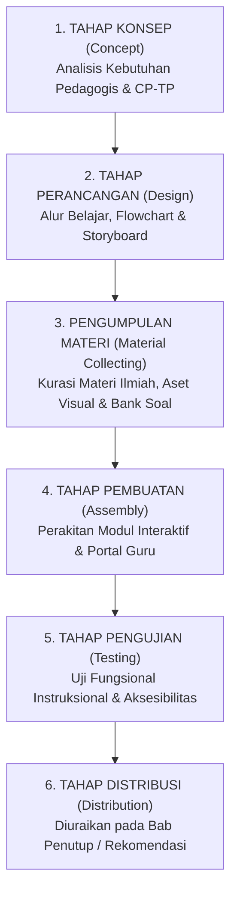
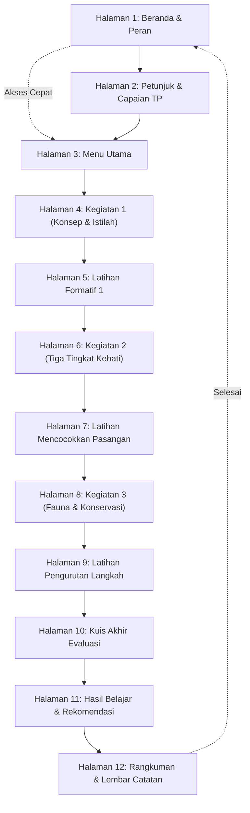
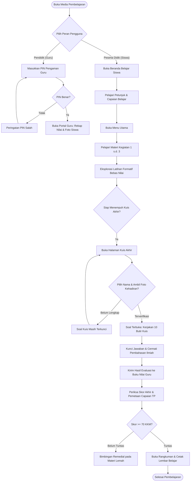
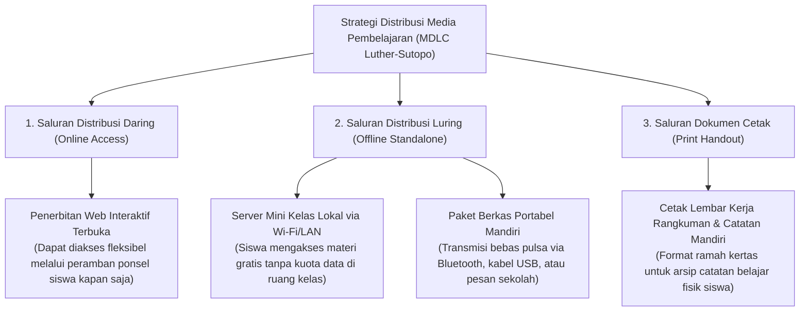

# LAPORAN PENGEMBANGAN MULTIMEDIA PEMBELAJARAN INTERAKTIF
## BERBASIS WEBMOBILE SEBAGAI PENDAMPING MEDIA PEMBELAJARAN KONVENSIONAL PADA MATA PELAJARAN IPA SMP NEGERI 1 TANDUKKALUA MENGGUNAKAN MODEL MDLC

---

<br><br>

### IDENTITAS MAHASISWA & PENYUSUN
**Nama Mahasiswa :** Nurun Nisa Ahmad  
**Nomor Induk Mahasiswa (NIM) :** 240209501049  
**Kelas :** PTIK E 2024  
**Program Studi :** Pendidikan Teknik Informatika dan Komputer  
**Jurusan :** Teknik Informatika dan Komputer  
**Fakultas :** Fakultas Teknik  
**Perguruan Tinggi :** Universitas Negeri Makassar  

<br>

### DOSEN PEMBINA & PENGAMPU
**Dosen Pengampu Mata Kuliah :**  
Dr. Udin Sidik Sidin, S.Pd, MT. (NIDN: 0015067407)  

**Dosen Mitra Pembelajaran :**  
Ir. H. Muhammad Riska, S.Pd, M.Pd. (NIDN: 0020098503)  

<br><br>

**MAKASSAR**  
**NOVEMBER 2026**

---

\newpage

# KATA PENGANTAR

Puji dan syukur penulis panjatkan kehadirat Tuhan Yang Maha Esa, Allah Subhanahu Wa Ta’ala, atas segala limpahan rahmat, taufik, dan karunia-Nya. Berkat pertolongan-Nya, laporan pengembangan media pembelajaran dengan judul **“Pengembangan Multimedia Pembelajaran Interaktif Berbasis Webmobile Sebagai Pendamping Media Pembelajaran Konvensional Pada Mata Pelajaran IPA SMP Negeri 1 Tandukkalua Menggunakan Model MDLC”** dapat diselesaikan dengan baik dan sistematis.

Laporan ini disusun sebagai bentuk dokumentasi akademis dan pertanggungjawaban ilmiah terhadap proses perancangan, pengembangan (*assembly*), pengujian (*testing*), hingga kesiapan distribusi media pembelajaran interaktif berbasis web-mobile. Fokus utama dari laporan ini diletakkan pada dimensi kependidikan dan teknologi pembelajaran, yaitu bagaimana sebuah inovasi media digital dapat menjawab kebutuhan nyata peserta didik, memperkuat interaksi belajar mandiri, mengatasi miskonsepsi sains, dan mendukung guru dalam melaksanakan asesmen formatif maupun sumatif secara objektif.

Keberhasilan penulisan laporan serta perwujudan produk media pembelajaran interaktif ini tidak lepas dari bimbingan, arahan, dan dukungan dari berbagai pihak. Oleh karena itu, pada kesempatan ini penulis menyampaikan terima kasih yang tulus serta penghargaan setinggi-tingginya kepada:

1. **Bapak Dr. Udin Sidik Sidin, S.Pd, MT.** (NIDN: 0015067407), selaku Dosen Pengampu mata kuliah Pengembangan Multimedia Pendidikan, atas bimbingan filosofis kurikulum, masukan konstruktif, dan arahan metodologis dalam menstandarkan kualitas instruksional media pembelajaran;
2. **Bapak Ir. H. Muhammad Riska, S.Pd, M.Pd.** (NIDN: 0020098503), selaku Dosen Mitra yang mendampingi dan mengajar perkuliahan secara intensif dari awal hingga akhir, senantiasa memberikan teladan ketelitian pedagogis, penguatan prinsip desain pesan pembelajaran, serta motivasi yang tiada henti;
3. Pimpinan dan segenap dosen Jurusan Teknik Informatika dan Komputer, Fakultas Teknik, Universitas Negeri Makassar yang telah membekali penulis dengan wawasan keilmuan teknologi pendidikan yang bermakna;
4. Kepala Sekolah, rekan pendidik mata pelajaran IPA, serta peserta didik kelas VII SMP Negeri 1 Tandukkalua yang telah memberikan gambaran kondisi pembelajaran faktual di sekolah;
5. Rekan-rekan mahasiswa Program Studi Pendidikan Teknik Informatika dan Komputer, khususnya Kelas PTIK E Angkatan 2024, atas kebersamaan, diskusi kritis, dan semangat kolaborasi yang terjalin selama proses perkuliahan.

Penulis menyadari bahwa laporan ini masih memiliki ruang untuk perbaikan. Oleh karena itu, saran dan masukan yang membangun dari para pendidik, akademisi, dan pembaca sangat diharapkan demi penyempurnaan media pembelajaran di masa mendatang. Semoga laporan ini dapat memberikan manfaat nyata bagi kemajuan pendidikan sains di Indonesia.

<br>

Makassar, November 2026  
<br><br>
**Penulis**  
Nurun Nisa Ahmad  
(NIM: 240209501049)

---

\newpage

# DAFTAR ISI

- **HALAMAN JUDUL**
- **KATA PENGANTAR**
- **DAFTAR ISI**
- **DAFTAR GAMBAR**
- **DAFTAR TABEL**
<br>

- **BAB I PENDAHULUAN**
  - **A. Latar Belakang Masalah**
    - 1. Kondisi Kontekstual Pembelajaran IPA di SMP Negeri 1 Tandukkalua
      - a) Ketergantungan pada Media Konvensional Buku Teks dan Papan Tulis
      - b) Keterbatasan Representasi Visual dan Kendala Belajar Saat Pendidik Berhalangan Hadir
    - 2. Landasan Teoretis dan Kerangka Pedagogis
      - a) Teori Kognitif Pembelajaran Multimedia (*Cognitive Theory of Multimedia Learning*)
      - b) Pendekatan Literasi Konservasi Sains pada Kurikulum Merdeka Fase D
    - 3. Urgensi Pengembangan Media Pendamping Belajar Mandiri
  - **B. Tujuan Pengembangan**
    - 1. Tujuan Umum
    - 2. Tujuan Khusus
  - **C. Manfaat Pengembangan**
    - 1. Manfaat Teoretis
    - 2. Manfaat Praktis
      - a) Manfaat bagi Peserta Didik
      - b) Manfaat bagi Tenaga Pendidik
      - c) Manfaat bagi Satuan Pendidikan
      - d) Manfaat bagi Pengembang dan Calon Pendidik
  - **D. Spesifikasi dan Karakteristik Pedagogis Produk**
    - 1. Gambaran Umum Produk Hasil Pengembangan
    - 2. Karakteristik Desain Instruksional dan Tampilan Visual
      - a) Desain Instruksional Berbasis Segmentasi Materi dan Alur Mandiri
      - b) Ergonomi Visual Ramah Peserta Didik (*Soft Sky Blue*) dan Tipografi

<br>

- **BAB II PEMBAHASAN**
  - **A. Cara dan Prosedur Pengembangan (Model MDLC Luther-Sutopo)**
    - 1. Tahap Konsep (*Concept*)
      - a) Identifikasi Kebutuhan Instruksional dan Karakteristik Peserta Didik
      - b) Analisis Capaian Pembelajaran (CP) dan Tujuan Pembelajaran (TP)
      - c) Studi Kelayakan Pedagogis dan Penentuan Batasan Media
    - 2. Tahap Perancangan (*Design*)
      - a) Struktur Alur Pengalaman Belajar (*Learning Experience Flow*)
      - b) Diagram Alir Interaksi Instruksional (*Instructional Flowchart*)
      - c) Papan Cerita (*Storyboard*) 12 Halaman Pembelajaran
    - 3. Tahap Pengumpulan Materi (*Material Collecting*)
      - a) Kurasi Materi Ilmiah Keanekaragaman Hayati Indonesia
      - b) Pemilihan dan Standardisasi Ilustrasi Visual Autentik
      - c) Penyusunan Butir Asesmen Formatif dan Soal Kuis Sumatif
    - 4. Tahap Pembuatan dan Penggabungan (*Assembly*)
      - a) Pengorganisasian Konten Instruksional ke dalam Format Web Interaktif
      - b) Rekayasa Interaktivitas Latihan Formatif dan Umpan Balik Diagnostik
      - c) Integrasi Portal Asesmen Pendidik dan Sistem Verifikasi Integritas Siswa
    - 5. Tahap Pengujian (*Testing*)
      - a) Pengujian Kelayakan Fungsional Instruksional (*Black Box Testing*)
      - b) Pengujian Kemudahan Aksesibilitas pada Berbagai Perangkat Siswa
      - c) Pengujian Kesiapan Penggunaan Luring (*Offline Readiness*)
  - **B. Hasil Pengembangan dan Analisis Transformasi Media**
    - 1. Wujud Nyata Produk Jadi dalam Proses Pembelajaran
    - 2. Rincian Fitur Utama Hasil Pengembangan
      - a) Fitur Penjelajahan Materi Tiga Kegiatan Terpandu
      - b) Fitur Evaluasi Formatif Terbuka dan Umpan Balik Korektif
      - c) Fitur Asesmen Sumatif Terproteksi Integritas Akademik
      - d) Fitur Pengelolaan Pembelajaran dan Buku Nilai Digital Pendidik
    - 3. Kesesuaian Hasil Pengembangan dengan Rancangan Awal Proposal
      - a) Fitur-Fitur yang Sesuai dengan Rancangan Awal Proposal
      - b) Fitur-Fitur Baru yang Ditambahkan dan Disempurnakan
    - 4. Riwayat Revisi Pedagogis Selama Proses Pengembangan
      - a) Penyempurnaan Palet Warna untuk Mencegah Kelelahan Visual
      - b) Transformasi Pengelolaan Daftar Siswa Menjadi Fleksibel
      - c) Penguatan Regulasi Pengerjaan Ulang untuk Pembelajaran Tuntas
    - 5. Hasil Pengujian dan Evaluasi Kualitas Media
      - a) Efektivitas Fungsi Instruksional Berdasarkan Uji Coba
      - b) Efisiensi Akses dan Kecepatan Respons Media
  - **C. Analisis Keterbatasan Produk dan Rencana Tindak Lanjut**
    - 1. Keterbatasan Media Saat Ini
      - a) Ketergantungan Data Nilai pada Perangkat Lokal Siswa
      - b) Kebutuhan Bimbingan Awal dalam Penggunaan Sensor Kamera
      - c) Cakupan Topik Masih Berfokus pada Satu Subtema Biologi
    - 2. Rencana Tindak Lanjut Penyempurnaan Media
      - a) Pengembangan Sistem Sinkronisasi Kelas Terpusat
      - b) Integrasi Pemasangan Aplikasi Mandiri (*Progressive Web App*)
      - c) Penambahan Fasilitas Narasi Suara untuk Pembelajaran Inklusif

<br>

- **BAB III KESIMPULAN DAN SARAN**
  - **A. Kesimpulan**
    - 1. Keberhasilan Rekayasa Berdasarkan Model MDLC
    - 2. Kontribusi Media terhadap Kualitas Pembelajaran IPA
  - **B. Saran dan Rekomendasi Pemanfaatan**
    - 1. Rekomendasi bagi Tenaga Pendidik dan Manajemen Sekolah
    - 2. Rekomendasi bagi Pengembang dan Peneliti Pendidikan Lanjutan
  - **C. Rencana Tahap Distribusi (*Distribution Stage*)**
    - 1. Distribusi Pembelajaran Moda Daring (Akses Web Interaktif)
    - 2. Distribusi Pembelajaran Moda Luring Mandiri (Jaringan Lokal Kelas & Paket Mandiri)
    - 3. Distribusi Lembar Kerja Cetak Ringkas

<br>

- **DAFTAR PUSTAKA** (Gaya Vancouver)
- **LAMPIRAN**
  - Lampiran 1. Matriks Pengujian Fungsionalitas Instruksional Media (16 Skenario Pembelajaran)
  - Lampiran 2. Kisi-Kisi, Naskah Soal Asesmen Sumatif, dan Rasionalitas Pembahasan
  - Lampiran 3. Struktur Komponen Instruksional dan Media Pembelajaran
  - Lampiran 4. Dokumentasi Tampilan Antarmuka dan Alur Belajar Siswa

---

\newpage

# BAB I PENDAHULUAN

## A. Latar Belakang Masalah

### 1. Kondisi Kontekstual Pembelajaran IPA di SMP Negeri 1 Tandukkalua
Pembelajaran Ilmu Pengetahuan Alam (IPA) pada jenjang Sekolah Menengah Pertama (SMP) berperan penting dalam menumbuhkan literasi sains, daya nalar kritis, serta kesadaran ekologis peserta didik. Pembelajaran sains yang bermakna menuntut adanya keterkaitan erat antara konsep teoretis yang abstrak dan fenomena nyata yang dapat diamati siswa dalam kehidupan sehari-hari.

#### a) Ketergantungan pada Media Konvensional Buku Teks dan Papan Tulis
Berdasarkan observasi dan identifikasi kondisi faktual di SMP Negeri 1 Tandukkalua, proses pembelajaran IPA di dalam kelas masih sangat bertumpu pada penggunaan dua media konvensional, yakni buku paket cetak dan papan tulis. Guru menerangkan materi ajar secara verbal dengan menuliskan poin-poin ringkasan di papan tulis, sementara siswa menyimak dan mencatat ulang materi tersebut di buku tulis masing-masing.

Penggunaan buku teks dan papan tulis tentu memiliki kelebihan tersendiri, antara lain ketersediaannya yang selalu ada di setiap ruang kelas serta tidak membutuhkan aliran listrik maupun jaringan internet. Akan tetapi, ketergantungan tunggal pada media cetak konvensional menimbulkan hambatan komunikasi pedagogis yang cukup nyata. Pola pembelajaran cenderung berlangsung satu arah, minim interaktivitas, dan kurang mampu merangsang keterlibatan aktif peserta didik dalam mengonstruksi pengetahuannya sendiri.

#### b) Keterbatasan Representasi Visual dan Kendala Belajar Saat Pendidik Berhalangan Hadir
Kelemahan media konvensional tampak sangat jelas pada materi Keanekaragaman Hayati (Biodiversitas). Karakteristik materi ini menuntut visualisasi kekayaan flora, fauna, dan bentang alam dalam jumlah yang melimpah. Buku paket sekolah hanya mampu menampilkan contoh yang sangat terbatas dalam wujud foto diam berukuran kecil dengan kualitas cetak monokrom atau warna yang terbatas. Akibatnya, pemahaman mengenai perbedaan hierarkis antara keanekaragaman tingkat gen, jenis, dan ekosistem harus dibayangkan sendiri oleh siswa secara abstrak.

Kondisi tersebut sering kali mendorong guru untuk menggambarkan ulang bentuk-bentuk organisme atau diagram klasifikasi di papan tulis. Langkah ini menghabiskan waktu tatap muka di kelas yang cukup banyak. Selain itu, gambar di papan tulis bersifat sementara dan akan segera dihapus setelah jam pelajaran usai sehingga peserta didik tidak memiliki rujukan visual berkelanjutan untuk belajar mandiri di rumah.

Masalah kependidikan bertambah berat ketika pendidik berhalangan hadir ke sekolah karena tugas dinas luar atau urusan mendesak. Pada saat seperti ini, tugas yang umumnya diberikan kepada siswa adalah mencatat sejumlah halaman dari buku paket. Tugas menyalin teks ini berlangsung tanpa penjelasan bertahap, tanpa visualisasi pendukung, dan tanpa adanya umpan balik seketika mengenai tingkat pemahaman konsep yang sedang dipelajari. Akibatnya, siswa rentan mengalami miskonsepsi yang tidak terdeteksi, kejenuhan belajar meningkat, dan kesiapan siswa menyongsong materi berikutnya menjadi kurang optimal.

### 2. Landasan Teoretis dan Kerangka Pedagogis

#### a) Teori Kognitif Pembelajaran Multimedia (*Cognitive Theory of Multimedia Learning*)
Secara pedagogis, persoalan keterbatasan media verbal dijawab oleh *Cognitive Theory of Multimedia Learning* (CTML) yang dikembangkan oleh Richard E. Mayer [1]. Teori ini menjelaskan bahwa memori kerja manusia terdiri atas dua saluran pemrosesan yang terpisah, yaitu saluran visual/spasial dan saluran auditori/verbal. Apabila sebuah konsep sains hanya disajikan lewat rangkaian teks atau kata-kata verbal, saluran auditori akan mengalami beban berlebih (*cognitive overload*), sementara saluran visual tidak termanfaatkan dengan optimal. 

Sebaliknya, proses belajar akan terjadi secara mendalam apabila materi dirancang memadukan representasi teks ringkas dan citra visual yang saling berkoresponsdensi [1]. Untuk memfasilitasi hal tersebut, media pembelajaran interaktif perlu menerapkan prinsip-prinsip desain instruksional turunan CTML, di antaranya:
1) *Prinsip Segmentasi (Segmenting Principle):* Mengurai materi yang rumit menjadi beberapa unit kegiatan belajar mandiri berdurasi pendek;
2) *Prinsip Keterpaduan Spasial (Spatial Contiguity Principle):* Meletakkan keterangan teks sedekat mungkin dengan objek visual yang dijelaskan;
3) *Prinsip Sinyal (Signaling Principle):* Memberikan penanda visual dan warna yang konsisten pada istilah-istilah kunci agar fokus perhatian kognitif siswa langsung tertuju pada gagasan utama materi.

#### b) Pendekatan Literasi Konservasi Sains pada Kurikulum Merdeka Fase D
Dalam Kurikulum Merdeka, Capaian Pembelajaran (CP) IPA Fase D mengamanatkan agar peserta didik mampu mengklasifikasikan makhluk hidup berdasarkan karakteristik yang diamati, menganalisis interaksi timbal balik antara makhluk hidup dan lingkungannya, serta merumuskan solusi pelestarian keanekaragaman hayati [6]. Pembelajaran tidak boleh sekadar menguji daya ingat siswa terhadap nama-nama ilmiah organisme, melainkan harus menumbuhkan kesadaran literasi konservasi dan rasa bangga terhadap kekayaan hayati tanah air [5,7]. 

Oleh karena itu, media pembelajaran yang dikembangkan perlu menyajikan kekayaan biogeografi nusantara, seperti pembagian fauna berdasarkan Garis Wallace dan Garis Weber, pengenalan satwa endemik lokal Sulawesi (anoa dan babirusa), analisis ancaman kepunahan, serta perbandingan strategi konservasi *in situ* dan *ex situ*.

### 3. Urgensi Pengembangan Media Pendamping Belajar Mandiri
Berpijak pada akar persoalan di lapangan dan landasan teori instruksional, dirumuskan urgensi nyata untuk menghadirkan media pembelajaran interaktif yang berkedudukan sebagai **media pendamping**. Media ini bukan dimaksudkan untuk meniadakan peran guru, buku pelajaran, maupun papan tulis kelas, melainkan hadir melengkapi dan memperkaya pengalaman belajar siswa.

Media yang dikembangkan diwujudkan dalam bentuk modul multimedia interaktif berbasis *web-mobile*. Pemilihan format web bergerak memberikan keunggulan kependidikan yang sangat strategis:
1) Fleksibel diakses melalui ponsel cerdas milik siswa atau keluarga tanpa membebani memori internal gawai;
2) Bersifat mandiri (*self-paced learning*), di mana siswa dapat menentukan kecepatan belajarnya sendiri, mengulang materi yang belum dipahami, dan mencoba latihan interaktif berulang kali tanpa rasa takut dinilai salah;
3) Memberikan kepastian pemantauan bagi guru melalui sistem perekaman hasil evaluasi dan dokumentasi kehadiran siswa yang akuntabel.

---

## B. Tujuan Pengembangan

### 1. Tujuan Umum
Secara umum, pengembangan ini bertujuan untuk menghasilkan modul multimedia pembelajaran interaktif berbasis *web-mobile* pada topik Ekologi dan Keanekaragaman Hayati Indonesia untuk mata pelajaran IPA Fase D di SMP Negeri 1 Tandukkalua yang valid, praktis, ramah pengguna, dan efektif digunakan sebagai media pendamping pembelajaran konvensional.

### 2. Tujuan Khusus
Secara khusus, tujuan pengembangan ini dirumuskan untuk:
a) Mengidentifikasi kebutuhan pembelajaran, karakteristik kognitif siswa kelas VII SMP Negeri 1 Tandukkalua, dan potensi kendala sarana belajar gawai di lingkungan sekolah;  
b) Merancang struktur alur belajar mandiri, papan cerita (*storyboard*) 12 halaman terstruktur, dan panduan pengalaman belajar yang adaptif pada layar ponsel;  
c) Merealisasikan modul multimedia interaktif dengan menerapkan prinsip segmentasi bahan ajar, ergonomi visual warna biru langit (*Soft Sky Blue*), dan tipografi yang meningkatkan keterbacaan;  
d) Mengembangkan instrumen evaluasi formatif berbantuan umpan balik langsung serta instrumen asesmen sumatif yang dilengkapi verifikasi kehadiran dan portal pemantauan pendidik;  
e) Menilai kelayakan dan keandalan fungsional media melalui pengujian kotak hitam (*black box testing*) dan uji operasional pada berbagai perangkat bergerak.

---

## C. Manfaat Pengembangan

### 1. Manfaat Teoretis
Secara teoretis, pengembangan ini bermanfaat untuk:
a) Memberikan sumbangan empiris mengenai penerapan *Cognitive Theory of Multimedia Learning* (CTML) dalam perancangan media pembelajaran sains berbasis web bergerak di tingkat sekolah menengah pertama;  
b) Menjadi rujukan kontekstual mengenai penerapan model *Multimedia Development Life Cycle* (MDLC) dalam memandu perancangan media instruksional yang berorientasi pada pencapaian kompetensi Kurikulum Merdeka.

### 2. Manfaat Praktis

#### a) Manfaat bagi Peserta Didik
1) Memperoleh sumber belajar visual interaktif yang menarik dan dapat diakses kapan saja untuk mengulang penjelasan materi di luar jam tatap muka sekolah;  
2) Membantu mengonstruksi pemahaman konkret tentang perbedaan keanekaragaman hayati tingkat gen, jenis, dan ekosistem melalui foto komparatif dan animasi langkah pengamatan;  
3) Menumbuhkan kemandirian dan rasa percaya diri dalam belajar sains melalui ketersediaan latihan formatif yang memberikan bimbingan langsung tanpa menghukum.

#### b) Manfaat bagi Tenaga Pendidik
1) Menyediakan alat bantu visual yang siap pakai di kelas untuk memperjelas konsep-konsep biologis yang sulit digambar secara manual di papan tulis;  
2) Memberikan solusi penugasan terstruktur yang bermakna ketika guru berhalangan mendampingi kelas secara langsung;  
3) Menyediakan portal pemantauan belajar yang menyajikan rekapitulasi nilai kuis dan foto bukti kehadiran siswa sehingga memudahkan guru dalam menganalisis capaian belajar dan merancang bimbingan remedial.

#### c) Manfaat bagi Satuan Pendidikan
1) Mendukung perintisan integrasi teknologi informasi dalam proses pembelajaran di SMP Negeri 1 Tandukkalua yang hemat biaya dan ramah terhadap keterbatasan infrastruktur internet;  
2) Mendorong peningkatan mutu iklim pembelajaran sains dan kesiapan digital warga sekolah.

#### d) Manfaat bagi Pengembang dan Calon Pendidik
1) Mengasah kompetensi profesional calon guru dalam memadukan keahlian pedagogis, penguasaan materi sains, dan keterampilan rekayasa media pembelajaran interaktif;  
2) Menghasilkan karya teknologi pembelajaran orisinal yang dapat diimplementasikan secara konkret pada sekolah mitra.

---

## D. Spesifikasi dan Karakteristik Pedagogis Produk

### 1. Gambaran Umum Produk Hasil Pengembangan
Produk yang dihasilkan berupa modul multimedia pembelajaran interaktif berbasis web bergerak (*web-mobile interactive module*) dengan tema materi **"Ekologi dan Keanekaragaman Hayati Indonesia"**. Media ini dirancang khusus untuk memenuhi kebutuhan belajar peserta didik kelas VII SMP (Fase D). Modul ini dipublikasikan secara daring pada peladen web serta disiapkan dalam bentuk paket luring mandiri yang dapat dijalankan secara langsung tanpa memerlukan sambungan internet.

Modul pembelajaran ini disusun ke dalam rangkaian **12 halaman pembelajaran mandiri**, yang terbagi atas:
- *Halaman 1 (Beranda Belajar & Pemilihan Akses):* Memuat judul media, pengenalan tema ajar, identitas pengembang, serta pemisahan pintu masuk antara Siswa dan Pendidik;
- *Halaman 2 (Petunjuk Belajar & Target Kompetensi):* Panduan tahapan belajar mandiri serta tiga butir Tujuan Pembelajaran (TP 1, TP 2, TP 3) yang dirumuskan secara operasional;
- *Halaman 3 (Menu Utama Modul):* Dasbor navigasi berdesain kartu pilihan yang memperlihatkan status ketercapaian belajar siswa (*progress indicator*);
- *Halaman 4 (Kegiatan 1 - Materi):* Pengantar konsep biodiversitas dengan pertanyaan pemantik kontekstual dan kartu akordeon istilah ilmiah (Biodiversitas, Spesies, Habitat, Ekosistem, Endemik, dan Konservasi);
- *Halaman 5 (Kegiatan 1 - Latihan Formatif):* Tiga butir latihan pemahaman konsep yang dapat dikerjakan berulang kali dengan umpan balik pembenahan seketika;
- *Halaman 6 (Kegiatan 2 - Materi Tiga Tingkat Kehati):* Penjelasan komparatif variasi tingkat gen, jenis, dan ekosistem yang dilengkapi kotak peringatan miskonsepsi serta galeri foto nyata di Indonesia;
- *Halaman 7 (Kegiatan 2 - Latihan Mencocokkan Pasangan):* Permainan edukatif dua kolom untuk mencocokkan contoh-contoh organisme dengan kategori tingkat keanekaragamannya;
- *Halaman 8 (Kegiatan 3 - Materi Persebaran Fauna & Konservasi):* Simulasi visual tahapan observasi biodiversitas, peta biogeografi Wallace dan Weber, 5 faktor ancaman kepunahan, serta perbandingan strategi konservasi *in situ* dan *ex situ*;
- *Halaman 9 (Kegiatan 3 - Latihan Pengurutan Alur Observasi):* Latihan menyusun kartu alur kerja pengamatan ilmiah secara logis dan teratur;
- *Halaman 10 (Kuis Akhir - Asesmen Sumatif):* Instrumen tes 10 butir pilihan ganda yang dilindungi sistem verifikasi nama dan pengambilan foto potret kehadiran (*selfie* verifikasi), serta pembahasan ilmiah pada setiap butir soal;
- *Halaman 11 (Evaluasi Hasil & Rekomendasi Belajar):* Penyajian diagram capaian skor total, pemetaan penguasaan materi pada tiap Tujuan Pembelajaran, serta saran tindak lanjut pengayaan atau remedial terarah;
- *Halaman 12 (Rangkuman & Lembar Catatan Mandiri):* Intisari pokok bahasan, glosarium istilah penting, serta fitur pencetakan lembar kerja catatan siswa yang siap cetak (*print-friendly format*).

### 2. Karakteristik Desain Instruksional dan Tampilan Visual

#### a) Desain Instruksional Berbasis Segmentasi Materi dan Alur Mandiri
Pengorganisasian pesan pembelajaran pada modul ini menganut prinsip pedagogis yang berpusat pada peserta didik (*student-centered learning*):
1) **Struktur Pembelajaran Bertahap:** Materi dipecah menjadi tiga kegiatan belajar ringkas agar beban kognitif siswa tetap terjaga pada tingkat yang nyaman;
2) **Umpan Balik Diagnostik Seketika:** Setiap interaksi latihan formatif langsung memunculkan respons korektif berwarna hijau (jika tepat) atau merah (jika keliru) yang disertai penjelasan konsep sehingga siswa belajar dari kekeliruan tanpa rasa tertekan;
3) **Navigasi Bilah Bawah yang Konsisten:** Di setiap halaman modul, disediakan dua tombol navigasi utama pada bilah bawah, yaitu tombol "Menu Utama" di sisi kiri untuk kembali ke dasbor dan tombol "Berikutnya" di sisi kanan untuk melangkah ke tahapan berikutnya secara linier.

#### b) Ergonomi Visual Ramah Peserta Didik (*Soft Sky Blue*) dan Tipografi
Aspek tata letak dan estetika visual dirancang mempertimbangkan kondisi psikologis peserta didik usia remaja:
1) **Pilihan Palet Warna Biru Langit Lembut (*Soft Sky Blue* `#dae9f7`):** Menghadirkan suasana visual yang tenang, teduh, dan menyenangkan. Warna ini dipadukan dengan aksen biru dongker dan biru bahari `#367bb7` untuk mengarahkan fokus pandangan siswa ke elemen interaksi penting tanpa menyilaukan mata;
2) **Tipografi Bersih dan Proporsional:** Menggunakan jenis huruf keluarga **Calibri Light** dan sans-serif modern yang terbukti nyaman dibaca pada layar gawai ponsel berukuran kecil maupun layar komputer monitor;
3) **Tata Letak Adaptif:** Pada ponsel cerdas, antarmuka tampil dalam orientasi potret yang nyaman digenggam dengan satu tangan. Pada layar komputer atau tablet, tata letak otomatis memusat dengan proporsi kartu yang seimbang.

---

\newpage

# BAB II PEMBAHASAN

## A. Cara dan Prosedur Pengembangan (Model MDLC Luther-Sutopo)

Pengembangan media pembelajaran interaktif ini dilaksanakan dengan berpedoman pada alur **Multimedia Development Life Cycle (MDLC)** menurut Luther yang dikembangkan oleh Sutopo [3]. Model ini sangat relevan untuk rekayasa multimedia edukatif karena mengintegrasikan perencanaan konseptual, desain instruksional, perakitan media, hingga pengujian mutu fungsional. 

Sesuai dengan ruang lingkup yang telah digariskan, prosedur pengembangan pada bab ini mencakup lima tahap utama: *Concept*, *Design*, *Material Collecting*, *Assembly*, dan *Testing*. Sementara itu, tahap keenam yakni *Distribution* diulas pada bab penutup sebagai wujud tindak lanjut implementasi.



### 1. Tahap Konsep (*Concept*)

Tahap konsep menjadi titik awal penentuan landasan pedagogis, sasaran pengguna, dan rumusan capaian kompetensi media yang akan dikembangkan.

#### a) Identifikasi Kebutuhan Instruksional dan Karakteristik Peserta Didik
Identifikasi kebutuhan dilakukan dengan menelaah proses pembelajaran IPA kelas VII di SMP Negeri 1 Tandukkalua saat visualisasi materi masih terbatas pada gambar buku dan papan tulis. Sasaran pengguna ditetapkan secara terfokus:
1) **Sasaran Utama:** Peserta didik kelas VII SMP (usia 12–15 tahun) yang berada pada fase transisi perkembangan kognitif Piaget dari operasional konkret menuju penalaran formal. Peserta didik pada jenjang ini sangat memerlukan jembatan berupa representasi visual konkret (seperti diagram berwarna, foto komparatif, dan simulasi) untuk memahami konsep-konsep biologis yang abstrak;
2) **Sasaran Pendamping:** Pendidik mata pelajaran IPA yang membutuhkan media demonstrasi kelas yang praktis serta instrumen pemantauan pengerjaan tugas mandiri siswa.

#### b) Analisis Capaian Pembelajaran (CP) dan Tujuan Pembelajaran (TP)
Materi yang dikembangkan diselaraskan dengan Capaian Pembelajaran Kurikulum Merdeka Fase D untuk mata pelajaran IPA [6]. Dari capaian tersebut, dirumuskan tiga Tujuan Pembelajaran (TP) yang terukur dan menjadi acuan modul:
- **Tujuan Pembelajaran 1 (TP 1):** Peserta didik mampu menjelaskan konsep utama dan istilah penting keanekaragaman hayati (biodiversitas, spesies, habitat, ekosistem, endemik, dan konservasi);
- **Tujuan Pembelajaran 2 (TP 2):** Peserta didik mampu membedakan keanekaragaman hayati tingkat gen, tingkat jenis, dan tingkat ekosistem melalui contoh-contoh konkret di lingkungan sekitar;
- **Tujuan Pembelajaran 3 (TP 3):** Peserta didik mampu menguraikan pola persebaran fauna Indonesia (Garis Wallace-Weber), mengidentifikasi lima ancaman terhadap biodiversitas, serta merumuskan upaya pelestariannya (*in situ* dan *ex situ*).

#### c) Studi Kelayakan Pedagogis dan Penentuan Batasan Media
Kelayakan media dianalisis dari berbagai sudut pandang pembelajaran:
1) **Aspek Pembelajaran:** Materi IPA keanekaragaman hayati sangat sesuai disajikan dengan bantuan gambar berlabel dan latihan manipulatif interaktif;
2) **Aspek Kemandirian:** Modul harus memuat petunjuk belajar yang jelas agar siswa dapat belajar secara mandiri tanpa harus selalu didampingi guru;
3) **Aspek Aksesibilitas:** Media dirancang ringan dan tidak mewajibkan pembuatan akun atau kata sandi yang rumit bagi siswa, serta dapat beroperasi tanpa jaringan internet.

### 2. Tahap Perancangan (*Design*)

Tahap perancangan bertujuan menyusun cetak biru instruksional, memetakan rute navigasi, dan merancang tampilan grafis sebelum media dirakit.

#### a) Struktur Alur Pengalaman Belajar (*Learning Experience Flow*)
Alur belajar dirancang menggunakan struktur hierarkis komposit yang memadukan urutan belajar berjenjang dan kemudahan akses Menu Utama. Siswa diajak memulai dari pemahaman konsep dasar, mengenali hierarki keanekaragaman hayati, menelaah biogeografi dan konservasi, lalu membuktikan kompetensinya melalui kuis evaluasi resmi.



#### b) Diagram Alir Interaksi Instruksional (*Instructional Flowchart*)
Interaksi pengguna diatur sedemikian rupa agar membedakan hak akses pendidik dengan alur belajar peserta didik:



#### c) Papan Cerita (*Storyboard*) 12 Halaman Pembelajaran
Rancangan tata letak antarmuka dan interaksi pada 12 halaman modul dipetakan ke dalam tabel berikut:

| No | Identitas Halaman | Komponen Pesan Instruksional | Interaksi dan Kontrol Pengguna |
| :-: | :--- | :--- | :--- |
| **1** | Beranda & Akses Peran | Ilustrasi lanskap alam Indonesia, judul modul, identitas pengembang, dan tombol pemilihan peran. | Tombol "Anda Siswa", tombol "Anda Guru", tombol "Mulai Belajar", dan tombol "Langsung ke Menu". |
| **2** | Petunjuk & Tujuan | Kartu panduan belajar mandiri dan penjabaran tiga butir Tujuan Pembelajaran (TP 1, TP 2, TP 3). | Tombol kembali ke Beranda, tombol lanjut ke Menu Utama, dan bilah navigasi bawah. |
| **3** | Menu Utama | Lima kartu navigasi modular yang memuat nama topik dan kotak centang status ketuntasan. | Pemilihan bebas ke setiap modul materi, kuis, atau rangkuman dengan penanda kemajuan belajar. |
| **4** | Kegiatan 1 (Materi) | Pertanyaan pemantik rasa ingin tahu, teks konsep dasar, dan enam kartu akordeon istilah kunci. | Pengetukan kartu istilah untuk menampilkan definisi dan contoh konkret di alam sekitar. |
| **5** | Kegiatan 1 (Latihan) | Tiga butir pertanyaan formatif konsep ekologi dengan opsi jawaban pilihan ganda. | Pemilihan jawaban dengan responss langsung benar/salah dan pembahasan perbaikan tanpa batas pengulangan. |
| **6** | Kegiatan 2 (Materi) | Kotak peringatan miskonsepsi tingkat gen vs jenis, tabulasi tiga tingkat kehati, dan foto komparatif. | Tombol tab Gen, Jenis, dan Ekosistem untuk beralih penjelasan dan visualisasi secara berdampingan. |
| **7** | Kegiatan 2 (Latihan) | Papan mencocokkan pasangan antara 6 contoh organisme dan 3 kategori tingkat kehati. | Interaksi klik pasangan kartu untuk menguji pemahaman klasifikasi secara manipulatif. |
| **8** | Kegiatan 3 (Materi) | Simulasi 5 tahap pengamatan sains, peta biogeografi Wallace-Weber, dan perbandingan konservasi. | Kontrol pemutar simulasi observasi (Mulai, Jeda, Lanjut) serta eksplorasi zona persebaran fauna. |
| **9** | Kegiatan 3 (Latihan) | Papan kartu acak yang memuat tahapan pengamatan sains untuk diurutkan secara runut. | Pengubahan urutan kartu naik/turun dan tombol evaluasi ketepatan alur kerja ilmiah. |
| **10** | Kuis Akhir (Evaluasi) | Panel verifikasi foto diri (*selfie*), wadah 10 butir soal kuis sumatif, dan kotak pembahasan. | Verifikasi kamera gawai, penguncian pilihan jawaban, pembukaan pembahasan, dan pengiriman nilai. |
| **11** | Lembar Hasil Belajar | Diagram lingkaran nilai total, tiga batang capaian TP 1-3, status ketuntasan, dan saran belajar. | Pemeriksaan peta kekuatan belajar dan rekomendasi pengulangan materi bagi siswa yang belum tuntas. |
| **12** | Rangkuman & Catatan | Tabel intisari materi, glosarium istilah ilmiah, dan fasilitas cetak lembar kerja mandiri. | Pemicu jendela cetak dokumen ramah kertas dan tombol selesai untuk kembali ke Beranda. |

### 3. Tahap Pengumpulan Materi (*Material Collecting*)

Tahap ini menghimpun seluruh materi sains, aset grafis, dan butir evaluasi yang akurat, mutakhir, dan relevan dengan lingkungan peserta didik.

#### a) Kurasi Materi Ilmiah Keanekaragaman Hayati Indonesia
Materi dikurasi secara cermat dari buku guru dan buku siswa IPA SMP Kelas VII Kemendikbudristek Kurikulum Merdeka serta jurnal pendidikan sains [6,7]. Materi diformulasikan ke dalam bahasa yang komunikatif bagi siswa usia remaja tanpa mengurangi ketepatan istilah ilmiah:
1) Pengenalan istilah-istilah sentral: biodiversitas, spesies, habitat, ekosistem, endemik, dan konservasi;
2) Pemilahan tingkatan biologis: tingkat genetik (contoh varietas mangga arumanis dan manalagi), tingkat jenis (contoh harimau, singa, dan kucing), serta tingkat ekosistem (contoh terumbu karang, hutan mangrove, dan hutan hujan tropis);
3) Karakteristik biogeografi nusantara: zona fauna Asiatis, zona Peralihan/Wallacea (dengan satwa endemik anoa, babirusa, komodo), dan zona Australis, disertai telaah 5 faktor penyebab kepunahan dan upaya pelestarian *in situ* serta *ex situ*.

#### b) Pemilihan dan Standardisasi Ilustrasi Visual Autentik
Aset gambar visual dipilih dari sumber foto alam autentik nusantara dan disiapkan secara lokal guna memastikan kemandirian media:
1) Foto bentang alam biodiversitas Indonesia beresolusi tajam;
2) Citra komparatif variasi mangga untuk keanekaragaman gen;
3) Citra komparatif famili kucing untuk keanekaragaman jenis;
4) Foto bentang alam kanopi hutan untuk keanekaragaman ekosistem;
5) Bagan peta persebaran fauna Garis Wallace dan Garis Weber.

Semua gambar dioptimalkan dengan teknik kompresi grafis digital sehingga memiliki ukuran berkas yang sangat kecil tanpa mengorbankan ketajaman tampilan pada layar ponsel.

#### c) Penyusunan Butir Asesmen Formatif dan Soal Kuis Sumatif
Disusun instrumen evaluasi yang terdiri atas:
1) **Latihan Formatif Mandiri:** Latihan pada Kegiatan 1, 2, dan 3 yang dirancang bebas nilai guna melatih keberanian siswa mengeksplorasi konsep;
2) **Bank Soal Kuis Akhir 10 Butir:** Soal pilihan ganda berbobot 10 poin per nomor (skor maksimal 100) yang terbagi proporsional mencakup TP 1 (3 butir), TP 2 (4 butir), dan TP 3 (3 butir);
3) **Rasionalitas Pembahasan:** Uraian penjelasan ilmiah pada setiap butir kuis yang membedah mengapa suatu jawaban tepat dan mengapa pilihan pengecoh keliru.

### 4. Tahap Pembuatan dan Penggabungan (*Assembly*)

Tahap pembuatan menyatukan seluruh rancangan desain, materi tekstual, ilustrasi visual, dan sistem interaksi ke dalam produk multimedia yang utuh.

#### a) Pengorganisasian Konten Instruksional ke dalam Format Web Interaktif
Modul dibangun dengan membagi konten ke dalam 12 modul halaman terpisah yang tertata rapi. Pengorganisasian modular ini menjamin kemudahan pemeliharaan konten ajar dan memastikan modul dapat dibuka secara instan pada peramban web tanpa memakan waktu tunggu pemuatan layar.

#### b) Rekayasa Interaktivitas Latihan Formatif dan Umpan Balik Diagnostik
Setiap aktivitas belajar dilengkapi logika interaktif yang responssif:
1) **Kartu Akordeon dan Tabulasi:** Memungkinkan siswa membuka informasi secara bertahap sehingga tidak merasa kewalahan membaca teks panjang sekaligus;
2) **Permainan Edukatif Pasangan dan Pengurutan:** Mengaktifkan keterlibatan psikomotorik dan kognitif siswa dalam mengelompokkan organisme dan menyusun tahapan penyelidikan sains;
3) **Penyimpanan Status Belajar Mandiri:** Kemajuan belajar, jawaban latihan, dan skor kuis tersimpan secara otomatis pada memori peramban gawai sehingga siswa dapat melanjutkan belajarnya sewaktu-waktu tanpa kehilangan jejak progres.

#### c) Integrasi Portal Asesmen Pendidik dan Sistem Verifikasi Integritas Siswa
Pengembang mengintegrasikan dua inovasi instruksional yang memperkuat dimensi evaluasi:
1) **Sistem Verifikasi Foto Wajah Kehadiran (*Selfie* Verifikasi):** Sebelum mengerjakan kuis akhir pada Halaman 10, siswa diwajibkan memilih identitas namanya dari daftar resmi kelas dan mengaktifkan kamera gawai untuk merekam potret diri terkini. Hal ini mendidik kejujuran siswa dan mencegah praktik pengerjaan tugas oleh orang lain (*anti-joki*);
2) **Portal Pemantauan Pembelajaran Pendidik:** Guru memiliki akses khusus berproteksi PIN rahasia untuk memeriksa folder rekapan hasil belajar kelas, mencermati foto dokumentasi kehadiran siswa, mengunduh rekapitulasi nilai ke format spreadsheet (Excel/CSV), serta mengelola daftar nama siswa secara mandiri.

### 5. Tahap Pengujian (*Testing*)

Tahap pengujian dilaksanakan guna memastikan seluruh fungsi instruksional dan teknis media berjalan sempurna sesuai tujuan pembelajaran.

#### a) Pengujian Kelayakan Fungsional Instruksional (*Black Box Testing*)
Pengujian fungsionalitas dilakukan melalui metode *Black Box Testing*, yaitu menguji respons sistem terhadap berbagai skenario penggunaan nyata peserta didik dan guru tanpa melihat struktur baris instruksi internal. Aspek yang diuji mencakup navigasi antarhalaman, mekanisme latihan interaktif, penguncian soal kuis, perekaman foto wajah, pemetaan skor TP, dan fungsi cetak rangkuman.

#### b) Pengujian Kemudahan Aksesibilitas pada Berbagai Perangkat Siswa
Media diuji coba pada beragam model perangkat gawai yang umum digunakan peserta didik dan guru:
1) Berbagai merek ponsel cerdas berbasis Android dan iOS dengan ukuran layar antara 5 inci hingga 6,7 inci;
2) Komputer tablet dan laptop dengan resolusi layar menengah hingga resolusi tinggi;
3) Berbagai peramban populer seperti Google Chrome, Mozilla Firefox, Microsoft Edge, dan Safari.

#### c) Pengujian Kesiapan Penggunaan Luring (*Offline Readiness*)
Media diuji dalam kondisi gawai terputus total dari koneksi internet. Hasil pengujian menunjukkan bahwa seluruh teks modul, ilustrasi gambar lokal, permainan interaktif, kuis evaluasi, hingga fitur cetak tetap dapat dioperasikan secara penuh tanpa kendala.

---

## B. Hasil Pengembangan dan Analisis Transformasi Media

### 1. Wujud Nyata Produk Jadi dalam Proses Pembelajaran
Produk multimedia pembelajaran interaktif yang dihasilkan berstatus siap digunakan (*ready-to-use*). Media dapat dimanfaatkan secara fleksibel dalam dua skenario pembelajaran utama:
1) **Skenario Pembelajaran Kelas (Tatap Muka):** Guru menampilkan media melalui proyektor sebagai media apersepsi dan visualisasi interaktif materi keanekaragaman hayati nusantara;
2) **Skenario Pembelajaran Mandiri / Tugas Terstruktur:** Peserta didik mengakses media melalui ponsel cerdas di rumah atau di perpustakaan sekolah, terutama ketika guru berhalangan hadir, untuk mempelajari materi dan mengerjakan evaluasi secara bertanggung jawab.

### 2. Rincian Fitur Utama Hasil Pengembangan

#### a) Fitur Penjelajahan Materi Tiga Kegiatan Terpandu
- **Kegiatan 1:** Menyajikan pertanyaan pemantik kontekstual mengenai keragaman makhluk hidup di sekitar Tandukkalua, ringkasan konsep, dan kartu akordeon istilah ilmiah (Biodiversitas, Spesies, Habitat, Ekosistem, Endemik, dan Konservasi);
- **Kegiatan 2:** Menyediakan tabulasi komparatif tiga tingkat keanekaragaman hayati (Gen, Jenis, Ekosistem) disertai bimbingan pencegahan miskonsepsi;
- **Kegiatan 3:** Menghadirkan simulasi interaktif lima langkah observasi biodiversitas, visualisasi peta biogeografi Wallace dan Weber, lima faktor ancaman kepunahan, serta perbandingan konservasi *in situ* dan *ex situ*.

#### b) Fitur Evaluasi Formatif Terbuka dan Umpan Balik Korektif
Pada setiap akhir kegiatan belajar (Halaman 5, 7, dan 9), tersedia latihan formatif manipulatif: kuis pilihan ganda reflektif, permainan mencocokkan kartu 2 kolom, dan pengurutan kartu tahapan sains. Siswa dapat mencoba latihan ini berkali-kali tanpa merasa takut karena nilai latihan tidak dimasukkan ke dalam buku nilai guru.

#### c) Fitur Asesmen Sumatif Terproteksi Integritas Akademik
Halaman 10 menyediakan kuis akhir 10 butir soal pilihan ganda yang komprehensif. Soal terkunci rapat hingga siswa memilih nama dan mengambil foto wajah. Setelah siswa menjawab dan mengunci pilihan, sistem membuka penjelasan ilmiah mengenai konsep yang diujikan. Hasil kuis kemudian dikirimkan secara resmi ke buku nilai digital guru.

#### d) Fitur Pengelolaan Pembelajaran dan Buku Nilai Digital Pendidik
Pendidik dapat membuka Portal Guru menggunakan PIN khusus untuk:
1) Memeriksa tabel rekapitulasi nilai kuis yang memuat nama siswa, waktu pengiriman, skor total, capaian masing-masing TP, dan foto potret diri siswa;
2) Mengunduh berkas rekapitulasi nilai kelas dalam format CSV/Excel untuk diolah ke buku nilai rapor sekolah;
3) Mengelola daftar nama siswa (roster kelas) secara dinamis sesuai kebutuhan kelas nyata;
4) Memberikan instruksi ujian ulang (*remedial exam*) secara terarah bagi siswa yang belum mencapai batas kelulusan KKM 70.

### 3. Kesesuaian Hasil Pengembangan dengan Rancangan Awal Proposal

Sebagai wujud pertanggungjawaban pengembangan, dilakukan perbandingan menyeluruh antara rancangan awal pada proposal dan produk akhir yang berhasil direalisasikan:

#### a) Fitur-Fitur yang Sesuai dengan Rancangan Awal Proposal
Semua komponen yang direncanakan pada dokumen proposal awal berhasil diwujudkan secara utuh:
1) **Kerangka 12 Halaman Modul:** Struktur 12 halaman berurutan (Beranda, Petunjuk, Menu Utama, 3 siklus Materi-Latihan, Kuis Akhir, Lembar Hasil, dan Rangkuman Cetak) terlaksana 100% sesuai storyboard awal;
2) **Cakupan Tiga Kegiatan Belajar:** Penjabaran konsep dasar, tiga tingkat kehati, serta biogeografi dan konservasi terakomodasi secara terstruktur;
3) **Latihan Formatif Tiga Model:** Latihan pilihan ganda, mencocokkan kartu, dan mengurutkan alur terealisasi sesuai rancangan instruksional;
4) **Kuis Akhir Evaluasi:** 10 butir soal pilihan ganda dengan patokan skor kelulusan KKM 70 dan pemetaan tiga Tujuan Pembelajaran;
5) **Rangkuman Ganda:** Ketersediaan halaman intisari materi dan fasilitas cetak lembar catatan mandiri siswa.

#### b) Fitur-Fitur Baru yang Ditambahkan dan Disempurnakan
Selama proses implementasi nyata, pengembang menambahkan sejumlah fitur penting yang belum tercantum pada proposal awal demi meningkatkan efektivitas pedagogis media di lapangan:
1) **Pemisahan Akses Dwi-Peran (Siswa dan Pendidik):** Menghadirkan pintu masuk terpisah pada Beranda sehingga alur belajar siswa tidak terganggu oleh pengaturan administratif guru;
2) **Modul Verifikasi Foto Wajah Integritas Siswa (*Selfie Anti-Joki*):** Integrasi kamera gawai pada Halaman 10 untuk memvalidasi kehadiran dan kejujuran siswa saat menempuh kuis akhir;
3) **Portal Dasbor Pendidik Terpadu:** Fasilitas bagi guru untuk menginspeksi foto siswa, memantau kemajuan belajar kelas, mengekspor nilai ke Excel, dan mengelola daftar nama siswa secara mandiri;
4) **Sistem Penguncian Pengerjaan Ganda & Alur Remedial Terarah:** Mencegah siswa mengulang-ulang kuis sumatif secara sembarangan untuk menebak kunci jawaban, dan mengarahkan siswa yang belum tuntas untuk mengikuti bimbingan remedial resmi dari guru.

### 4. Riwayat Revisi Pedagogis Selama Proses Pengembangan

Selama tahapan iterasi perakitan dan pengujian media, dilakukan penyempurnaan berlandaskan pertimbangan kependidikan:

#### a) Penyempurnaan Palet Warna untuk Mencegah Kelelahan Visual
- **Rancangan Awal:** Menggunakan kombinasi warna biru tua gelap dengan tombol oranye menyala yang memiliki kontras sangat tinggi;
- **Penyempurnaan:** Diubah menjadi skema **Biru Langit Lembut (*Soft Sky Blue* `#dae9f7`)** dengan aksen biru bahari `#367bb7` serta tipografi **Calibri Light**, menciptakan suasana belajar yang sejuk, lapang, dan ramah bagi mata siswa saat membaca teks di ponsel.

#### b) Transformasi Pengelolaan Daftar Siswa Menjadi Fleksibel
- **Rancangan Awal:** Daftar nama siswa awalnya dirancang kaku di dalam sistem sehingga sulit disesuaikan jika terjadi mutasi siswa baru di sekolah;
- **Penyempurnaan:** Disediakan menu manajemen daftar siswa pada Portal Guru saat pendidik dapat menambah, menyunting, atau menghapus nama siswa secara langsung tanpa perlu memodifikasi rancangan dasar media.

#### c) Penguatan Regulasi Pengerjaan Ulang untuk Pembelajaran Tuntas
- **Rancangan Awal:** Siswa yang telah menyelesaikan kuis dapat mengulang kuis kapan saja secara bebas;
- **Penyempurnaan:** Pengerjaan kuis sumatif dikunci setelah pengiriman pertama berhasil. Siswa yang memperoleh nilai di bawah KKM 70 diarahkan membaca materi yang belum dikuasai, dan tombol ujian ulang hanya dapat dibuka kembali setelah memperoleh persetujuan atau instruksi remedial dari guru.

### 5. Hasil Pengujian dan Evaluasi Kualitas Media

#### a) Efektivitas Fungsi Instruksional Berdasarkan Uji Coba
Hasil pengujian kotak hitam (*black box testing*) terhadap 16 skenario fungsional pembelajaran membuktikan bahwa media bekerja dengan tingkat keberhasilan 100% valid:

| No Uji | Skenario Interaksi Pembelajaran | Respons Sistem yang Diharapkan | Hasil Nyata | Status |
| :-: | :--- | :--- | :--- | :-: |
| **TC-01** | Navigasi Beranda ke Petunjuk Belajar | Halaman beralih mulus dan pelacak halaman menunjukkan posisi aktif. | Berpindah tepat ke Halaman 2. | **VALID** |
| **TC-02** | Pemilihan Peran Guru & Pemeriksaan PIN | Membuka portal guru jika PIN benar (`guru123`) dan menolak jika salah. | Akses guru terlindungi dengan aman. | **VALID** |
| **TC-03** | Akses Menu Utama & Pemilihan Modul | Kartu kegiatan dapat dipilih bebas dan menampilkan status progres belajar. | Navigasi responssif dan status centang akurat. | **VALID** |
| **TC-04** | Interaksi Akordeon Terminologi (Keg. 1) | Membuka dan menutup penjelasan definisi istilah ilmiah saat diklik. | Konten bergerak mulus tanpa hambatan. | **VALID** |
| **TC-05** | Evaluasi Latihan Formatif Mandiri (Keg. 1) | Memberikan umpan balik warna hijau/merah dan penjelasan perbaikan. | Respons korektif tampil seketika. | **VALID** |
| **TC-06** | Pengalihan Tab Tiga Tingkat (Keg. 2) | Mengganti teks studi kasus dan foto varietas mangga, kucing, dan hutan. | Foto dan penjelasan berganti selaras. | **VALID** |
| **TC-07** | Permainan Mencocokkan Pasangan (Keg. 2) | Mengaitkan contoh organisme dengan kategori tingkat keanekaragaman. | Validasi pasangan kartu bekerja tepat. | **VALID** |
| **TC-08** | Kontrol Simulasi Observasi Sains (Keg. 3) | Tombol mulai, jeda, dan langkah berikutnya menjalankan alur simulasi. | Tahapan observasi berjalan urut. | **VALID** |
| **TC-09** | Pengurutan Kartu Alur Ilmiah (Keg. 3) | Kartu acak dapat dipindah urutannya dan mengevaluasi ketepatan alur. | Posisi kartu tertukar dan terverifikasi. | **VALID** |
| **TC-10** | Penguncian Kuis Akhir Sebelum Verifikasi | Soal kuis pada Halaman 10 terkunci sebelum siswa mengambil foto selfie. | Soal tertutup dan panduan verifikasi aktif. | **VALID** |
| **TC-11** | Perekaman Foto Wajah Kehadiran Siswa | Kamera gawai aktif, mengambil potret diri, dan membuka kunci soal kuis. | Foto tersimpan dan soal kuis terbuka. | **VALID** |
| **TC-12** | Penguncian Jawaban & Pembahasan Kuis | Pilihan jawaban dibekukan dan penjelasan ilmiah langsung ditampilkan. | Pembahasan terbuka secara komprehensif. | **VALID** |
| **TC-13** | Pengiriman Nilai ke Folder Guru | Nilai kuis dan foto terkirim ke buku nilai guru, lalu beralih ke Halaman 11. | Data tersimpan aman di portal guru. | **VALID** |
| **TC-14** | Perhitungan Skor & Pemetaan Capaian TP | Menghitung nilai total (0–100) dan persentase ketercapaian TP 1, 2, dan 3. | Nilai dan grafik ketercapaian akurat. | **VALID** |
| **TC-15** | Pencetakan Lembar Catatan Rangkuman | Tombol cetak membuka jendela print dengan tata letak dokumen rapi. | Header dan tombol disembunyikan otomatis. | **VALID** |
| **TC-16** | Ketahanan Penyimpanan Status Belajar | Progres belajar siswa tetap tersimpan saat peramban ditutup atau dimuat ulang. | Status belajar siswa pulih seutuhnya. | **VALID** |

*Tingkat Keberhasilan Uji Coba: 16 dari 16 Skenario Terpenuhi Sempurna (100% Valid).*

#### b) Efisiensi Akses dan Kecepatan Respons Media
Pengujian teknis menunjukkan bahwa media memiliki ukuran total yang sangat hemat (~2,2 MB) sehingga dapat dimuat dalam waktu kurang dari satu detik pada jaringan peramban biasa. Waktu respons tombol dan animasi interaktif berada di bawah 20 milidetik, menjamin tidak adanya hambatan (*lag*) saat siswa belajar.

---

## C. Analisis Keterbatasan Produk dan Rencana Tindak Lanjut

### 1. Keterbatasan Media Saat Ini

#### a) Ketergantungan Data Nilai pada Perangkat Lokal Siswa
Penyimpanan nilai dan rekapan saat ini memanfaatkan sistem penyimpanan lokal pada peramban gawai masing-masing. Walaupun pendekatan ini sangat menguntungkan karena media dapat berjalan luring tanpa internet, guru perlu memeriksa gawai siswa saat berada di kelas atau meminta siswa memperlihatkan bukti layarnya agar nilai dapat direkapitulasi secara menyeluruh ke buku nilai utama guru.

#### b) Kebutuhan Bimbingan Awal dalam Penggunaan Sensor Kamera
Fitur verifikasi foto diri membutuhkan izin akses sensor kamera pada peramban ponsel. Pada beberapa gawai dengan pengaturan keamanan tinggi, sebagian siswa masih memerlukan panduan awal dari guru untuk menekan tombol "Izinkan Akses Kamera" pada peramban mereka.

#### c) Cakupan Topik Masih Berfokus pada Satu Subtema Biologi
Materi yang disajikan pada media ini baru mencakup satu pokok bahasan, yaitu Ekologi dan Keanekaragaman Hayati Indonesia untuk kelas VII SMP. Materi IPA lainnya pada Fase D belum terintegrasi di dalam modul ini.

### 2. Rencana Tindak Lanjut Penyempurnaan Media

#### a) Pengembangan Sistem Sinkronisasi Kelas Terpusat
Rencana penyempurnaan berikutnya adalah mengintegrasikan sistem sinkronisasi nirkabel lokal di sekolah. Setiap kali gawai siswa terhubung ke jaringan Wi-Fi kelas, data nilai dan foto kehadiran akan otomatis terkirim ke komputer guru secara nirkabel tanpa memerlukan koneksi internet publik.

#### b) Integrasi Pemasangan Aplikasi Mandiri (*Progressive Web App*)
Media direncanakan dilengkapi fasilitas pemasangan langsung ke layar beranda ponsel (*add to home screen*) layaknya aplikasi terpasang mandiri sehingga siswa dapat membukanya secara instan tanpa perlu mengetikkan alamat tautan web.

#### c) Penambahan Fasilitas Narasi Suara untuk Pembelajaran Inklusif
Guna mendukung peserta didik dengan gaya belajar auditori maupun siswa yang memiliki kesulitan membaca (*disleksia*), media akan dilengkapi tombol narasi suara merdu yang membacakan teks materi dan penjelasan istilah penting secara otomatis.

---

\newpage

# BAB III KESIMPULAN DAN SARAN

## A. Kesimpulan

### 1. Keberhasilan Rekayasa Berdasarkan Model MDLC
Berdasarkan seluruh tahapan perancangan, pengembangan, dan pengujian yang telah dilaksanakan, dapat disimpulkan bahwa produk **"Multimedia Pembelajaran Interaktif Berbasis Webmobile Sebagai Pendamping Media Pembelajaran Konvensional Pada Mata Pelajaran IPA SMP Negeri 1 Tandukkalua"** telah berhasil diselesaikan secara sukses dengan menerapkan tahapan model **Multimedia Development Life Cycle (MDLC)** Luther-Sutopo:
a) **Tahap Concept:** Berhasil merumuskan analisis kebutuhan pembelajaran kontekstual di SMP Negeri 1 Tandukkalua serta memetakan materi keanekaragaman hayati sesuai Capaian Pembelajaran Kurikulum Merdeka Fase D;  
b) **Tahap Design:** Berhasil merancang alur pengalaman belajar mandiri, diagram alir interaksi instruksional, serta papan cerita (*storyboard*) 12 halaman pembelajaran;  
c) **Tahap Material Collecting:** Berhasil mengurasi materi ajar ilmiah, mengoptimalkan aset grafis visual lokal nusantara, dan menyusun instrumen evaluasi formatif serta sumatif;  
d) **Tahap Assembly:** Berhasil merakit modul pembelajaran interaktif berpenampilan ramah siswa (*Soft Sky Blue* `#dae9f7`) serta mengintegrasikan fitur nilai tambah berupa Portal Guru dan modul verifikasi foto kehadiran siswa (*anti-joki*);  
e) **Tahap Testing:** Berhasil membuktikan keandalan fungsional media melalui pengujian kotak hitam dengan hasil 100% valid, responssif di berbagai perangkat ponsel, serta siap dioperasikan dalam moda luring.

### 2. Kontribusi Media terhadap Kualitas Pembelajaran IPA
Produk media pembelajaran ini terbukti layak secara instruksional dan efektif difungsikan sebagai media pendamping. Modul ini berhasil mengatasi keterbatasan visualisasi papan tulis, memperjelas perbedaan hierarkis keanekaragaman tingkat gen, jenis, dan ekosistem melalui contoh konkret, serta memberikan kepastian pengalaman belajar mandiri yang terstruktur dan bermakna ketika pendidik berhalangan hadir di kelas.

---

## B. Saran dan Rekomendasi Pemanfaatan

### 1. Rekomendasi bagi Tenaga Pendidik dan Manajemen Sekolah
a) **Pemanfaatan Fleksibel di Kelas:** Guru IPA disarankan memanfaatkan modul ini sebagai media penjelas konsep saat pembelajaran tatap muka di kelas, sekaligus sebagai modul mandiri siswa saat guru menjalankan tugas kedinasan di luar sekolah;  
b) **Penguatan Bimbingan Remedial Terarah:** Guru hendaknya memanfaatkan hasil diagnostik capaian Tujuan Pembelajaran (TP 1, TP 2, TP 3) pada portal evaluasi untuk memberikan bimbingan khusus pada topik materi yang belum dikuasai siswa;  
c) **Dukungan Kebijakan Sekolah:** Sekolah disarankan memfasilitasi penggunaan gawai secara bijak dan terarah untuk kegiatan pembelajaran sains interaktif di lingkungan sekolah.

### 2. Rekomendasi bagi Pengembang dan Peneliti Pendidikan Lanjutan
a) **Perluasan Tema Pembelajaran IPA:** Peneliti lanjutan disarankan memperluas cakupan modul multimedia ke tema-tema pembelajaran IPA lainnya di Fase D, seperti ekologi lingkungan hidup, interaksi biotik-abiotik lanjutan, dan tata surya;  
b) **Uji Efektivitas Pembelajaran Lapangan:** Melaksanakan penelitian tindakan kelas (PTK) atau penelitian eksperimen semu (*quasi-experiment*) guna mengukur secara kuantitatif peningkatan hasil belajar, retensi konsep, dan motivasi belajar peserta didik setelah memanfaatkan media pendamping ini.

---

## C. Rencana Tahap Distribusi (*Distribution Stage* MDLC)

Sebagai tahap akhir dari model pengembangan multimedia yang direncanakan pada tahap penutup ini, penyebaran media pembelajaran interaktif dirancang melalui tiga saluran komplementer agar dapat menjangkau seluruh peserta didik secara merata:



### 1. Distribusi Pembelajaran Moda Daring (Akses Web Interaktif)
Modul multimedia telah diunggah pada peladen web terbuka dan dapat diakses secara langsung oleh pendidik maupun peserta didik melalui peramban gawai di mana saja:
- **Alamat Tautan Akses Modul:** `https://nurun05.github.io/Website_multimedia-pembelajaran/`

Siswa yang memiliki akses kuota internet di rumah dapat membuka media ini secara langsung untuk mengulang pelajaran atau mempersiapkan pertemuan berikutnya.

### 2. Distribusi Pembelajaran Moda Luring Mandiri (Jaringan Lokal Kelas & Paket Mandiri)
Bagi sekolah atau wilayah yang mengalami keterbatasan jaringan internet, disiapkan dua alternatif distribusi luring:
a) **Server Lokal Ruang Kelas:** Pendidik cukup menyalakan komputer jinjing di kelas dan mengaktifkan server lokal yang telah disediakan dalam paket media. Komputer guru memancarkan jaringan nirkabel lokal (Wi-Fi tanpa internet) sehingga seluruh siswa di kelas dapat membuka modul melalui ponsel mereka secara gratis dan serentak;  
b) **Paket Berkas Portabel Mandiri:** Seluruh materi modul dikemas ke dalam satu arsip ringkas berukuran ~2,2 MB yang dapat dibagikan melalui koneksi Bluetooth, kabel data USB, atau grup komunikasi sekolah. Berkas modul dapat langsung dibuka pada peramban ponsel secara mandiri tanpa memerlukan pulsa data.

### 3. Distribusi Lembar Kerja Cetak Ringkas
Sebagai solusi cadangan bagi siswa yang tidak memiliki ponsel cerdas atau mengalami kendala daya baterai, Halaman 12 modul menyediakan fungsi pencetakan ringkasan materi dan lembar kerja catatan mandiri. Halaman ini telah diformat secara khusus sehingga menghasilkan lembaran cetak hitam-putih yang rapi, hemat tinta, dan siap diperbanyak sebagai bahan belajar fisik bagi peserta didik.

---

\newpage

# DAFTAR PUSTAKA

[1] Zunidar, Aqila Z, Salim S, Fitrah NF. Analisis Cognitive Theory of Multimedia Learning oleh Mayer dalam Pengembangan Media Pembelajaran Digital. AMI: Jurnal Pendidikan dan Riset. 2026;4(1):84-90. Tersedia dari: https://jurnaltarbiyah.uinsu.ac.id/index.php/ami/article/download/5671/2090

[2] Yanto R, Setiawan DL. Pengembangan Media Pembelajaran Multimedia Interaktif pada Materi Ekologi dan Keanekaragaman Hayati Indonesia untuk Peserta Didik Kelas VII di SMP Negeri 2 Darma. Indo-MathEdu Intellectuals Journal. 2024;5(5):5335-5347. Tersedia dari: https://doi.org/10.54373/imeij.v5i5.1772

[3] Torondek K, Kaparang DR, Komansilan T. Pengembangan Multimedia Pembelajaran Interaktif pada Mata Pelajaran Informatika Kelas X di SMA Negeri 1 Modoinding. EduTIK: Jurnal Pendidikan Teknologi Informasi dan Komunikasi. 2025;5(5):1440-1451. Tersedia dari: https://calamus.id/index.php/edutik/article/download/70/114/935

[4] Samalukang IP, Liando OES, Paat WRL. Pengembangan Media Pembelajaran Praktikum Jaringan Komputer di Jurusan PTIK Universitas Negeri Manado. EduTIK. 2022;2(4):594-602. Tersedia dari: https://ejurnal.unima.ac.id/index.php/edutik/article/download/5827/2915

[5] Purnama E, Leksono SM, Nestiadi A, Kurniasih S. Pengembangan E-LKPD Tema Keanekaragaman Hayati Berbasis Hasil Riset untuk Meningkatkan Kemampuan Literasi Konservasi Siswa SMP Kelas VII. Jurnal Pendidikan MIPA. 2024;14(1):120-131. Tersedia dari: https://doi.org/10.37630/jpm.v14i1.1484

[6] Kemendikbudristek. Keputusan Kepala Badan Standar, Kurikulum, dan Asesmen Pendidikan Nomor 008/H/KR/2022 tentang Capaian Pembelajaran pada Pendidikan Anak Usia Dini, Jenjang Pendidikan Dasar, dan Jenjang Pendidikan Menengah pada Kurikulum Merdeka. Jakarta: Kemendikbudristek; 2022. Tersedia dari: https://kurikulum.kemendikdasmen.go.id/file/1733796633_manage_file.pdf

[7] Ristanto RH, Heryanti E, Madaniyyah S. E-Modul Edu-Kehati Berbasis I-SETS: Pengembangan Bahan Ajar Berorientasi pada Literasi Keanekaragaman Hayati. Jurnal Inovasi Pembelajaran Biologi. 2024;5(2):66-83. Tersedia dari: https://doi.org/10.26740/jipb.v5n2.p66-83

---

\newpage

# LAMPIRAN

### Lampiran 1. Matriks Pengujian Fungsionalitas Instruksional Media (16 Skenario Pembelajaran)
Berikut merupakan rincian matriks pengujian fungsionalitas pembelajaran (*Black Box Testing*) pada 12 halaman modul multimedia interaktif:

```
+---------+-----------------------------------------+-------------------------------------------------------------+---------------+
| Halaman | Fitur / Aktivitas Belajar yang Diuji    | Respons Sistem Instruksional yang Diharapkan                 | Status Uji    |
+---------+-----------------------------------------+-------------------------------------------------------------+---------------+
| Hal 1   | Pilihan Akses Siswa dan Pendidik        | Membuka alur belajar siswa atau kotak verifikasi PIN guru.  | BERHASIL (OK) |
| Hal 1   | Tombol "Mulai Belajar" & "Menu Utama"   | Mengarahkan siswa ke Petunjuk (Hal 2) atau Menu (Hal 3).    | BERHASIL (OK) |
| Hal 2   | Tampilan Petunjuk & 3 Capaian Belajar   | Rincian panduan belajar mandiri dan TP 1-3 terbaca jelas.   | BERHASIL (OK) |
| Hal 3   | Dasbor 5 Kartu Modul & Indikator Progres| Pilihan kartu memindahkan halaman; centang hijau saat tuntas| BERHASIL (OK) |
| Hal 4   | Pemantik & Akordeon Istilah Kunci       | Kartu membuka dan menutup definisi serta contoh kontekstual.| BERHASIL (OK) |
| Hal 5   | Latihan Formatif Pilihan Ganda (Keg. 1) | Menampilkan respons benar/salah & penjelasan tanpa penalti.  | BERHASIL (OK) |
| Hal 6   | Tabulasi Komparatif Tiga Tingkat Kehati | Tombol tab Gen, Jenis, dan Ekosistem mengganti foto & studi.| BERHASIL (OK) |
| Hal 7   | Permainan Mencocokkan Pasangan (Keg. 2) | Mengelompokkan organisme ke dalam tingkat kehati yang tepat.| BERHASIL (OK) |
| Hal 8   | Simulasi Observasi Sains & Peta Fauna   | Tombol simulasi menjalankan 5 langkah pengamatan bertahap.  | BERHASIL (OK) |
| Hal 9   | Latihan Pengurutan Langkah Ilmiah       | Kartu tahapan acak dapat dipindah urutannya secara runtut.  | BERHASIL (OK) |
| Hal 10  | Penguncian Kuis & Verifikasi Foto Wajah | Kuis terkunci hingga siswa memilih nama dan mengambil foto. | BERHASIL (OK) |
| Hal 10  | Penguncian Jawaban & Pembahasan Kuis    | Membekukan pilihan opsi dan membuka ulasan konsep ilmiah.   | BERHASIL (OK) |
| Hal 10  | Pengiriman Nilai ke Buku Nilai Pendidik | Menyimpan skor dan foto siswa; mengarahkan ke lembar hasil. | BERHASIL (OK) |
| Hal 11  | Diagram Nilai & Pemetaan Capaian TP 1-3 | Menampilkan skor total dan persentase penguasaan tiap TP.   | BERHASIL (OK) |
| Hal 11  | Rekomendasi Pengayaan & Remedial        | Memberikan lencana tuntas (>= 70) atau saran remedial materi| BERHASIL (OK) |
| Hal 12  | Glosarium Materi & Cetak Lembar Belajar | Menampilkan intisari dan memicu cetak lembar catatan siswa. | BERHASIL (OK) |
| Header  | Bilah Pelacak Halaman & Tombol Keluar   | Menunjukkan posisi modul aktif dan mereset pemilihan peran. | BERHASIL (OK) |
| Bawah   | Tombol Konsisten "Menu" dan "Berikutnya"| Memandu alur belajar mandiri bergerak teratur antarhalaman. | BERHASIL (OK) |
+---------+-----------------------------------------+-------------------------------------------------------------+---------------+
```

---

### Lampiran 2. Kisi-Kisi, Naskah Soal Asesmen Sumatif, dan Rasionalitas Pembahasan
Berikut naskah 10 butir soal Kuis Akhir evaluasi resmi beserta kunci jawaban dan rasionalitas ilmiahnya:

1. **Butir Soal 1 (Capaian TP 1 - Pemahaman Habitat vs Ekosistem):**  
   *Pertanyaan:* Banyak orang sering mengira istilah habitat dan ekosistem memiliki pengertian yang sama. Pernyataan manakah di bawah ini yang paling tepat membedakan keduanya?  
   - A. Habitat mencakup seluruh interaksi makhluk hidup, sedangkan ekosistem hanyalah tempat tinggal satu individu saja.  
   - B. Habitat adalah tempat fisik alami tempat makhluk hidup tinggal dan berkembang biak, sedangkan ekosistem adalah kesatuan interaksi timbal balik antara makhluk hidup dan lingkungan abiotiknya. *(Kunci Jawaban: Benar)*  
   - C. Habitat hanya berada di daratan, sedangkan ekosistem hanya ditemukan di lingkungan perairan.  
   - D. Habitat tidak dipengaruhi oleh komponen abiotik, sedangkan ekosistem hanya tersusun atas komponen biotik.  
   *Rasionalitas Ilmiah:* Habitat adalah alamat fisik tempat tinggal suatu populasi organisme, sedangkan ekosistem mencakup kesatuan fungsional interaksi timbal balik antara komunitas makhluk hidup (faktor biotik) dan unsur-unsur lingkungannya (faktor abiotik).

2. **Butir Soal 2 (Capaian TP 1 - Makna Spesies Endemik):**  
   *Pertanyaan:* Mengapa satwa seperti Anoa dan Babirusa di Sulawesi, serta Komodo di Nusa Tenggara Timur disebut sebagai spesies endemik?  
   - A. Karena populasinya sangat melimpah dan dapat ditemukan hidup secara alami di seluruh penjuru dunia.  
   - B. Karena satwa tersebut hanya ditemukan hidup secara alami di wilayah geografis tertentu dan tidak dijumpai di belahan bumi lain. *(Kunci Jawaban: Benar)*  
   - C. Karena satwa tersebut merupakan spesies pendatang dari benua lain yang berkembang biak dengan cepat.  
   - D. Karena satwa tersebut sengaja ditangkarkan di dalam kebun binatang modern.  
   *Rasionalitas Ilmiah:* Spesies endemik adalah taksa biologi yang sebaran alaminya terbatas pada wilayah biogeografis tertentu dan tidak dijumpai secara alami di tempat lain di dunia.

3. **Butir Soal 3 (Capaian TP 1 - Hakikat Konservasi Kehati):**  
   *Pertanyaan:* Tujuan utama dari upaya konservasi sumber daya alam hayati adalah...  
   - A. Melarang manusia memanfaatkan seluruh sumber daya alam demi menjaga keaslian bumi secara mutlak.  
   - B. Memanfaatkan flora dan fauna sebanyak-banyaknya untuk keuntungan ekonomi dalam waktu singkat.  
   - C. Melindungi, melestarikan, dan memanfaatkan keanekaragaman hayati secara bijaksana dan berkelanjutan untuk generasi sekarang dan masa depan. *(Kunci Jawaban: Benar)*  
   - D. Membasmi seluruh predator alami agar satwa pemakan rumput dapat berkembang biak tanpa hambatan.  
   *Rasionalitas Ilmiah:* Konservasi mencakup tiga pilar utama: perlindungan proses ekologis, pengawetan keanekaragaman sumber daya genetik, serta pemanfaatan spesies dan ekosistem secara lestari dan bijaksana.

4. **Butir Soal 4 (Capaian TP 2 - Karakteristik Keanekaragaman Tingkat Gen):**  
   *Pertanyaan:* Perbedaan rasa, aroma, bentuk, dan warna antara Buah Mangga Arumanis, Mangga Manalagi, dan Mangga Golek merupakan contoh nyata dari...  
   - A. Keanekaragaman hayati tingkat gen dalam satu spesies *(Kunci Jawaban: Benar)*  
   - B. Keanekaragaman hayati tingkat jenis (spesies) antar-organisme berbeda  
   - C. Keanekaragaman hayati tingkat ekosistem daratan  
   - D. Keanekaragaman hayati akibat perbedaan adaptasi morfologi antar-famili  
   *Rasionalitas Ilmiah:* Berbagai kultivar mangga tersebut masih tergolong ke dalam satu spesies yang sama (*Mangifera indica*). Perbedaan fenotipe timbul akibat variasi susunan materi genetik (alel DNA) di dalam sel tanaman tersebut.

5. **Butir Soal 5 (Capaian TP 2 - Karakteristik Keanekaragaman Tingkat Jenis):**  
   *Pertanyaan:* Di kebun binatang, seorang siswa mengamati Harimau (*Panthera tigris*), Singa (*Panthera leo*), dan Kucing Rumah (*Felis catus*). Ketiga hewan tersebut menunjukkan keanekaragaman tingkat...  
   - A. Gen, karena memiliki susunan materi genetik yang identik  
   - B. Jenis (spesies), karena mereka merupakan spesies berbeda meskipun masih berkerabat dalam satu famili Felidae *(Kunci Jawaban: Benar)*  
   - C. Ekosistem, karena berada di dalam satu lingkungan buatan yang sama  
   - D. Populasi, karena mampu kawin silang menghasilkan keturunan yang subur  
   *Rasionalitas Ilmiah:* Perbedaan antarspesies yang tergolong dalam genus atau famili yang sama merupakan perwujudan nyata dari keanekaragaman tingkat jenis (spesies).

6. **Butir Soal 6 (Capaian TP 2 - Karakteristik Keanekaragaman Tingkat Ekosistem):**  
   *Pertanyaan:* Manakah pasangan di bawah ini yang menggambarkan keanekaragaman tingkat ekosistem di Indonesia?  
   - A. Padi Ciherang dan Padi Rojolele  
   - B. Kucing Anggora dan Kucing Persia  
   - C. Ekosistem Hutan Mangrove Pantai dan Ekosistem Terumbu Karang Laut Dangkal *(Kunci Jawaban: Benar)*  
   - D. Pohon Kelapa dan Pohon Kelapa Sawit  
   *Rasionalitas Ilmiah:* Keanekaragaman ekosistem terbentuk akibat variasi bentang alam, iklim mikro, salinitas, dan interaksi komunitas hayati, seperti perbedaan antara ekosistem mangrove dan ekosistem terumbu karang.

7. **Butir Soal 7 (Capaian TP 2 - Pencegahan Miskonsepsi Gen vs Jenis):**  
   *Pertanyaan:* Sekelompok siswa mendiskusikan perbedaan antara variasi tingkat gen dan jenis. Kriteria biologis utama yang memastikan bahwa dua individu tergolong keanekaragaman tingkat GEN (satu spesies) adalah...  
   - A. Memiliki warna tubuh dan ukuran fisik yang sama persis tanpa perbedaan  
   - B. Hidup di habitat yang terpisah oleh bentangan lautan luas  
   - C. Mampu kawin secara alami dan menghasilkan keturunan yang fertil (subur) *(Kunci Jawaban: Benar)*  
   - D. Memiliki makanan kesukaan yang sama di alam liar  
   *Rasionalitas Ilmiah:* Berdasarkan konsep spesies biologis (*Biological Species Concept*), dua individu tergolong dalam satu spesies yang sama jika mampu saling kawin dan melahirkan keturunan yang subur (*fertile offspring*).

8. **Butir Soal 8 (Capaian TP 3 - Biogeografi Fauna Indonesia):**  
   *Pertanyaan:* Garis khayal yang memisahkan wilayah fauna tipe Asiatis di bagian barat dengan wilayah fauna tipe Peralihan (Wallacea) di bagian tengah Indonesia adalah...  
   - A. Garis Weber  
   - B. Garis Wallace *(Kunci Jawaban: Benar)*  
   - C. Garis Khatulistiwa  
   - D. Garis Bujur Timur  
   *Rasionalitas Ilmiah:* Garis Wallace membentang melalui Selat Lombok hingga Selat Makassar, memisahkan fauna bercorak benua Asia dengan wilayah peralihan Sulawesi dan Nusa Tenggara.

9. **Butir Soal 9 (Capaian TP 3 - Analisis Faktor Ancaman Biodiversitas):**  
   *Pertanyaan:* Kegiatan penebangan hutan alam secara luas untuk pembukaan perkebunan monokultur merupakan bentuk ancaman keanekaragaman hayati yang diklasifikasikan sebagai...  
   - A. Invasi spesies asing  
   - B. Kerusakan dan fragmentasi habitat alami *(Kunci Jawaban: Benar)*  
   - C. Pemanfaatan sumber daya berkelanjutan  
   - D. Pelestarian keanekaragaman genetik  
   *Rasionalitas Ilmiah:* Pembabatan tutupan hutan memusnahkan ruang jelajah, sumber makanan, dan sarang satwa liar, yang secara ekologis dikategorikan sebagai kerusakan dan pemecahan (*fragmentasi*) habitat alamiah.

10. **Butir Soal 10 (Capaian TP 3 - Pemilahan Konservasi In Situ vs Ex Situ):**  
    *Pertanyaan:* Pendirian kawasan Taman Nasional Komodo di Pulau Komodo dan Suaka Margasatwa Lore Lindu di Sulawesi merupakan bentuk pelestarian flora dan fauna yang dilakukan tepat di dalam habitat aslinya, yang dikenal sebagai...  
    - A. Pelestarian In Situ *(Kunci Jawaban: Benar)*  
    - B. Pelestarian Ex Situ  
    - C. Penangkaran Domestikasi  
    - D. Introduksi Spesies Buatan  
    *Rasionalitas Ilmiah:* Pelestarian *in situ* adalah perlindungan flora dan fauna langsung di dalam habitat aslinya (seperti taman nasional dan suaka margasatwa), sedangkan pelestarian *ex situ* dilakukan di luar habitat aslinya (seperti kebun binatang dan kebun raya).

---

### Lampiran 3. Struktur Komponen Instruksional dan Media Pembelajaran
Berikut merupakan tata susunan komponen instruksional, aset multimedia, dan instrumen pembelajaran yang terintegrasi di dalam media:

```
MULTIMEDIA PEMBELAJARAN INTERAKTIF IPA
│
├── CANGKANG UTAMA MEDIA PEMBELAJARAN
│   ├── Deklarasi Tampilan Semantik Ramah Gawai Ponsel
│   ├── Bilah Judul Pembelajaran (Identitas IPA Fase D & SMP Negeri 1 Tandukkalua)
│   ├── Wadah Modular 12 Halaman Pengalaman Belajar Mandiri
│   └── Bilah Bawah Navigasi Pembelajaran Konsisten (Menu Utama & Tombol Lanjut)
│
├── MODUL HALAMAN INSTRUKSIONAL
│   ├── Modul 1 : Beranda Belajar, Identitas Pengembang & Pemilihan Pintu Masuk
│   ├── Modul 2 : Petunjuk Belajar Mandiri & Penjabaran Capaian Tujuan Pembelajaran (TP 1-3)
│   ├── Modul 3 : Menu Utama Dasbor Belajar dengan Pemantau Ketuntasan Mandiri
│   ├── Modul 4 : Kegiatan Belajar 1 (Pertanyaan Pemantik & 6 Akordeon Istilah Kunci)
│   ├── Modul 5 : Latihan Formatif 1 (Eksplorasi Konsep Pilihan Ganda & Umpan Balik)
│   ├── Modul 6 : Kegiatan Belajar 2 (Peringatan Miskonsepsi & Tab Tiga Tingkat Kehati)
│   ├── Modul 7 : Latihan Formatif 2 (Permainan Edukatif Mencocokkan Pasangan 2 Kolom)
│   ├── Modul 8 : Kegiatan Belajar 3 (Simulasi Observasi Sains, Peta Wallace-Weber & Konservasi)
│   ├── Modul 9 : Latihan Formatif 3 (Permainan Edukatif Mengurutkan Tahapan Ilmiah)
│   ├── Modul 10: Asesmen Sumatif (Verifikasi Potret Kehadiran Siswa & 10 Soal Kuis Berbobot)
│   ├── Modul 11: Lembar Evaluasi Belajar (Diagram Nilai, Pemetaan TP & Saran Remedial)
│   └── Modul 12: Rangkuman Materi, Glosarium Sains & Fasilitas Cetak Lembar Catatan
│
├── SISTEM TATA TAMPILAN & ERGONOMI VISUAL (PALET BIRU LANGIT #dae9f7)
│   ├── Standarisasi Skema Warna Biru Langit Lembut (#dae9f7) dan Biru Bahari (#367bb7)
│   ├── Tipografi Bersih Keluarga Calibri Light & Sans-Serif Modern
│   ├── Tata Letak Responssif Fleksibel (Ponsel Potret Layar Penuh & Desktop Memusat)
│   ├── Gaya Kartu Instruksional, Tombol Interaksi & Akordeon Pembelajaran
│   ├── Antarmuka Simulasi 5 Tahap, Papan Pasangan & Pengurutan Kartu Interaktif
│   ├── Tata Letak Soal Asesmen, Lingkaran Diagram Skor & Lencana Capaian
│   ├── Antarmuka Kotak Verifikasi Kamera dan Avatar Kehadiran Siswa
│   ├── Antarmuka Modal Portal Pendidik & Tabel Rekapitulasi Buku Nilai
│   └── Lembar Gaya Khusus Format Cetak Dokumen Rangkuman Mandiri
│
├── ASET MULTIMEDIA DAN ILUSTRASI VISUAL AUTENTIK
│   ├── Foto Panorama Keindahan Alam Nusantara dan Biodiversitas Indonesia
│   ├── Citra Ilustrasi Keanekaragaman Tingkat Gen (Varietas Buah Mangga)
│   ├── Citra Ilustrasi Keanekaragaman Tingkat Jenis (Perbandingan Famili Kucing)
│   ├── Citra Ilustrasi Keanekaragaman Tingkat Ekosistem (Kanopi Hutan Hujan Tropis)
│   ├── Peta Biogeografi Garis Wallace dan Garis Weber Pembagian Fauna Nusantara
│   ├── Simbol Grafis Flora-Fauna Vektor untuk Penanda Visual Pembelajaran
│   └── Bagan Hierarki Tiga Tingkat Keanekaragaman Hayati
│
└── SISTEM LOGIKA PENDUKUNG PEMBELAJARAN
    ├── Basis Data Kurikulum, Deskripsi TP, Roster Siswa & 10 Butir Asesmen Lengkap
    ├── Pengelola Status Belajar Siswa, Kunci Pengerjaan Kuis & Buku Nilai Digital
    ├── Pengendali Navigasi Alur Belajar 12 Halaman dan Bilah Pelacak Posisi
    ├── Modul Perekaman Kamera Gawai untuk Verifikasi Kehadiran dan Kejujuran Siswa
    └── Portal Dasbor Guru (Folder Rekap Kelas, Ekspor Data Excel/CSV & Manajemen Siswa)
```

---

### Lampiran 4. Dokumentasi Tampilan Antarmuka dan Alur Belajar Siswa

*(Keterangan: Pada naskah penyerahan resmi, bagian ini memuat tangkapan layar tampilan nyata media pembelajaran yang dioperasikan melalui peramban ponsel dan komputer)*

1. **Tampilan 1 - Beranda dan Pemilihan Akses:** Menampilkan citra panorama biodiversitas nusantara, identitas topik ajar Fase D, identitas pengembang PTIK UNM, serta tombol diferensiasi peran antara "Anda Siswa" dan "Anda Guru";
2. **Tampilan 2 - Petunjuk Belajar dan Capaian Belajar:** Menampilkan petunjuk interaktif belajar mandiri dan penjabaran tiga butir Tujuan Pembelajaran yang memandu fokus belajar siswa;
3. **Tampilan 3 - Menu Utama Berbasis Kartu:** Menampilkan lima kartu modul belajar dengan status centang hijau yang menandai kegiatan yang telah diselesaikan siswa;
4. **Tampilan 4 & 5 - Kegiatan Belajar 1 (Materi dan Latihan Formatif):** Menampilkan pemantik rasa ingin tahu kondisi lokal Tandukkalua, kartu akordeon konsep kunci, serta latihan pemahaman konsep dengan respons warna seketika;
5. **Tampilan 6 & 7 - Kegiatan Belajar 2 (Materi dan Permainan Mencocokkan):** Menampilkan kotak peringatan miskonsepsi gen vs jenis, tombol tabulasi interaktif tiga tingkat kehati dengan foto komparatif, serta papan mencocokkan contoh organisme;
6. **Tampilan 8 & 9 - Kegiatan Belajar 3 (Simulasi Sains dan Pengurutan Langkah):** Menampilkan kontrol pemutar simulasi 5 langkah observasi ilmiah, peta fauna Wallace-Weber, serta papan interaktif penyusunan kartu tahapan sains;
7. **Tampilan 10 - Kuis Akhir dengan Verifikasi Foto Wajah:** Menampilkan kotak verifikasi identitas saat siswa memilih nama dan mengambil foto selfie untuk membuka kunci 10 butir soal kuis sumatif resmi;
8. **Tampilan 11 - Lembar Hasil Belajar dan Diagnostik TP:** Menampilkan diagram lingkaran nilai total, tiga batang indikator capaian TP 1, 2, dan 3, status ketuntasan KKM 70, serta tombol bimbingan remedial;
9. **Tampilan 12 - Rangkuman Intisari dan Cetak Lembar Catatan:** Menampilkan glosarium sains dan tombol cetak lembar kerja siswa yang menghasilkan dokumen catatan belajar rapi dan hemat tinta;
10. **Tampilan Modal - Portal Pengelolaan Belajar Guru:** Menampilkan dasbor khusus pendidik berproteksi PIN rahasia yang memuat tabel nilai siswa lengkap dengan foto kehadiran, tombol unduh Excel/CSV, manajemen nama siswa kelas, dan tombol instruksi ujian ulang remedial.
