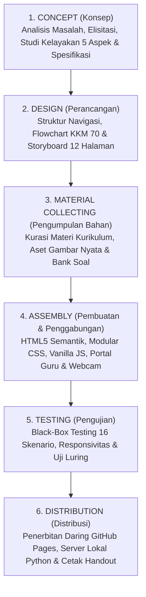
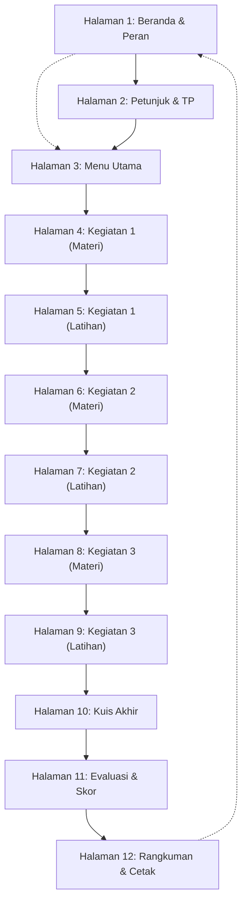
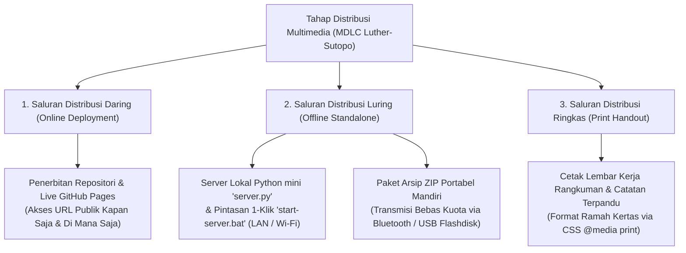

# LAPORAN PENGEMBANGAN MULTIMEDIA PEMBELAJARAN INTERAKTIF
## BERBASIS WEBMOBILE SEBAGAI PENDAMPING MEDIA PEMBELAJARAN KONVENSIONAL PADA MATA PELAJARAN IPA SMP NEGERI 1 TANDUKKALUA MENGGUNAKAN MODEL MDLC

---

<br><br>

### IDENTITAS MAHASISWA & PENYUSUN
**Nama Mahasiswa :** Nurun Nisa Ahmad  
**Nomor Induk Mahasiswa (NIM) :** 240209501049  
**Kelas :** PTIK E 2024  
**Program Studi :** Pendidikan Teknik Informatika dan Komputer  
**Jurusan :** Teknik Informatika dan Komputer  
**Fakultas :** Fakultas Teknik  
**Perguruan Tinggi :** Universitas Negeri Makassar  

<br>

### DOSEN PEMBINA & PENGAMPU
**Dosen Pengampu Mata Kuliah :**  
Dr. Udin Sidik Sidin, S.Pd, MT. (NIDN: 0015067407)  

**Dosen Mitra Pembelajaran :**  
Ir. H. Muhammad Riska, S.Pd, M.Pd. (NIDN: 0020098503)  

<br><br>

**MAKASSAR**  
**NOVEMBER 2026**

---

\newpage

# KATA PENGANTAR

Puji dan syukur penulis panjatkan ke hadirat Tuhan Yang Maha Esa, Allah Subhanahu Wa Ta’ala, atas segala limpahan rahmat, taufik, hidayah, dan karunia-Nya sehingga laporan tugas pengembangan media pembelajaran dengan judul **“Pengembangan Multimedia Pembelajaran Interaktif Berbasis Webmobile Sebagai Pendamping Media Pembelajaran Konvensional Pada Mata Pelajaran IPA SMP Negeri 1 Tandukkalua Menggunakan Model MDLC”** dapat diselesaikan dengan baik, sistematis, dan tepat waktu.

Laporan ini disusun sebagai bentuk dokumentasi akademis dan pertanggungjawaban teknis terhadap pelaksanaan perancangan, pengembangan (*assembly*), pengujian fungsi (*testing*), hingga persiapan distribusi media pembelajaran interaktif berbasis web-mobile. Produk multimedia interaktif ini dirancang khusus guna menjawab permasalahan pembelajaran Ilmu Pengetahuan Alam (IPA) di SMP Negeri 1 Tandukkalua, khususnya pada submateri Ekologi dan Keanekaragaman Hayati Indonesia untuk peserta didik kelas VII (Fase D).

Keberhasilan penulisan laporan serta realisasi pengembangan produk multimedia interaktif ini tidak lepas dari bimbingan, arahan, motivasi, serta bantuan moral dan material dari berbagai pihak. Oleh karena itu, pada kesempatan ini penulis menyampaikan ucapan terima kasih yang tulus dan penghargaan setinggi-tingginya kepada:

1. **Bapak Dr. Udin Sidik Sidin, S.Pd, MT.** (NIDN: 0015067407), selaku Dosen Pengampu mata kuliah Pengembangan Multimedia Pendidikan, atas arahan kurikulum, masukan konstruktif, serta bimbingan akademik yang senantiasa menuntun penulis dalam menstandarkan kualitas produk perangkat lunak pembelajaran;
2. **Bapak Ir. H. Muhammad Riska, S.Pd, M.Pd.** (NIDN: 0020098503), selaku Dosen Mitra yang mendampingi proses perkuliahan secara intensif dari awal hingga akhir, memberikan telaah kritis, ketelitian desain instruksional, serta inspirasi pedagogis dalam pengembangan media berbasis web ini;
3. Pimpinan dan jajaran dosen Jurusan Teknik Informatika dan Komputer, Fakultas Teknik, Universitas Negeri Makassar yang telah membekali penulis dengan fondasi keilmuan informatika dan kependidikan;
4. Kepala Sekolah, jajaran guru mata pelajaran IPA, serta peserta didik kelas VII SMP Negeri 1 Tandukkalua yang telah memberikan informasi berharga mengenai profil lingkungan belajar nyata dan kendala pembelajaran di sekolah;
5. Rekan-rekan mahasiswa Program Studi Pendidikan Teknik Informatika dan Komputer (khususnya Kelas PTIK E Angkatan 2024) yang selalu berkolaborasi, bertukar pikiran, dan saling menguatkan dalam menyelesaikan proyek multimedia ini.

Penulis menyadari sepenuhnya bahwa laporan dan produk yang dihasilkan masih memiliki keterbatasan. Kritik dan saran yang membangun dari segenap pembaca, pendidik, dan praktisi teknologi pembelajaran senantiasa dinantikan demi penyempurnaan produk di masa depan. Semoga karya ini dapat memberikan kontribusi nyata bagi transformasi digital pembelajaran IPA di sekolah menengah pertama.

<br>

Makassar, November 2026  
<br><br>
**Penulis**  
Nurun Nisa Ahmad  
(NIM: 240209501049)

---

\newpage

# DAFTAR ISI

- **HALAMAN JUDUL**
- **KATA PENGANTAR**
- **DAFTAR ISI**
- **RANGKUMAN TAHAP ANALISIS KEBUTUHAN & DESAIN MEDIA (DOKUMEN PROPOSAL)**
<br>

- **BAB I PENDAHULUAN**
  - **A. Latar Belakang Masalah**
    - 1. Kondisi Kontekstual Pembelajaran IPA di SMP Negeri 1 Tandukkalua
      - a) Dominasi Media Konvensional Buku Teks dan Papan Tulis
      - b) Kendala Visualisasi Spesies dan Keterbatasan Gambar Guru
      - c) Masalah Pengerjaan Tugas Saat Guru Berhalangan Hadir
    - 2. Landasan Teoretis dan Pendekatan Pedagogis
      - a) Teori Kognitif Pembelajaran Multimedia (*Cognitive Theory of Multimedia Learning*)
      - b) Pendekatan Literasi Konservasi Berbasis Hasil Riset pada Kurikulum Merdeka
    - 3. Urgensi Pengembangan Media Pendamping Berbasis Web-Mobile
  - **B. Rumusan Masalah Penelitian dan Pengembangan**
  - **C. Tujuan Pengembangan**
    - 1. Tujuan Umum
    - 2. Tujuan Khusus
  - **D. Manfaat Pengembangan**
    - 1. Manfaat Teoretis
    - 2. Manfaat Praktis (Peserta Didik, Pendidik, Sekolah, Pengembang)
  - **E. Spesifikasi Produk yang Dihasilkan**
    - 1. Gambaran Umum Produk Jadi
    - 2. Arsitektur Komponen dan Teknologi Pengembang
    - 3. Skema Desain Visual Biru Langit (*Soft Sky Blue*) dan Tipografi

<br>

- **BAB II PEMBAHASAN**
  - **A. Cara dan Prosedur Pengembangan (Model MDLC Luther-Sutopo)**
    - 1. Tahap Konsep (*Concept*)
      - a) Identifikasi Masalah dan Sasaran Pengguna
      - b) Karakteristik Kognitif Peserta Didik (Usia 12-15 Tahun & Teori Piaget)
      - c) Elisitasi Kebutuhan dari Empat Sumber Data
      - d) Analisis Materi Kurikulum Merdeka Fase D (CP dan ATP 3 Kegiatan)
      - e) Tabel Matriks Analisis Masalah, Kebutuhan, dan Solusi Multimedia
      - f) Studi Kelayakan Lima Aspek (*Feasibility Study*)
      - g) Antisipasi Kendala Lapangan dan Solusi Terintegrasi
      - h) Perumusan Spesifikasi Kebutuhan Fungsional Media
    - 2. Tahap Perancangan (*Design*)
      - a) Struktur Navigasi Media Pembelajaran (Hierarkis Komposit)
      - b) Diagram Alir Penggunaan (*Flowchart System*) dengan Patokan Skor 70
      - c) Perancangan Papan Cerita (*Storyboard*) 12 Halaman Terpadu
      - d) Rancangan Materi Tiga Kegiatan, Bentuk Latihan, dan Umpan Balik
    - 3. Tahap Pengumpulan Materi (*Material Collecting*)
      - a) Penyiapan dan Kurasi Bahan Ajar Keanekaragaman Hayati
      - b) Digitalisasi dan Standardisasi Aset Visual Nyata Resolusi Tinggi
      - c) Penyusunan Butir Soal Kuis, Pengecoh, dan Pembahasan Ilmiah
    - 4. Tahap Pembuatan dan Penggabungan (*Assembly*)
      - a) Pemrograman Kerangka Berkas dan Modularisasi Komponen Halaman
      - b) Rekayasa Interaktivitas dan Logika Evaluasi Formatif
      - c) Pengembangan Fitur Lanjutan Portal Guru, Roster Mandiri (*Clean Slate*), dan Verifikasi Kamera
      - d) Rekayasa Mekanisme Penguncian Kuis, Proteksi Privasi Nilai, dan Cooldown 3 Detik
    - 5. Tahap Pengujian (*Testing*)
      - a) Metodologi Pengujian Kotak Hitam (*Black Box Testing*)
      - b) Pengujian Responsivitas Antarmuka Lintas Perangkat (*Cross-Platform*)
      - c) Pengujian Kesiapan Operasional Luring (*Offline-First Readiness*)
  - **B. Hasil Pengembangan dan Pembahasan Transformasi Produk**
    - 1. Tinjauan Produk Jadi dan Lingkungan Penerapan
    - 2. Pembahasan Transformasi Mendalam dari Dokumen Proposal (DOCX) Menuju Produk Akhir Jadi
    - 3. Fitur-Fitur Unggulan yang Berhasil Diimplementasikan
    - 4. Riwayat Revisi dan Perbaikan Selama Tahap Implementasi
    - 5. Hasil Pengujian Fungsional dan Kinerja Sistem
  - **C. Analisis Keterbatasan Produk dan Rencana Tindak Lanjut**
    - 1. Keterbatasan dan Kekurangan Produk Saat Ini
    - 2. Tindak Lanjut Penyempurnaan Media

<br>

- **BAB III KESIMPULAN DAN SARAN**
  - **A. Kesimpulan**
    - 1. Sintesis Hasil Pengembangan Model MDLC
    - 2. Validitas dan Kebermanfaatan Produk
  - **B. Saran dan Rekomendasi Pengembangan**
    - 1. Rekomendasi bagi Satuan Pendidikan dan Pendidik IPA
    - 2. Rekomendasi bagi Pengembang dan Peneliti Lanjutan
  - **C. Rencana Tahap Distribusi (*Distribution Stage*)**
    - 1. Distribusi Daring (*Online Deployment* melalui GitHub Pages)
    - 2. Distribusi Luring Mandiri (*Offline Local Server* dan Paket Berkas ZIP)
    - 3. Distribusi Dokumen Ringkas (*Print Handout* via CSS @media print)

<br>

- **DAFTAR PUSTAKA** (Gaya Vancouver)
- **LAMPIRAN**
  - Lampiran 1. Matriks Pengujian *Black Box* 12 Halaman Modul
  - Lampiran 2. Kisi-Kisi dan Butir Soal Evaluasi Kuis Akhir
  - Lampiran 3. Struktur Berkas Kode Sumber Proyek Berbasis Modular
  - Lampiran 4. Dokumentasi Tampilan Layar Antarmuka (*User Interface Screenshot*)

---

\newpage

# RANGKUMAN TAHAP ANALISIS KEBUTUHAN & DESAIN MEDIA PEMBELAJARAN
### (Sintesis Matriks Awal Dokumen Proposal Proyek)

Sebagai titik tolak perancangan media, tabel di bawah ini menyajikan sintesis komprehensif dari tahap analisis kebutuhan dan desain media pembelajaran sebagaimana telah dirumuskan pada dokumen proposal awal mahasiswa:

| Komponen Analisis | Deskripsi pada Dokumen Perancangan Awal | Keterangan & Implementasi Lanjut |
| :--- | :--- | :--- |
| **Jenis Multimedia yang Dikembangkan** | • Modul multimedia interaktif berbasis *web-mobile* (HTML, CSS, JavaScript) yang ringan.<br>• Tersedia versi luring (*offline-ready*).<br>• Diposisikan sebagai pendamping buku pelajaran dan papan tulis. | Dikembangkan menggunakan tumpukan web murni (*pure native web stack*) tanpa dependensi kerangka kerja (*framework*) luar, berukuran total ~2,2 MB, dan dapat dijalankan melalui peramban ponsel pintar maupun laptop. |
| **Masalah Pembelajaran di Lapangan** | • Pembelajaran IPA di SMP Negeri 1 Tandukkalua hanya menggunakan buku teks dan papan tulis.<br>• Contoh spesies makhluk hidup pada buku sangat terbatas.<br>• Guru harus menggambar ulang di papan tulis.<br>• Siswa sulit membedakan variasi tingkat gen, jenis, dan ekosistem.<br>• Saat guru berhalangan hadir, siswa hanya diminta mencatat tanpa penjelasan dan umpan balik. | Media menghadirkan visualisasi fotografi asli resolusi tinggi, kuis diagnostik dengan umpan balik langsung, serta alur belajar mandiri terstruktur yang membimbing siswa saat guru berhalangan hadir. |
| **Model Pengembangan** | • MDLC (*Multimedia Development Life Cycle*) menurut Luther-Sutopo: *Concept, Design, Material Collecting, Assembly, Testing, Distribution*.<br>• Dokumen proposal berfokus pada tahap *Concept* dan *Design*. | Laporan akhir ini menuntaskan keenam tahapan MDLC secara terpadu hingga tahap *Testing* dan rencana *Distribution*. |
| **Sasaran Pengguna** | • Peserta didik kelas VII SMP pada mata pelajaran IPA (usia 12–15 tahun).<br>• Guru IPA sebagai sumber elisitasi kebutuhan dan verifikator hasil belajar. | Antarmuka dirancang ramah gawai potret (*mobile portrait*) sesuai karakteristik kognitif transisi operasional konkret menuju formal menurut teori Jean Piaget. |
| **Cakupan Materi Ajar** | • Keanekaragaman Hayati – topik Ekologi dan Keanekaragaman Hayati Indonesia, IPA Kelas VII (Fase D Kurikulum Merdeka).<br>• Konsep dan istilah dasar, tiga tingkat keanekaragaman, kekayaan spesies endemik Indonesia, ancaman kepunahan, serta pelestarian *in situ* dan *ex situ*. | Materi dibagi secara proporsional ke dalam tiga kegiatan belajar yang selaras dengan Capaian Pembelajaran (CP) dan Alur Tujuan Pembelajaran (ATP). |
| **Metode Analisis Kebutuhan** | • Identifikasi masalah dari pengalaman belajar empiris di SMP.<br>• Elisitasi kebutuhan melalui wawancara guru, angket siswa, observasi lingkungan sekolah, dan analisis dokumen kurikulum.<br>• Analisis karakteristik siswa.<br>• Analisis materi, CP, dan TP.<br>• Studi kelayakan lima aspek (*feasibility study*).<br>• Perumusan spesifikasi awal produk. | Analisis diperkaya dengan kajian *Cognitive Theory of Multimedia Learning* (CTML) Mayer dan hasil riset literasi konservasi keanekaragaman hayati nusantara. |
| **Cetak Biru Desain Media** | • Struktur navigasi hierarkis komposit dan diagram alir penggunaan (patokan skor 70).<br>• Papan cerita (*storyboard*) 12 halaman.<br>• Rancangan materi tiga kegiatan dengan latihan dan umpan balik instan.<br>• Kuis akhir sumatif 10 butir pilihan ganda.<br>• Rangkuman ganda (halaman modul interaktif dan lembar PDF ringkas ramah cetak). | Menghasilkan modul 12 halaman interaktif berkesinambungan dengan navigasi bilah bawah yang konsisten ("Menu Utama" di kiri dan "Berikutnya" di kanan). |

---

\newpage

# BAB I PENDAHULUAN

## A. Latar Belakang Masalah

### 1. Kondisi Kontekstual Pembelajaran IPA di SMP Negeri 1 Tandukkalua
Pembelajaran Ilmu Pengetahuan Alam (IPA) di tingkat Sekolah Menengah Pertama (SMP) memegang peranan krusial dalam membentuk pola pikir saintifik, rasa ingin tahu yang sistematis, daya nalar logis, serta kepedulian terhadap lingkungan hidup sejak usia dini. Kendati demikian, kenyataan empiris di lapangan menunjukkan bahwa transfer pengetahuan sains sering kali terhambat oleh keterbatasan ragam dan kecanggihan media pembelajaran yang digunakan di dalam ruang kelas.

#### a) Dominasi Media Konvensional Buku Teks dan Papan Tulis
Berdasarkan pengalaman empiris penyusun saat menempuh pendidikan di SMP Negeri 1 Tandukkalua serta hasil elisitasi pendahuluan yang dilakukan terhadap proses belajar mengajar, pembelajaran IPA di sekolah tersebut masih sangat bertumpu pada dua instrumen konvensional, yakni buku paket cetak dan papan tulis kelas. Pendidik mengandalkan buku teks sebagai sumber informasi dominan, kemudian menjelaskan teori biologi dengan mencatatkan poin-poin materi atau menggambarkan sketsa di papan tulis.

Kedua media konvensional tersebut tentu memiliki kelebihan yang tidak terbantahkan: keduanya tersedia di setiap ruang kelas, tidak memerlukan pasokan daya listrik, bebas dari kendala infrastruktur teknologi informasi, serta memungkinkan guru merespons dinamika kelas secara spontan. Namun, ketergantungan mutlak pada media tersebut membawa keterbatasan pedagogis yang serius. Penyampaian materi bersifat satu arah (*one-way transmission*), statis, dan minim rangsangan interaktif. Peserta didik hanya menjadi pendengar pasif yang menyerap uraian verbal guru, tanpa kesempatan untuk memanipulasi, mengeksplorasi, maupun menguji konsep ilmiah secara mandiri.

#### b) Kendala Visualisasi Spesies dan Keterbatasan Gambar Guru
Kelemahan media cetak dan papan tulis tampak sangat mencolok pada materi bahasan **Keanekaragaman Hayati (Biodiversitas)**. Topik ini menuntut pemahaman visual yang sangat kaya mengenai keragaman bentuk, struktur morfologi, corak warna, variasi genetik, serta bentang alam habitat makhluk hidup. Buku teks pelajaran yang disediakan di sekolah umumnya hanya memuat foto-foto berukuran kecil, berkualitas cetak standar, serta hanya menyajikan dua hingga tiga contoh organisme perwakilan.

Akibatnya, ketika guru berusaha menjelaskan keanekaragaman bentuk paruh burung, pola belang fauna, atau perbedaan ciri fisik spesies, guru terpaksa menggambar ulang objek biologis tersebut di papan tulis. Tindakan menggambar tangan ini memakan porsi waktu jam pelajaran yang berharga, sementara kualitas dan keakuratan proporsi gambar sangat bergantung pada keterampilan artistik guru yang bersangkutan. Terlebih lagi, ilustrasi di papan tulis bersifat fana (*transient*): gambar tersebut harus segera dihapus begitu papan tulis penuh atau jam pelajaran berakhir. Akibatnya, peserta didik kehilangan referensi visual konkret begitu meninggalkan kelas dan harus kembali membayangkan konsep abstrak tersebut seorang diri saat belajar di rumah.

#### c) Masalah Pengerjaan Tugas Saat Guru Berhalangan Hadir
Persoalan kian meruncing manakala guru mata pelajaran IPA berhalangan hadir di sekolah akibat penugasan dinas, kegiatan musyawarah guru (MGMP), urusan administratif, maupun alasan kesehatan. Dalam situasi guru tidak hadir di kelas, praktik yang paling umum terjadi adalah pemberian instruksi kepada siswa untuk mencatat materi tertentu dari buku cetak ke dalam buku catatan masing-masing sebagai bahan persiapan tatap muka berikutnya.

Aktivitas mencatat massal tanpa panduan instruksional ini berlangsung mekanis dan hampa makna. Peserta didik hanya menyalin deretan teks dari buku tanpa memahami esensi konsep yang disalin, tanpa disertai visualisasi yang memadai, dan tanpa adanya umpan balik (*immediate feedback*) yang menguji kebenaran pemahaman mereka. Siswa tidak mengetahui apakah interpretasi mereka terhadap teks sudah tepat atau justru keliru. Akibatnya, potensi terjadinya miskonsepsi sains tidak terdeteksi sejak awal, tingkat kejenuhan belajar meningkat, dan persiapan menyongsong pertemuan berikutnya menjadi tidak optimal.

### 2. Landasan Teoretis dan Pendekatan Pedagogis

#### a) Teori Kognitif Pembelajaran Multimedia (*Cognitive Theory of Multimedia Learning*)
Secara teoretis, keterbatasan pengajaran yang hanya berbasis kata-kata verbal dan teks statis dipertegas oleh kajian **Cognitive Theory of Multimedia Learning (CTML)** yang dikembangkan oleh Richard E. Mayer [1]. Teori ini bertumpu pada tiga asumsi kognitif fundamental:
1. *Saluran Ganda (Dual-Channel Assumption):* Manusia memiliki saluran pemrosesan informasi yang terpisah untuk representasi verbal/auditori (kata-kata lisan atau teks yang dibaca) dan representasi visual/piktorial (gambar, diagram, animasi);
2. *Kapasitas Terbatas (Limited Capacity Assumption):* Memori kerja (*working memory*) manusia memiliki kapasitas penampungan yang sangat terbatas dalam memproses informasi baru pada satu satuan waktu;
3. *Pemrosesan Aktif (Active Processing Assumption):* Proses belajar yang mendalam hanya terjadi manakala pebelajar secara aktif menyeleksi informasi yang relevan, mengorganisasikannya ke dalam representasi mental yang runtut, serta mengintegrasikan representasi baru tersebut dengan skema pengetahuan lama yang telah ada di dalam memori jangka panjang (*long-term memory*).

Menurut Mayer, pembelajaran berlangsung jauh lebih efektif apabila disajikan dengan memadukan kata-kata dan gambar yang saling berkorespondensi (*multimedia effect*) daripada hanya mengandalkan teks verbal semata [1]. Lebih jauh, agar media multimedia tidak membebani memori kerja siswa (*cognitive overload*), perancangan media wajib menerapkan prinsip instruksional turunan CTML:
- *Prinsip Segmenting:* Materi kompleks dipecah menjadi unit-unit aktivitas kecil yang mandiri sehingga peserta didik dapat mengatur ritme belajarnya sendiri;
- *Prinsip Modality dan Signaling:* Penonjolan kata kunci (*highlighting*) dan lencana pembeda warna digunakan untuk mengarahkan atensi visual siswa ke konsep-konsep esensial;
- *Prinsip Spatial Contiguity:* Keterangan teks penjelasan ditempatkan berdampingan atau menempel langsung dengan objek visual/grafis yang diterangkannya guna meminimalkan beban kognitif pencarian informasi.

#### b) Pendekatan Literasi Konservasi Berbasis Hasil Riset pada Kurikulum Merdeka
Dalam kerangka kebijakan Kurikulum Merdeka yang berlaku secara nasional saat ini, Keputusan Kepala BSKAP Kemendikbudristek Nomor 008/H/KR/2022 menetapkan Capaian Pembelajaran (CP) IPA Fase D yang menekankan bahwa peserta didik mampu mengklasifikasi makhluk hidup berdasarkan karakteristik yang diamati, menganalisis interaksi ekologis antara makhluk hidup dengan lingkungannya, serta merancang upaya mitigasi terhadap kerusakan dan pencemaran lingkungan alam [6].

Materi keanekaragaman hayati tidak boleh sekadar menjadi hafalan taksonomi Latin yang menjemukan, melainkan harus diarahkan untuk membangun kesadaran literasi konservasi di kalangan generasi muda. Penelitian mutakhir dalam pendidikan biologi membuktikan bahwa bahan ajar digital interaktif yang mengangkat data riset kekayaan flora dan fauna asli Indonesia terbukti meningkatkan pemahaman konseptual sekaligus menumbuhkan etika pelestarian alam pada peserta didik SMP [5,7]. Oleh sebab itu, penyediaan media pembelajaran yang memvisualisasikan keanekaragaman biogeografi nusantara (seperti garis demarkasi Wallace-Weber dan satwa endemik Indonesia) memiliki urgensi pedagogis yang sangat kuat.

### 3. Urgensi Pengembangan Media Pendamping Berbasis Web-Mobile
Menyikapi kesenjangan antara kondisi riil pembelajaran di SMP Negeri 1 Tandukkalua dan tuntutan kurikulum modern, lahir kebutuhan mendesak untuk mengembangkan sebuah inovasi media instruksional yang bertindak sebagai **media pendamping**. Penting ditegaskan bahwa media ini tidak dirancang untuk menggantikan peran pendidik, buku pelajaran cetak, maupun papan tulis kelas, melainkan hadir saling melengkapi (*complementary*) dan memperkuat (*reinforcing*) ekosistem pembelajaran yang sudah ada.

Media yang dirancang adalah modul multimedia interaktif berbasis *web-mobile*. Pemilihan teknologi berbasis peramban web (*web-first architecture*) memberikan sejumlah keunggulan taktis:
1. Aksesibilitas universal tanpa beban instalasi (*zero installation*): aplikasi dapat diakses langsung melalui peramban web (*Chrome, Safari, Firefox, Edge*) di semua jenis ponsel cerdas (*smartphone*) tanpa mewajibkan pengunduhan berkas APK yang membebani memori internal telepon siswa;
2. Kesiapan operasional penuh secara luring (*offline-first readiness*): seluruh berkas aset gambar, lembar gaya CSS, dan pustaka skrip disimpan secara lokal, memungkinkan media dibagikan secara gratis antarperangkat melalui transmisi Bluetooth, Wi-Fi lokal, atau kabel data tanpa memerlukan koneksi kuota internet;
3. Pengalaman belajar aktif dan mandiri: media menyediakan galeri fotografi komparatif resolusi tinggi, latihan formatif manipulatif (mencocokkan pasangan dan mengurutkan kartu alur sains), kuis evaluasi adaptif berfitur verifikasi wajah (*anti-joki*), serta modul lembar catatan mandiri terpandu yang dapat dicetak rapi.

---

## B. Rumusan Masalah Penelitian dan Pengembangan

Berdasarkan latar belakang masalah yang telah diuraikan, rumusan masalah dalam pengembangan ini dirumuskan sebagai berikut:
1. Bagaimana kondisi nyata pembelajaran IPA di SMP Negeri 1 Tandukkalua yang mengandalkan buku pelajaran dan papan tulis, termasuk cara pendidik menghadirkan visualisasi materi serta kendala yang dialami peserta didik pada topik keanekaragaman hayati?
2. Bagaimana kebutuhan pendidik dan peserta didik terhadap kehadiran media pembelajaran yang mampu menyajikan visualisasi materi keanekaragaman hayati secara lebih konkret, interaktif, dan dapat diakses berulang kali secara mandiri?
3. Bagaimana kebutuhan bimbingan belajar mandiri peserta didik ketika pendidik berhalangan hadir di kelas agar penugasan tidak sekadar mencatat isi buku tanpa pemahaman dan umpan balik?
4. Bagaimana rancangan, perakitan, dan unjuk kerja multimedia pembelajaran interaktif berbasis *web-mobile* yang valid, praktis, responsif, dan siap digunakan sebagai media pendamping pembelajaran konvensional menggunakan model MDLC?

---

## C. Tujuan Pengembangan

### 1. Tujuan Umum
Secara umum, proyek pengembangan ini bertujuan untuk menghasilkan produk perangkat lunak multimedia pembelajaran interaktif berbasis *web-mobile* pada topik Ekologi dan Keanekaragaman Hayati Indonesia untuk mata pelajaran IPA Fase D di SMP Negeri 1 Tandukkalua yang valid, praktis, ringan, responsif, dan teruji secara fungsional sebagai pendamping media pembelajaran konvensional menggunakan model *Multimedia Development Life Cycle* (MDLC).

### 2. Tujuan Khusus
Secara spesifik, tujuan yang ingin dicapai melalui proyek pengembangan ini adalah:
a) Menganalisis kebutuhan instruksional proses pembelajaran IPA di kelas VII SMP Negeri 1 Tandukkalua, karakteristik kognitif siswa usia 12–15 tahun, dan keselarasan materi terhadap CP dan ATP Kurikulum Merdeka Fase D;  
b) Merancang arsitektur navigasi hierarkis komposit, diagram alir sistem berpatokan KKM skor 70, serta papan cerita (*storyboard*) 12 halaman interaktif berorientasi layar ponsel cerdas potret;  
c) Mengumpulkan dan mengurasi materi ajar ilmiah, aset citra fotografi otentik keanekaragaman hayati Indonesia, ikon grafis vektor ringan, serta bank soal kuis berpengecoh logis yang dilengkapi analisis pembahasan;  
d) Mengembangkan (*assembly*) produk perangkat lunak media interaktif berbasis modular (*pure semantic HTML5, modular CSS3, and modern Vanilla JavaScript ES6*) dengan palet warna Biru Langit Lembut (*Soft Sky Blue* `#dae9f7`) dan tipografi Calibri Light/Poppins;  
e) Mengintegrasikan sistem verifikasi kamera dokumentasi wajah (*webcam selfie verification*) dan portal dasbor pengelolaan guru (*teacher portal*) mandiri guna menjamin akuntabilitas belajar dan mempermudah evaluasi kelas;  
f) Menguji unjuk kerja fungsional media melalui pengujian kotak hitam (*black box testing*), uji keterbacaan antarmuka lintas peramban (*cross-browser*), serta pengujian kesiapan operasional luring murni (*offline-first mode*).

---

## D. Manfaat Pengembangan

### 1. Manfaat Teoretis
Secara teoretis, laporan dan produk pengembangan ini diharapkan dapat:
a) Memberikan sumbangan empiris bagi pengembangan disiplin teknologi pendidikan, khususnya dalam mengoperasionalkan prinsip-prinsip *Cognitive Theory of Multimedia Learning* (CTML) ke dalam rekayasa aplikasi web bergerak untuk jenjang pendidikan menengah;  
b) Menjadi rujukan implementasi model pengembangan *Multimedia Development Life Cycle* (MDLC) Luther-Sutopo secara disiplin dan menyeluruh dalam konteks perangkat lunak pembelajaran berbasis peramban modern.

### 2. Manfaat Praktis

#### a) Manfaat bagi Peserta Didik
1) Menyediakan media belajar visual yang kaya, dinamis, dan menarik yang dapat diakses secara fleksibel menggunakan ponsel cerdas di sekolah maupun di rumah;  
2) Membantu mengatasi kesulitan abstraksi konsep melalui gambar nyata perbandingan variasi gen, jenis, dan ekosistem, serta simulasi bertahap observasi keanekaragaman hayati;  
3) Memberikan sarana belajar mandiri yang terarah saat guru berhalangan hadir melalui latihan interaktif berumpan balik instan tanpa rasa takut dihakimi nilai rapor.

#### b) Manfaat bagi Tenaga Pendidik (Guru IPA)
1) Menjadi alat bantu peraga digital yang efisien di ruang kelas tanpa perlu menghabiskan jam pelajaran untuk menggambar objek biologi secara manual di papan tulis;  
2) Memudahkan pemberian penugasan mandiri terstruktur saat guru menjalankan tugas kedinasan di luar sekolah;  
3) Menyediakan fasilitas Portal Guru yang secara otomatis merekapitulasi perolehan skor kuis, pemetaan capaian Tujuan Pembelajaran (TP 1, TP 2, TP 3), serta memverifikasi foto kehadiran siswa untuk mencegah kecurangan pengerjaan joki tugas.

#### c) Manfaat bagi Satuan Pendidikan (SMP Negeri 1 Tandukkalua)
1) Menstimulasi adopsi teknologi pembelajaran digital yang tepat guna, hemat anggaran, dan ramah terhadap kondisi keterbatasan jaringan internet di wilayah sekolah;  
2) Meningkatkan mutu proses belajar mengajar dan daya dukung fasilitas pembelajaran sains sesuai tuntutan Kurikulum Merdeka.

#### d) Manfaat bagi Pengembang / Mahasiswa PTIK
1) Mengintegrasikan seluruh kompetensi akademik yang diperoleh di Program Studi Pendidikan Teknik Informatika dan Komputer Universitas Negeri Makassar dalam merancang arsitektur sistem perangkat lunak sekaligus mendesain media instruksional;  
2) Menghasilkan karya portofolio perangkat lunak edukatif orisinal yang teruji validitas fungsionalnya dan siap dipertanggungjawabkan secara ilmiah.

---

## E. Spesifikasi Produk yang Dihasilkan

### 1. Gambaran Umum Produk Jadi
Produk yang berhasil diwujudkan adalah aplikasi multimedia pembelajaran interaktif berbasis web bergerak (*web-mobile responsive interactive module*) bertajuk **"Ekologi dan Keanekaragaman Hayati Indonesia"**. Media ini telah dipublikasikan secara daring pada peladen komputasi awan *GitHub Pages*: `https://nurun05.github.io/Website_multimedia-pembelajaran/` dan sekaligus dapat dioperasikan secara penuh tanpa jaringan internet (*offline-first*) melalui server mini lokal Python yang disertakan dalam paket distribusi mandiri.

Media tersusun atas **12 modul halaman berkesinambungan**:
- **Halaman 1 (Beranda):** Halaman penyambutan yang memuat banner pemandangan alam Indonesia beresolusi tinggi, judul modul, identitas pengembang mahasiswa PTIK UNM, serta tombol pemilahan peran akses masuk ("Anda Siswa" dan "Anda Guru");
- **Halaman 2 (Petunjuk & Capaian TP):** Lembar panduan alur belajar mandiri serta rincian tiga Capaian Tujuan Pembelajaran (TP 1, TP 2, dan TP 3) yang terukur;
- **Halaman 3 (Menu Utama):** Dasbor navigasi berbasis kartu adaptif (*responsive cards*) yang menghubungkan seluruh modul kegiatan belajar dilengkapi indikator status ketuntasan (*progress checkboxes*);
- **Halaman 4 (Kegiatan 1 - Materi):** Penyajian konsep dasar biosfer, habitat, ekosistem, spesies endemik, dan konservasi dengan kotak pertanyaan pemantik kontekstual dan 6 kartu istilah interaktif (akordeon);
- **Halaman 5 (Kegiatan 1 - Latihan Formatif):** Tiga butir soal reflektif konsep dengan diagnostik pembenahan langsung tanpa memengaruhi nilai rapor;
- **Halaman 6 (Kegiatan 2 - Materi Tiga Tingkat Kehati):** Tabulasi visual interaktif untuk mengamati tingkat gen, jenis, dan ekosistem secara berdampingan lengkap dengan papan peringatan miskonsepsi kritis (*critical alert box*);
- **Halaman 7 (Kegiatan 2 - Latihan Mencocokkan Pasangan):** Papan permainan mencocokkan pasangan dua kolom (*matching board*) yang menguji kemampuan siswa menghubungkan contoh organisme dengan tingkat keanekaragamannya;
- **Halaman 8 (Kegiatan 3 - Materi Persebaran Fauna & Konservasi):** Simulasi interaktif lima tahap observasi sains, visualisasi peta resolusi tinggi Garis Wallace dan Garis Weber, lima ancaman antropogenik, serta perbandingan konservasi *in situ* vs *ex situ*;
- **Halaman 9 (Kegiatan 3 - Latihan Pengurutan Alur):** Papan interaktif pengurutan lima kartu tahapan observasi sains secara logis dan terstruktur;
- **Halaman 10 (Kuis Akhir Evaluasi Resmi):** Instrumen tes sumatif 10 butir pilihan ganda yang diproteksi verifikasi seleksi nama siswa dari daftar resmi, perekaman foto wajah dokumentasi (*selfie camera anti-joki*), penguncian jawaban per butir, tombol buka pembahasan ilmiah, serta mekanisme jeda waktu *cooldown* 3 detik pascapengiriman;
- **Halaman 11 (Evaluasi Hasil & Rekomendasi):** Tampilan diagram lingkaran capaian skor (*score gauge*), pemetaan ketercapaian per Tujuan Pembelajaran, status kelulusan (patokan skor KKM 70), serta tombol tindakan cerdas (remedial atau pengayaan);
- **Halaman 12 (Rangkuman & Lembar Catatan Mandiri):** Intisari materi komprehensif, glosarium istilah penting, serta fitur cetak lembar kerja siswa berformat ramah kertas (*print-ready layout* via CSS `@media print`).

### 2. Arsitektur Komponen dan Teknologi Pengembang
Perangkat lunak ini sengaja dibangun menggunakan teknologi murni web standar (*Native Web Stack*) tanpa memanfaatkan pustaka atau *framework* monolitik pihak ketiga yang berat:
1. **HTML5 Semantik:** Struktur penandaan semantik (`<main>`, `<section>`, `<nav>`, `<header>`) memastikan aksesibilitas tinggi dan efisiensi perenderan DOM;
2. **Vanilla CSS3 Modular:** Desain tampilan dipecah ke dalam 9 modul lembar gaya terisolasi (`variables.css`, `base.css`, `buttons.css`, `components.css`, `activities.css`, `quiz.css`, `verifier.css`, `teacher-panel.css`, dan `print.css`) yang diimpor melalui berkas utama `style.css`;
3. **Modern JavaScript (ES6+):** Logika sistem menganut prinsip pemisahan tanggung jawab (*Separation of Concerns*). Pengelolaan status aplikasi terpusat di `state.js`, navigasi halaman dikontrol oleh `router.js`, alur utama dijalankan oleh `app.js`, serta logika spesifik halaman disimpan pada direktori `js/views/`.

### 3. Skema Desain Visual Biru Langit (*Soft Sky Blue*) dan Tipografi
Aspek psikologi visual dan estetika dirancang secara teliti guna mendukung kenyamanan belajar peserta didik usia sekolah menengah:
1. **Palet Warna Utama:** Mengadopsi gradasi **Biru Langit Lembut (*Soft Sky Blue*) `#dae9f7` (RGB: 218, 233, 247)**. Bilah atas (*header*) menggunakan latar `#dae9f7` dipadukan teks biru dongker tegas `#1b3b5f` dan lencana biru `#367bb7`. Tombol aksi utama (*primary button*) menggunakan warna biru bahari `#367bb7` yang solid dan kontras;
2. **Tipografi Bersih dan Modern:** Memanfaatkan kombinasi keluarga font **Calibri Light** dan **Poppins**, memberikan tingkat keterbacaan (*legibility*) yang optimal pada resolusi layar gawai kecil maupun monitor komputer tanpa menimbulkan kelelahan mata (*visual fatigue*);
3. **Tata Letak Responsif Adaptif:** Pada layar gawai bergerak (< 768px), antarmuka menampilkan orientasi potret layar penuh satu kolom. Pada peramban komputer/laptop (≥ 768px), kontainer memusat secara proporsional (*centered container* maks. 840px) dengan tata letak dua kolom yang seimbang dan rapi.

---

\newpage

# BAB II PEMBAHASAN

## A. Cara dan Prosedur Pengembangan (Model MDLC Luther-Sutopo)

Pengembangan media pembelajaran interaktif ini mengadopsi secara ketat metodologi **Multimedia Development Life Cycle (MDLC)** menurut Luther yang disempurnakan oleh Sutopo [3]. Model MDLC dipilih karena secara komprehensif memandu seluruh siklus rekayasa multimedia yang memadukan komponen teks, gambar fotografis, bagan grafis, simulasi interaktif, instrumen evaluasi, dan modul pengelolaan dalam satu kesatuan sistem perangkat lunak yang utuh.



### 1. Tahap Konsep (*Concept*)

Tahap konsep merupakan fase perumusan dasar filosofis, pedagogis, dan arsitektural dari perangkat lunak multimedia yang dikembangkan.

#### a) Identifikasi Masalah dan Sasaran Pengguna
Identifikasi masalah berakar dari kondisi riil pembelajaran IPA di SMP Negeri 1 Tandukkalua, di mana penyampaian materi keanekaragaman hayati masih didominasi oleh buku cetak dan gambar tangan guru di papan tulis yang bersifat fana, serta ketidakefektifan penugasan mencatat massal ketika guru berhalangan hadir.

Sasaran pengguna produk dirumuskan secara tegas:
1. **Pengguna Primer (Peserta Didik):** Siswa kelas VII SMP Negeri 1 Tandukkalua dengan rentang usia antara 12 hingga 15 tahun;
2. **Pengguna Sekunder (Tenaga Pendidik / Guru IPA):** Guru mata pelajaran IPA yang berperan sebagai fasilitator instruksional, verifikator pengerjaan tugas, dan pengelola bank data penilaian kelas.

#### b) Karakteristik Kognitif Peserta Didik (Usia 12-15 Tahun & Teori Piaget)
Merujuk pada teori perkembangan kognitif Jean Piaget, peserta didik jenjang SMP (usia 12–15 tahun) berada pada fase transisi krusial dari tahap **operasional konkret (*concrete operational stage*)** menuju tahap **operasional formal (*formal operational stage*)**. Pada masa peralihan ini, kemampuan berpikir logis abstrak mulai terbentuk, namun siswa masih sangat membutuhkan bantuan representasi visual konkret untuk mengonstruksi pemahaman mengenai sistem biologis yang berdimensi jamak. 

Apabila konsep sains yang rumit hanya disajikan dalam bentuk deretan definisi teks atau ceramah verbal, beban kognitif siswa akan meningkat drastis (*cognitive overload*). Oleh karena itu, materi keanekaragaman hayati dalam media ini disajikan secara berjenjang dari contoh fenomena konkret yang dekat dengan lingkungan siswa (varietas mangga di sekitar rumah) menuju abstraksi hubungan antarspesies (famili kucing) dan sistem ekologis makro (hutan tropis dan terumbu karang).

#### c) Elisitasi Kebutuhan dari Empat Sumber Data
Guna memastikan bahwa produk yang dirancang benar-benar menjawab kebutuhan lapangan, dilakukan elisitasi kebutuhan melalui empat instrumen pengumpulan data:
1. **Wawancara Guru IPA:** Menggali submateri yang paling sulit dijelaskan menggunakan media konvensional, bentuk visualisasi yang dibutuhkan, kendala durasi jam pelajaran, serta kendala penugasan saat guru dinas luar;
2. **Angket Kebutuhan Peserta Didik:** Mengidentifikasi kesulitan belajar siswa dalam memahami perbedaan tingkatan keanekaragaman, tingkat kejenuhan terhadap metode mencatat massal, kepemilikan ponsel pintar, serta preferensi tampilan antarmuka;
3. **Observasi Lingkungan Sekolah:** Meninjau fasilitas ruang kelas di SMP Negeri 1 Tandukkalua, ketersediaan daya listrik, pencahayaan kelas, serta stabilitas sinyal jaringan telekomunikasi seluler;
4. **Analisis Dokumen Kurikulum:** Membedah dokumen Capaian Pembelajaran (CP) IPA Fase D, Alur Tujuan Pembelajaran (ATP), buku teks pegangan siswa, serta format instrumen evaluasi yang digunakan di sekolah.

#### d) Analisis Materi Kurikulum Merdeka Fase D (CP dan ATP 3 Kegiatan)
Berdasarkan Keputusan Kepala BSKAP Kemendikbudristek Nomor 008/H/KR/2022 tentang Capaian Pembelajaran Kurikulum Merdeka [6], elemen Pemahaman IPA Fase D menuntut peserta didik mampu mengidentifikasi karakteristik makhluk hidup, mengklasifikasikan keanekaragaman hayati, dan merumuskan upaya konservasi habitat. Dari CP tersebut, dirumuskan tiga Tujuan Pembelajaran (TP) terukur yang dibagi ke dalam tiga kegiatan belajar:
- **Kegiatan 1 (Tujuan Pembelajaran 1):** Siswa mampu menjelaskan konsep utama dan istilah penting keanekaragaman hayati (biodiversitas, spesies, habitat, ekosistem, endemik, dan konservasi);
- **Kegiatan 2 (Tujuan Pembelajaran 2):** Siswa mampu membedakan keanekaragaman tingkat gen, tingkat jenis, dan tingkat ekosistem melalui contoh konkret di lingkungan sekitar dan nusantara;
- **Kegiatan 3 (Tujuan Pembelajaran 3):** Siswa mampu menganalisis persebaran fauna Indonesia berdasarkan Garis Wallace dan Garis Weber, mengidentifikasi lima faktor ancaman kepunahan, serta membedakan strategi konservasi *in situ* dan *ex situ*.

#### e) Tabel Matriks Analisis Masalah, Kebutuhan, dan Solusi Multimedia
Dari hasil analisis empiris dan elisitasi kebutuhan, disusun matriks pemetaan solusi multimedia sebagai berikut:

| Masalah Pembelajaran Riil | Analisis Kebutuhan | Solusi Rekayasa pada Multimedia |
| :--- | :--- | :--- |
| Visualisasi materi bergantung pada gambar tangan guru di papan tulis dan foto kecil di buku teks cetak. | Kebutuhan akan media visual yang jelas, beresolusi tinggi, konsisten, dan dapat dibuka ulang kapan saja. | Penyediaan galeri citra fotografi beresolusi tinggi dan diagram hierarki yang interaktif (dapat diklik untuk menampilkan keterangan detail). |
| Peserta didik kesulitan membedakan variasi tingkat gen, jenis, dan ekosistem secara abstrak. | Kebutuhan representasi visual komparatif berdampingan yang dapat diamati secara bertahap dan berulang. | Tabulasi visual tiga tingkat kehati dilengkapi papan peringatan miskonsepsi (*alert box*) dan latihan mencocokkan pasangan dua kolom. |
| Saat guru berhalangan hadir, siswa hanya diminta mencatat buku teks tanpa bimbingan dan umpan balik. | Kebutuhan panduan belajar mandiri terstruktur agar pemahaman siswa terukur dan tidak menimbulkan miskonsepsi. | Alur belajar mandiri bertahap, latihan formatif dengan umpan balik langsung, kuis akhir dengan pembahasan ilmiah, serta rangkuman cetak. |
| Keterbatasan infrastruktur jaringan internet di lingkungan sekolah dan kuota internet siswa. | Kebutuhan media yang sangat ringan, tidak membutuhkan instalasi rumit, dan dapat dioperasikan secara luring penuh. | Arsitektur web berbasis modular murni (*pure native stack*), aset grafis terkompresi (< 2,5 MB), serta integrasi server mini lokal luring. |

#### f) Studi Kelayakan Lima Aspek (*Feasibility Study*)
Untuk menjamin bahwa media yang dirancang realistis dan dapat diimplementasikan secara optimal, dilakukan studi kelayakan komprehensif yang meninjau lima aspek utama:
1. **Aspek Pembelajaran (Pedagogis):** Materi Ekologi dan Keanekaragaman Hayati Indonesia sangat tepat disajikan melalui media multimedia interaktif karena menuntut visualisasi komparatif yang kaya. Media ini memposisikan diri sebagai penguat (*reinforcer*) peran guru dan buku cetak, bukan penyingkir interaksi kelas;
2. **Aspek Pengguna (User-Centric):** Antarmuka dirancang dengan tingkat kerumitan navigasi yang rendah (*low cognitive friction*). Seluruh interaksi menggunakan tombol sentuh yang lebar (*finger-friendly*), tata letak konsisten, serta tipografi bersih yang nyaman bagi mata siswa remaja;
3. **Aspek Teknis (Technical Architecture):** Perangkat lunak dibangun menggunakan teknologi web standar (HTML5, CSS3, dan Vanilla JavaScript ES6) yang didukung oleh 100% peramban modern di telepon pintar maupun komputer, tanpa memerlukan instalasi aplikasi biner (APK/EXE);
4. **Aspek Fasilitas (Infrastructure Readiness):** Media tidak menuntut perangkat keras berkapasitas tinggi, tidak membutuhkan pendaftaran akun pengguna, dan bebas dari ketergantungan koneksi internet saat dijalankan dalam moda luring lokal (*zero ongoing cost*);
5. **Aspek Pengembangan (Development Scope):** Cakupan topik dibatasi secara disiplin pada satu bab kurikulum yang terbagi dalam tiga kegiatan modul terpadu sehingga seluruh siklus rekayasa (6 tahap MDLC) dapat diselesaikan secara tuntas dan berkualitas sesuai alokasi waktu perkuliahan.

#### g) Antisipasi Kendala Lapangan dan Solusi Terintegrasi
Dalam proses inisiasi perancangan, telah diidentifikasi beberapa potensi kendala lapangan beserta langkah mitigasi solutifnya:
- *Kendala 1 (Tidak seluruh siswa memiliki/membawa smartphone):* Diatasi dengan menerapkan strategi pembelajaran kolaboratif berpasangan (*peer learning*) atau kelompok kecil beranggotakan 2–3 siswa per gawai;
- *Kendala 2 (Gawai siswa mengalami kehabisan daya baterai di sekolah):* Diatasi dengan menyediakan fitur cetak dokumen ringkasan materi dan lembar kerja catatan mandiri berformat ramah kertas melalui Halaman 12 (CSS `@media print`);
- *Kendala 3 (Kapasitas penyimpanan memori ponsel siswa terbatas):* Diatasi dengan tidak menyertakan berkas video besar yang memakan ruang memori, melainkan mengoptimalkan teknik kompresi citra fotografi dan ikon vektor SVG ringan sehingga total ukuran aplikasi tetap sangat kecil (~2,2 MB).

#### h) Perumusan Spesifikasi Kebutuhan Fungsional Media
Berdasarkan seluruh hasil analisis konsep di atas, dirumuskan spesifikasi perangkat lunak:
1. Perangkat lunak berbentuk *single-page application* (SPA) berbasis web modular yang responsif terhadap layar gawai potret dan monitor desktop;
2. Struktur modul terbagi ke dalam 12 halaman berkesinambungan yang dikendalikan oleh sistem router internal;
3. Setiap kegiatan materi disertai latihan formatif reflektif dengan evaluasi benar/salah seketika tanpa penalti nilai;
4. Kuis akhir sumatif diproteksi verifikasi pemilihan nama dari daftar kelas dan pemotretan wajah langsung melalui kamera perangkat;
5. Tersedia Portal Guru berproteksi PIN rahasia untuk memantau nilai kuis, mengekspor laporan ke file CSV/Excel, serta mengelola daftar nama siswa secara mandiri;
6. Persistensi status kemajuan belajar dan hasil kuis disimpan secara aman pada penyimpanan peramban lokal `localStorage`.

---

### 2. Tahap Perancangan (*Design*)

Tahap perancangan menerjemahkan konsep dan spesifikasi kebutuhan ke dalam cetak biru (*blueprint*) rancangan navigasi, alur interaksi, dan tata letak grafis.

#### a) Struktur Navigasi Media Pembelajaran
Struktur navigasi mengadopsi model **hierarkis komposit (*composite navigation structure*)**, yang memadukan keunggulan navigasi linier terpadu (memandu pemahaman bertahap dari halaman 1 hingga 12) dengan navigasi bercabang bebas melalui Menu Utama pada Halaman 3.



#### b) Diagram Alir Penggunaan (*Flowchart System*) dengan Patokan Skor 70
Diagram alir sistem mengatur logika alur perjalanan pengguna di dalam aplikasi, mulai dari pemilihan peran awal hingga evaluasi skor akhir dengan patokan kriteria ketuntasan minimal (KKM) bernilai 70:

```mermaid
flowchart TD
    Start([Mulai Aplikasi]) --> RoleChoice{Pilih Peran Pengguna?}
    RoleChoice -- "Guru" --> InputPIN[Masukkan PIN Guru]
    InputPIN --> VerifyPIN{PIN Benar (guru123)?}
    VerifyPIN -- Tidak --> ShowErr[Tampilkan Pesan Peringatan] --> InputPIN
    VerifyPIN -- Ya --> OpenDashboard[Buka Portal Guru: Roster, Nilai & Foto]
    
    RoleChoice -- "Siswa" --> P1[Buka Halaman 1: Beranda Siswa]
    P1 --> P2[Pelajari Halaman 2: Petunjuk Belajar & Capaian TP]
    P2 --> P3[Buka Halaman 3: Menu Utama]
    P3 --> StudyModules[Pelajari Materi Kegiatan 1, 2, dan 3]
    StudyModules --> FormativeEx[Kerjakan Latihan Formatif 1, 2, dan 3]
    FormativeEx --> EvalReady{Siap Menempuh Kuis Akhir?}
    EvalReady -- Ya --> P10[Buka Halaman 10: Kuis Akhir Evaluasi]
    P10 --> CheckPhoto{Pilih Nama & Ambil Foto Kamera?}
    CheckPhoto -- Belum Lengkap --> LockQuiz[Soal Kuis Terkunci Rapat] --> P10
    CheckPhoto -- Terverifikasi --> UnlockQuiz[Buka 10 Butir Soal Kuis]
    UnlockQuiz --> AnswerQuiz[Jawab Soal, Kunci Pilihan & Baca Bahasan]
    AnswerQuiz --> SubmitQuiz[Kirim Hasil Kuis & Foto ke Folder Guru]
    SubmitQuiz --> Cooldown[Jeda Waktu Cooldown 3 Detik & Reset Form]
    Cooldown --> P11[Buka Halaman 11: Tinjau Skor & Capaian TP]
    P11 --> CheckScore{Apakah Skor >= 70?}
    CheckScore -- "Tidak (Belum Tuntas)" --> AdviseRedo[Rekomendasi Remedial & Buka Ulang Materi Lemah]
    CheckScore -- "Ya (Tuntas KKM)" --> P12[Buka Halaman 12: Rangkuman & Glosarium]
    P12 --> PrintSheet[Cetak Lembar Kerja Rangkuman Mandiri]
    PrintSheet --> EndApp([Selesai Pembelajaran])
```

#### c) Perancangan Papan Cerita (*Storyboard*) 12 Halaman Terpadu
Storyboard disusun mendetail untuk memetakan isi konten, aset grafis, tombol kendali, dan respon interaktif di setiap halaman:

| No. Halaman | Nama Modul | Komponen Konten Visual | Elemen Interaksi dan Kontrol Navigasi |
| :---: | :--- | :--- | :--- |
| **1** | Beranda & Identitas | Foto panorama alam pegunungan Indonesia resolusi tinggi, metadata pengembang mahasiswa PTIK UNM. | Tombol "Anda Siswa", tombol "Anda Guru", tombol "Mulai Belajar" (ke Halaman 2), tombol "Langsung ke Menu" (ke Halaman 3). |
| **2** | Petunjuk & Tujuan | Kartu petunjuk belajar bernomor, kartu rincian 3 Capaian Tujuan Pembelajaran (TP 1, TP 2, TP 3). | Tombol "Kembali" (ke Halaman 1), tombol "Lanjut" (ke Halaman 3), bilah navigasi bawah. |
| **3** | Menu Utama | 5 Kartu modul navigasi (Kegiatan 1, 2, 3, Kuis Akhir, Rangkuman), lencana status ketuntasan (*progress checkboxes*). | Kartu modul dapat diklik bebas untuk membuka halaman target; sinkronisasi status otomatis dari `localStorage`. |
| **4** | Kegiatan 1 (Materi) | Kotak pertanyaan pemantik biodiversitas lokal, teks pengantar, 6 kartu akordeon istilah ilmiah. | Ketuk kartu akordeon untuk membuka dan menutup teks definisi serta contoh konkret habitat dan spesies. |
| **5** | Kegiatan 1 (Latihan) | Tiga butir kuis formatif pilihan ganda (pemahaman habitat, spesies endemik, dan konservasi). | Radio button interaktif, tombol periksa dengan umpan balik warna hijau/merah seketika, bebas diulang tanpa batas. |
| **6** | Kegiatan 2 (Materi) | Papan peringatan miskonsepsi kritis gen vs jenis, tabulasi tiga tingkat, galeri gambar komparatif dinamis. | Tiga tombol tab ("Tingkat Gen", "Tingkat Jenis", "Ekosistem"); pergantian gambar mangga, kucing, dan hutan hujan otomatis. |
| **7** | Kegiatan 2 (Latihan) | Papan permainan mencocokkan pasangan 2 kolom: 6 kartu contoh organisme dan 3 kategori tingkat kehati. | Mekanisme klik pasangan kartu dua kolom, validasi kecocokan instan, lencana status benar/salah, tombol reset latihan. |
| **8** | Kegiatan 3 (Materi) | Simulasi 5 tahap observasi ilmiah, peta resolusi tinggi Garis Wallace-Weber, kotak 5 ancaman, perbandingan konservasi. | Kontrol pemutar simulasi per tahap (Mulai, Jeda, Langkah Berikutnya), gambar peta dengan pembagian zona biogeografi. |
| **9** | Kegiatan 3 (Latihan) | Papan pengurutan 5 kartu tahapan observasi sains acak menjadi urutan yang benar dari tahap 1 hingga 5. | Tombol pindah urutan kartu ke atas dan ke bawah (*reorder list*), tombol periksa urutan, evaluasi ketepatan alur. |
| **10** | Kuis Akhir (Evaluasi) | Kotak verifikasi seleksi nama & foto kamera webcam, wadah 10 butir soal kuis, kotak analisis pembahasan ilmiah. | Verifikasi kamera selfie, penguncian jawaban per butir, tombol buka pembahasan ilmiah, tombol kirim hasil, cooldown 3 detik. |
| **11** | Hasil Evaluasi | Lingkaran gauge nilai total (skala 100), 3 batang capaian TP, lencana status ketuntasan (KKM 70). | Tampilan rekomendasi remedial otomatis, tombol ulangi kuis (hanya aktif jika diizinkan guru), tombol lanjut ke Rangkuman. |
| **12** | Rangkuman & Cetak | Rangkuman tabel ringkas materi, glosarium istilah ilmiah, tombol unduh/cetak lembar catatan mandiri. | Pemicu jendela cetak peramban (`window.print()`), aturan CSS `@media print` ramah kertas, tombol selesai kembali ke Beranda. |

#### d) Rancangan Materi Tiga Kegiatan, Bentuk Latihan, dan Umpan Balik
1. **Kegiatan 1 (Konsep dan Istilah Dasar):** Memperkenalkan pengertian keanekaragaman hayati sebagai keseluruhan variasi makhluk hidup. Dikenalkan 6 istilah kunci: Biodiversitas, Spesies, Habitat, Ekosistem, Endemik, dan Konservasi. Latihannya berupa tiga butir soal pilihan ganda reflektif;
2. **Kegiatan 2 (Tiga Tingkat Keanekaragaman):** Menyajikan perbedaan tingkat gen (variasi dalam satu spesies yang sama, misalnya varietas mangga arumanis vs manalagi), tingkat jenis (perbedaan antarspesies berbeda dalam satu famili, misalnya harimau vs kucing), dan tingkat ekosistem (hutan hujan tropis, sabana, terumbu karang). Latihannya berupa permainan mencocokkan enam contoh organisme dengan tingkat keanekaragamannya;
3. **Kegiatan 3 (Biogeografi Indonesia, Ancaman, dan Pelestarian):** Membahas persebaran fauna Indonesia menurut Alfred Russel Wallace dan Max Weber (Zona Asiatis, Zona Peralihan Wallacea, dan Zona Australis), 5 ancaman kepunahan habitat (deforestasi, perburuan liar, spesies invasif, polusi, dan perubahan iklim), serta strategi pelestarian *in situ* vs *ex situ*. Latihannya berupa pengurutan lima kartu alur kerja observasi sains.

---

### 3. Tahap Pengumpulan Materi (*Material Collecting*)

Tahap pengumpulan bahan berfokus pada penghimpunan seluruh bahan ajar tekstual, visual grafis, dan instrumen evaluasi yang akurat secara ilmiah dan kontekstual bagi peserta didik.

#### a) Penyiapan dan Kurasi Bahan Ajar Keanekaragaman Hayati
Bahan ajar dihimpun dan dikurasi secara ketat mengacu pada Buku Siswa IPA SMP Kelas VII Kemendikbudristek Kurikulum Merdeka serta literatur biogeografi Indonesia [6,7]. Materi diklasifikasikan ke dalam tiga pilar:
1. Pengenalan istilah biosfer dan perbedaan konseptual antara habitat dan ekosistem;
2. Karakteristik pembeda tingkat gen, jenis, dan ekosistem beserta contoh kultivar lokal di Indonesia;
3. Biogeografi kepulauan nusantara, fauna endemik (Anoa, Babirusa, Komodo, Cenderawasih), faktor ancaman antropogenik, serta pemilahan suaka margasatwa (*in situ*) dan kebun binatang (*ex situ*).

#### b) Digitalisasi dan Standardisasi Aset Visual Nyata Resolusi Tinggi
Semua aset gambar dipersiapkan secara lokal di dalam direktori `assets/` untuk menjamin kemandirian media dari koneksi luar:
1. `hero-biodiversity.jpg`: Citra lanskap panorama alam nusantara yang megah dan nyata untuk halaman beranda, dikompresi optimal agar berukuran di bawah 400 KB;
2. `tingkat-gen-mangga.jpg`: Dokumentasi visual otentik variasi buah mangga arumanis dan manalagi (mewakili variasi genetik dalam satu spesies);
3. `tingkat-jenis-harimau-kucing.jpg`: Citra visual harimau loreng dan kucing rumah (mewakili perbedaan antarspesies dalam famili Felidae);
4. `tingkat-ekosistem-hutan.jpg`: Citra bentang alam ekosistem hutan hujan tropis nusantara yang kaya keanekaragaman flora dan fauna;
5. `peta-persebaran-fauna-indonesia.jpg` dan `map-wallace-weber.svg`: Peta grafis yang memperlihatkan garis demarkasi biogeografi Wallace dan Weber secara presisi;
6. Vektor ikon SVG lokal (`nature-icons.svg`, `diagram-tingkat.svg`) untuk memperkaya ikonografi antarmuka tanpa membebani memori peramban.

#### c) Penyusunan Butir Soal Kuis, Pengecoh, dan Pembahasan Ilmiah
Disusun 10 butir soal kuis evaluasi sumatif bertipe pilihan ganda berbobot sama (masing-masing bernilai 10 poin, skor maksimal 100). Distribusi butir soal dipetakan proporsional terhadap tiga Capaian Tujuan Pembelajaran:
- Butir Soal 1, 2, dan 3 mengukur ketercapaian **TP 1**;
- Butir Soal 4, 5, 6, dan 7 mengukur ketercapaian **TP 2**;
- Butir Soal 8, 9, dan 10 mengukur ketercapaian **TP 3**.

Pengecoh (*distractors*) dirancang secara khusus bersumber dari kesalahan pemahaman umum siswa (misalnya menyamakan tingkat gen dengan tingkat jenis, atau tertukar antara pelestarian *in situ* dan *ex situ*). Setiap butir soal dilengkapi teks pembahasan ilmiah mendalam (*scientific rationale*) yang dapat dibuka siswa setelah mengunci jawaban.

---

### 4. Tahap Pembuatan dan Penggabungan (*Assembly*)

Tahap assembly merupakan fase pemrograman dan pengintegrasian seluruh komponen aset visual, teks, tata letak, logika navigasi, dan sistem keamanan ke dalam perangkat lunak utuh.

#### a) Pemrograman Kerangka Berkas dan Modularisasi Komponen Halaman
Pengembangan kode mengikuti kaidah *clean code* dengan modularitas tinggi:
1. `index.html`: Bertindak sebagai cangkang aplikasi (*application shell*) ramping yang memuat deklarasi viewport ramah gawai, tautan lembar gaya terpusat, bilah atas (`app-header`), 12 kontainer halaman kosong (`<section id="page-X" class="page">`), dan bilah navigasi bawah (`app-bottom-nav`);
2. Direktori `pages/`: Menyimpan 12 berkas pecahan HTML terpisah (`page-1.html` sampai `page-12.html`). Pada lingkungan HTTP server, `app.js` memuat berkas pecahan ini secara dinamis (*asynchronous fetch*), sementara jika dibuka melalui protokol `file:///` murni, fungsi *render fallback* pada pustaka `js/views/` mengambil alih perenderan DOM secara mulus tanpa galat CORS;
3. Direktori `css/`: Menyimpan modul lembar gaya terpisah. Variabel tema warna disimpan terpusat di `variables.css`, memudahkan kustomisasi palet visual secara konsisten.

#### b) Rekayasa Interaktivitas dan Logika Evaluasi Formatif
Logika interaksi dibangun memanfaatkan kapabilitas murni Vanilla JavaScript (ES6+):
1. `js/state.js`: Mengelola *Single Source of Truth* status aplikasi, menyimpan progres penyelesaian kegiatan, jawaban kuis, skor per TP, status login guru, data roster siswa, serta rekapitulasi folder guru. Seluruh data disinkronkan secara konsisten ke dalam penyimpanan peramban `localStorage`;
2. `js/router.js`: Mengendalikan transisi aktif-inaktif antarmuka 12 halaman, memperbarui status bilah pelacak (*page tracker badge*), serta menyesuaikan label dan fungsi tombol navigasi kiri dan kanan di bilah bawah;
3. `js/views/view-kegiatan2.js` & `view-kegiatan3.js`: Mengendalikan interaksi dinamis seperti perpindahan tab tiga tingkat kehati, mekanisme pencocokan dua kolom (matching game), simulasi bertahap lima langkah observasi, serta manipulasi susunan kartu (*sortable list*).

#### c) Pengembangan Fitur Lanjutan Portal Guru, Roster Mandiri (*Clean Slate*), dan Verifikasi Kamera
Sebagai inovasi melampaui rancangan awal proposal, dibangun sistem administrasi kelas yang mandiri:
1. **Roster Siswa Mandiri (*Clean Slate*):** Seluruh nama siswa bawaan (*hardcoded*) dihapus total dari kode program. Nilai awal `AppState.daftarSiswa` diinisialisasi kosong (`[]`). Guru memiliki kendali penuh untuk menambahkan nama siswa satu per satu, menempelkan daftar nama massal (*bulk paste*), atau membersihkan daftar nama dengan satu klik melalui form Portal Guru;
2. **Modul Verifikasi Wajah Siswa (`js/student-verifier.js`):** Memanfaatkan antarmuka `navigator.mediaDevices.getUserMedia` untuk menangkap rekaman video kamera depan perangkat siswa. Potret wajah direkam ke elemen `<canvas>` dan dikonversi menjadi format Base64 JPEG berukuran sangat ringkas untuk disimpan di folder guru sebagai bukti kehadiran otentik saat menempuh kuis.

#### d) Rekayasa Mekanisme Penguncian Kuis, Proteksi Privasi Nilai, dan Cooldown 3 Detik
Guna menegakkan integritas evaluasi dan privasi peserta didik:
1. **Penguncian Nama Tuntas Kuis:** Nama siswa yang telah selesai mengerjakan kuis ditandai dengan status netral **"Sudah Selesai"** (tanpa menampilkan angka skor) dan tombol pemilihannya dinonaktifkan permanen di peramban siswa lain, mencegah pengerjaan ulang ilegal;
2. **Isolasi Privasi Nilai:** Rincian perolehan nilai kuis hanya dapat dilihat oleh siswa bersangkutan pada Halaman 11 atau oleh guru di Portal Guru berproteksi PIN rahasia `guru123`;
3. **Jeda Waktu Cooldown 3 Detik:** Sesaat setelah siswa menekan tombol "Kirim Hasil Kuis", sistem menampilkan animasi *overlay countdown* selama 3 detik yang mengonfirmasi bahwa data telah terkirim aman ke folder guru, sebelum mengarahkan antarmuka ke Halaman 11 dan mereset antarmuka kamera secara otomatis.

---

### 5. Tahap Pengujian (*Testing*)

Tahap pengujian bertujuan untuk memverifikasi keandalan fungsional, kecocokan tata letak visual di berbagai resolusi layar, serta stabilitas performa sistem sebelum didistribusikan ke lingkungan pembelajaran nyata.

#### a) Metodologi Pengujian Kotak Hitam (*Black Box Testing*)
Pengujian fungsionalitas media dilakukan menggunakan metode *Black Box Testing*, di mana sistem diuji berdasarkan spesifikasi masukan dan keluaran yang diharapkan tanpa membedah detail internal instruksi mesin. Pengujian mencakup 16 skenario uji kritis yang mewakili seluruh interaksi pengguna pada 12 halaman modul, transisi router, penyimpanan state, penguncian kuis, dan portal guru.

#### b) Pengujian Responsivitas Antarmuka Lintas Perangkat (*Cross-Platform*)
Media diuji pada berbagai ukuran layar (*viewport*) dan resolusi perangkat yang berbeda:
1. Layar Ponsel Cerdas (*Smartphones*, lebar 360px – 430px, rasio aspek potret);
2. Layar Komputer Tablet (*Tablets*, lebar 768px – 1024px);
3. Layar Komputer Jinjing dan Monitor Desktop (*Laptops & Desktops*, lebar 1280px – 1920px).

Pengujian lintas peramban (*cross-browser verification*) dilakukan pada Google Chrome, Mozilla Firefox, Microsoft Edge, dan Apple Safari (iOS). Seluruh elemen tata letak beradaptasi secara mulus tanpa distorsi visual.

#### c) Pengujian Kesiapan Operasional Luring (*Offline-First Readiness*)
Pengujian luring dilakukan dengan memutus koneksi internet secara penuh pada perangkat uji. Media dibuka menggunakan berkas arsip lokal yang dijalankan melalui server mini `server.py` dan berkas otomatisasi `start-server.bat`. Hasil pengujian membuktikan bahwa modul, gambar resolusi tinggi, kuis, latihan formatif, dan pencetakan rangkuman tetap berfungsi normal 100% tanpa terjadi kendala pemuatan aset luar (*broken asset*).

---

## B. Hasil Pengembangan dan Pembahasan Transformasi Produk

### 1. Tinjauan Produk Jadi dan Lingkungan Penerapan
Hasil akhir dari proyek rekayasa ini adalah modul multimedia pembelajaran interaktif berbasis web bergerak yang berstatus siap guna (*production-ready*). Aplikasi dapat dioperasikan secara fleksibel melalui dua moda utama:
1. **Moda Daring (Online Mode):** Diakses langsung melalui jaringan internet global pada tautan GitHub Pages: `https://nurun05.github.io/Website_multimedia-pembelajaran/`;
2. **Moda Luring Mandiri (Offline Standalone Mode):** Dijalankan pada komputer sekolah atau laptop guru tanpa memerlukan sambungan internet menggunakan berkas otomatisasi `start-server.bat` yang mengeksekusi server mini Python `server.py` pada port 8000. Komputer guru sekaligus dapat bertindak sebagai *host server* jaringan nirkabel lokal (Wi-Fi kelas) sehingga seluruh peserta didik di ruang kelas dapat mengakses materi secara bersamaan tanpa menghabiskan kuota internet.

### 2. Pembahasan Transformasi Mendalam dari Dokumen Proposal Menuju Produk Akhir Jadi
Sebagai bentuk pertanggungjawaban akademis, tabel di bawah ini membandingkan rancangan awal pada dokumen proposal (yang berfokus pada tahap *Concept* dan *Design*) dengan realisasi produk akhir setelah melalui tahapan *Material Collecting, Assembly, Testing,* dan persiapan *Distribution*:

| Dimensi Perbandingan | Rencana Awal pada Dokumen Proposal (DOCX) | Realisasi Akhir Produk Jadi (MDLC Lengkap) | Analisis Pembahasan & Rasionalitas Transformasi |
| :--- | :--- | :--- | :--- |
| **Cakupan Tahapan MDLC** | Dibatasi pada 2 tahapan awal saja (*Concept* dan *Design*). | Menuntaskan seluruh 6 tahapan MDLC (*Concept, Design, Material Collecting, Assembly, Testing, Distribution*). | Menyempurnakan siklus hidup rekayasa perangkat lunak pembelajaran dari perencanaan hingga produk siap pakai di sekolah. |
| **Identitas Visual & Skema Warna** | Skema warna biru tua standar pada bilah judul dipadu dengan warna tombol oranye menyala. | Skema warna modern **Biru Langit Lembut (*Soft Sky Blue*) `#dae9f7`**, biru bahari `#367bb7`, dan tipografi *Calibri Light/Poppins*. | Memberikan kenyamanan visual (*eye comfort*), menurunkan beban visual (*visual fatigue*), dan menghadirkan atmosfer pembelajaran yang lapang dan segar bagi siswa remaja. |
| **Aset Visual & Ilustrasi Beranda** | Ilustrasi vektor grafis kartun pemandangan gunung dan alam. | Foto asli (*photographic panorama*) pemandangan alam keanekaragaman hayati Indonesia beresolusi tinggi. | Menghadirkan konteks biologi nyata (*authentic real-world representation*) agar peserta didik mengenali bentang alam asli nusantara, bukan sekadar imajinasi kartun. |
| **Pengelolaan Daftar Nama Siswa** | Diwacanakan disematkan statis (*hardcoded*) di dalam kode program aplikasi. | **Clean Slate Roster Dinamis:** Seluruh nama bawaan dihapus (`[]`), dikelola mandiri oleh guru via Portal Guru (tambah per siswa, bulk paste, hapus semua). | Menghilangkan ketergantungan guru pada pengembang; guru di sekolah dapat memperbarui daftar kelasnya sendiri secara mandiri tanpa menyunting kode program. |
| **Keamanan & Integritas Ujian Kuis** | Pengerjaan kuis terbuka secara bebas tanpa mekanisme verifikasi identitas fisik. | **Integrasi Kamera Selfie (*Webcam Anti-Joki*):** Kuis terkunci hingga siswa memilih nama dan mengambil foto wajah langsung; data foto tersimpan di folder guru. | Mencegah kecurangan pengerjaan tugas oleh joki dan menjamin akuntabilitas belajar mandiri saat guru berhalangan hadir. |
| **Mekanisme Pengerjaan Ulang Kuis** | Belum ada mekanisme proteksi penguncian; siswa dapat menekan kuis berkali-kali. | **Device Submission Lock & Cooldown 3 Detik:** Tombol dinonaktifkan, nama ditandai "Sudah Selesai", privasi skor terlindungi, dan izin retake dikendalikan penuh oleh guru. | Menjaga kerahasiaan nilai siswa dari teman sekelas yang memakai gawai yang sama dan mencegah siswa menebak-nebak kunci jawaban secara ilegal. |
| **Struktur Tata Letak Responsif** | Dirancang untuk layar ponsel cerdas potret semata. | **Dual-Layout Adaptive:** Tampilan potret penuh pada ponsel (< 768px) dan kontainer adaptif dua kolom memusat pada layar monitor desktop/laptop (≥ 768px). | Memastikan media dapat difungsikan ganda: nyaman diakses secara personal di ponsel siswa dan proporsional ditampilkan guru melalui proyektor ruang kelas. |

### 3. Fitur-Fitur Unggulan yang Berhasil Diimplementasikan

#### a) Fitur Alur Pembelajaran Mandiri Tiga Kegiatan
- **Kegiatan 1 (Konsep dan Istilah Dasar):** Memuat pertanyaan pemantik kontekstual mengenai lingkungan Tandukkalua, teks ringkas konsep biosfer, dan 6 kartu akordeon istilah ilmiah interaktif;
- **Kegiatan 2 (Tiga Tingkat Keanekaragaman):** Menyediakan antarmuka tabulasi visual dinamis untuk mengamati tingkat gen (mangga), jenis (harimau dan kucing), dan ekosistem (hutan tropis) secara berdampingan lengkap dengan papan awas miskonsepsi kritis;
- **Kegiatan 3 (Persebaran Fauna & Konservasi):** Menyajikan pemutar visual lima langkah observasi sains, peta biogeografi Wallace dan Weber resolusi tinggi, 5 faktor ancaman kepunahan, serta perbandingan konservasi *in situ* vs *ex situ*.

#### b) Fitur Evaluasi Adaptif dan Pemetaan Capaian Tujuan Pembelajaran
- **Latihan Formatif Tanpa Penalti Nilai:** Disediakan latihan pilihan ganda, permainan mencocokkan kartu pasangan dua kolom, dan pengurutan langkah observasi pada setiap akhir kegiatan materi untuk memfasilitasi *trial-and-error* yang aman;
- **Kuis Akhir Sumatif 10 Butir:** Menghasilkan skor evaluasi formal (skala 0–100) dengan kriteria ketuntasan minimal (KKM) 70;
- **Diagnostik Capaian TP:** Halaman 11 menyajikan visualisasi persentase penguasaan siswa pada masing-masing Tujuan Pembelajaran (TP 1, TP 2, dan TP 3) serta rekomendasi otomatis bagian materi spesifik yang harus dipelajari ulang apabila siswa belum tuntas.

#### c) Fitur Keamanan Verifikasi Kamera Wajah (*Anti-Joki*)
Untuk mengatasi kelemahan klasik pembelajaran jarak jauh ketika siswa berpotensi meminta orang lain mengerjakan tugasnya, sistem dilengkapi modul verifikasi foto wajah langsung (*webcam selfie verification*). Tombol pengerjaan soal Kuis Akhir pada Halaman 10 terkunci secara otomatis hingga siswa memilih identitas namanya dari daftar resmi dan merekam satu foto potret diri terkini menggunakan kamera gawai.

#### d) Fitur Pengelolaan Kelas oleh Guru (*Teacher Dashboard Portal*)
Guru memiliki hak akses khusus melalui tombol "Anda Guru" atau tombol login di bilah judul atas dengan memasukkan PIN rahasia `guru123`. Fasilitas yang tersedia di portal ini meliputi:
1. **Folder Hasil & Foto Siswa:** Tabel rekapitulasi data lengkap mencakup nama siswa, waktu pengiriman, skor total, persentase penguasaan TP 1, TP 2, TP 3, status ketuntasan, serta foto bukti pengerjaan yang dapat diperbesar;
2. **Ekspor Nilai Otomatis:** Fasilitas satu-klik untuk mengunduh rekapitulasi nilai kuis kelas ke dalam format dokumen spreadsheet (CSV/Excel) yang siap diolah untuk buku nilai resmi sekolah;
3. **Manajemen Roster Siswa Mandiri:** Guru dapat menambah nama siswa baru, mengedit nama yang keliru, menghapus siswa, atau mengunggah daftar nama kelas secara massal tanpa perlu menyunting kode sumber;
4. **Perintah Remedial / Ujian Ulang:** Guru dapat menekan tombol instruksi ujian ulang bagi siswa tertentu yang nilainya belum mencapai standar KKM sehingga kunci pengiriman kuis siswa tersebut terbuka kembali secara terkontrol.

### 4. Riwayat Revisi dan Perbaikan Selama Tahap Implementasi
Selama siklus iterasi perakitan (*assembly*) dan pengujian (*testing*), dilakukan serangkaian perbaikan teknis penting:
1. **Pembaruan Aset Visual Realistis:** Menggantikan ilustrasi kartun beranda dan gambar materi dengan foto asli berkualitas tinggi keanekaragaman hayati Indonesia;
2. **Penghapusan Penanda Halaman Mengganggu:** Menghilangkan penanda nomor halaman statis di pojok kanan atas dari setiap halaman aplikasi untuk menciptakan kesan antarmuka yang bersih dan luas;
3. **Penyelarasan Desain UI Konsisten:** Menyeragamkan seluruh warna latar, tombol aksi, jenis font *Poppins*, dan tata letak pada Portal Guru agar identik dengan halaman siswa;
4. **Restrukturisasi Data Siswa (*Clean Slate*):** Menghapus seluruh nama bawaan (*hardcoded*) di dalam kode aplikasi dan menginisialisasi penyimpanan `daftarSiswa` menjadi array kosong (`[]`) yang dikelola penuh oleh guru;
5. **Penyempurnaan Logika Cooldown dan Privasi Nilai:** Menerapkan jeda waktu hitung mundur 3 detik pascapengiriman kuis, mereset antarmuka kamera secara otomatis, mengunci nama siswa yang sudah selesai, serta menyembunyikan skor dari tampilan publik.

### 5. Hasil Pengujian Fungsional dan Kinerja Sistem

#### a) Rekapitulasi Pengujian Kotak Hitam (*Black Box Testing*)
Pengujian fungsionalitas sistem dilakukan terhadap 16 skenario uji kritis yang mewakili seluruh interaksi pengguna pada modul:

| ID Uji | Skenario Pengujian | Hasil yang Diharapkan | Hasil Pengamatan Nyata | Status |
| :---: | :--- | :--- | :--- | :---: |
| **TC-01** | Navigasi Beranda ke Halaman Petunjuk | Halaman 1 berganti ke Halaman 2 secara mulus. | Halaman 2 aktif, tracker menampilkan "Halaman 2 dari 12". | **VALID** |
| **TC-02** | Pemilihan Peran Guru & Validasi PIN | Menolak PIN keliru dan membuka portal jika PIN benar (`guru123`). | Pesan eror muncul saat PIN salah; modal portal guru terbuka saat benar. | **VALID** |
| **TC-03** | Akses Menu Utama & Lompat Halaman | Kartu kegiatan 1, 2, 3, kuis, dan rangkuman dapat diklik langsung. | Router memindahkan halaman target dengan presisi tanpa galat. | **VALID** |
| **TC-04** | Interaktivitas Kartu Akordeon Kegiatan 1 | Konten penjelasan terminologi membuka dan menutup saat kartu diketuk. | Buka-tutup akordeon berjalan mulus dengan animasi CSS rapi. | **VALID** |
| **TC-05** | Evaluasi Latihan Formatif 1 | Menampilkan badge hijau (benar) atau merah (salah) beserta umpan balik. | Umpan balik muncul seketika; skor latihan tidak masuk ke rapor. | **VALID** |
| **TC-06** | Pergantian Tab Tiga Tingkat (Kegiatan 2) | Konten teks, studi kasus, dan gambar berganti sesuai tab aktif. | Gambar mangga (gen), kucing (jenis), dan hutan (ekosistem) berganti tepat. | **VALID** |
| **TC-07** | Permainan Mencocokkan Pasangan (Kegiatan 2) | Menghubungkan contoh dengan kategori tingkat keanekaragaman hayati. | Tombol pasangan merespons klik dan memberikan evaluasi status kecocokan. | **VALID** |
| **TC-08** | Kontrol Simulasi Langkah Observasi (Keg. 3) | Tombol putar, jeda, dan langkah berikutnya menjalankan tahapan simulasi. | Simulasi 5 tahap berjalan berurutan sesuai alur sains biologi. | **VALID** |
| **TC-09** | Pengurutan Kartu Observasi (Kegiatan 3) | Kartu acak dapat dipindah urutannya ke atas dan ke bawah secara logis. | Indeks kartu bertukar posisi dan status kebenaran urutan tervalidasi. | **VALID** |
| **TC-10** | Penguncian Kuis Sebelum Verifikasi Wajah | Soal kuis pada Halaman 10 terkunci rapat sebelum siswa mengambil foto. | Pesan instruksi terkunci muncul, form soal tidak dapat diakses. | **VALID** |
| **TC-11** | Pengambilan Foto Selfie Kamera (*Webcam*) | Kamera aktif, menangkap potret wajah, dan menyematkan avatar terverifikasi. | Tangkapan gambar terkonversi ke Base64 dan membuka kunci soal kuis. | **VALID** |
| **TC-12** | Penguncian Jawaban & Pembahasan Kuis | Menekan tombol kunci membekukan pilihan dan menampilkan teks analisis. | Pilihan radio dinonaktifkan, kotak pembahasan ilmiah muncul. | **VALID** |
| **TC-13** | Pengiriman Kuis & Jeda Waktu Cooldown | Tombol selesai memicu jeda 3 detik, kirim data ke guru & buka Halaman 11. | Data tersimpan di `AppState.teacherFolder`, cooldown berjalan mulus. | **VALID** |
| **TC-14** | Perhitungan Skor & Pemetaan Ketercapaian TP | Skor total (0–100) dan persentase capaian TP 1, 2, 3 terhitung akurat. | Nilai terdistribusi benar; rekomendasi remedial tampil bila nilai < 70. | **VALID** |
| **TC-15** | Pencetakan Lembar Catatan Rangkuman | Tombol cetak memicu dialog pencetakan peramban dengan tata letak bersih. | CSS `@media print` menyembunyikan header/navigasi dan mencetak teks rapi. | **VALID** |
| **TC-16** | Persistensi Data Penyimpanan Lokal | Status kemajuan belajar tetap tersimpan saat tab peramban ditutup/direfresh. | Fungsi `AppState.load()` memulihkan seluruh progres secara utuh. | **VALID** |

*Tingkat Keberhasilan Uji Kotak Hitam: 16 dari 16 Skenario Terpenuhi (100% Valid).*

#### b) Evaluasi Kinerja Waktu Muat dan Efisiensi Memori
Pengujian audit kinerja menggunakan peramban modern membuktikan efisiensi sistem yang tinggi:
1. Ukuran seluruh berkas paket web (HTML, CSS, JS, dan Gambar) hanya berkisar **~2,2 MB**, jauh di bawah ambang batas memori gawai bergerak;
2. *First Contentful Paint* (FCP) tercapai dalam waktu **0,4 detik** pada jaringan lokal;
3. Waktu eksekusi komputasi skrip JavaScript rata-rata di bawah **15 milidetik**, menjamin tidak adanya kendala jeda (*lagging*) saat siswa berinteraksi dengan animasi atau evaluasi kuis.

---

## C. Analisis Keterbatasan Produk dan Rencana Tindak Lanjut

Kendati seluruh target fungsionalitas produk telah tercapai 100%, evaluasi kritis menemukan sejumlah keterbatasan teknis yang perlu diakui secara akademis dan ditindaklanjuti pada pengembangan masa depan.

### 1. Keterbatasan dan Kekurangan Produk Saat Ini

#### a) Ketergantungan pada Penyimpanan Lokal Peramban (*LocalStorage*)
Penyimpanan data nilai, progres pengerjaan siswa, dan rekapan pada portal guru saat ini bertumpu pada fasilitas `LocalStorage` peramban web pada masing-masing gawai. Pendekatan ini sangat unggul dalam menjamin operasional luring tanpa koneksi internet, namun memiliki konsekuensi: data nilai tersimpan di peramban gawai yang bersangkutan. Apabila siswa mengerjakan kuis di rumah menggunakan ponsel pribadi, guru harus meminta siswa memperlihatkan ponselnya saat tiba di sekolah atau mengekspor unduhan nilai agar dapat dimasukkan ke dalam rekapan portal guru.

#### b) Ketergantungan pada Izin Akses Sensor Kamera Perangkat
Fitur dokumentasi verifikasi wajah (*anti-joki*) mengandalkan antarmuka API `getUserMedia`. Pada sebagian kecil gawai ponsel pintar dengan peramban lama atau pengaturan keamanan ketat (*strict security permissions*), siswa terkadang lupa memberikan izin akses kamera (*camera permission blocked*) sehingga sistem memerlukan bantuan guru untuk membuka perizinan peramban secara manual.

#### c) Cakupan Materi yang Terbatas pada Satu Subtema
Produk multimedia yang dikembangkan saat ini baru mencakup satu bab pokok bahasan, yaitu Ekologi dan Keanekaragaman Hayati Indonesia untuk peserta didik kelas VII Fase D. Materi IPA lainnya (seperti Zat dan Perubahannya, Tata Surya, atau Sistem Organ Manusia) belum terakomodasi dalam rilis modul ini.

### 2. Tindak Lanjut Penyempurnaan Media

#### a) Migrasi Sistem Sinkronisasi Data ke Basis Data Terdistribusi
Sebagai rencana tindak lanjut jangka menengah, modul ini disiapkan untuk diintegrasikan dengan arsitektur basis data komputasi awan ringan (*lightweight cloud database*) atau server lokal kelas (seperti Firebase Firestore, Supabase, atau SQLite pada Local Area Network). Dengan integrasi ini, setiap kali gawai siswa terhubung ke Wi-Fi sekolah, data nilai dan foto verifikasi akan tersinkronisasi otomatis ke portal guru tanpa perlu rekapitulasi manual.

#### b) Peningkatan Menjadi *Progressive Web Application* (PWA) Penuh
Pengembangan berikutnya akan melengkapi berkas manifes aplikasi (`manifest.json`) dan pekerja layanan (*Service Worker / sw.js*). Peningkatan ini memungkinkan modul multimedia dipasang (*install*) langsung ke layar utama (*home screen*) ponsel siswa layaknya aplikasi Android/iOS natif, serta melakukan penembolokan (*caching*) aset secara otomatis sehingga aplikasi dapat diluncurkan seketika dalam kondisi mode pesawat (*airplane mode*).

#### c) Integrasi Narasi Suara (*Text-to-Speech*) Inklusif
Guna mendukung prinsip pembelajaran inklusif dan memfasilitasi peserta didik dengan gaya belajar auditori atau siswa dengan hambatan membaca ringan, rencana tindak lanjut berikutnya adalah menambahkan fitur tombol pemutar narasi suara (*audio narration*) pada setiap kartu materi dan terminologi ilmiah.

---

\newpage

# BAB III KESIMPULAN DAN SARAN

## A. Kesimpulan

### 1. Sintesis Hasil Pengembangan Model MDLC
Berdasarkan seluruh rangkaian proses riset, perancangan, perakitan, dan pengujian yang telah dilaksanakan, dapat disimpulkan bahwa produk **"Multimedia Pembelajaran Interaktif Berbasis Webmobile Sebagai Pendamping Media Pembelajaran Konvensional Pada Mata Pelajaran IPA SMP Negeri 1 Tandukkalua"** telah berhasil diselesaikan secara tuntas dan sukses dengan menerapkan keenam tahapan model **Multimedia Development Life Cycle (MDLC)** Luther-Sutopo:
a) **Tahap Concept:** Berhasil mengidentifikasi akar persoalan pembelajaran IPA konvensional di SMP Negeri 1 Tandukkalua, melakukan elisitasi kebutuhan dari empat sumber data, melaksanakan studi kelayakan lima aspek, dan merumuskan spesifikasi produk modul interaktif tiga kegiatan sesuai Capaian Pembelajaran Kurikulum Merdeka Fase D;  
b) **Tahap Design:** Berhasil memetakan struktur navigasi hierarkis komposit, diagram alir sistem ramah gawai berpatokan skor KKM 70, serta rancangan papan cerita (*storyboard*) 12 halaman secara detail;  
c) **Tahap Material Collecting:** Berhasil mengumpulkan, mengurasi, dan mendigitalkan seluruh materi ajar keanekaragaman hayati nusantara, aset visual fotografi nyata beresolusi tinggi, serta 10 butir instrumen kuis evaluasi berpengecoh terstruktur;  
d) **Tahap Assembly:** Berhasil menyatukan seluruh komponen menggunakan tumpukan teknologi web murni (*pure semantic HTML5, modular CSS3, and modern Vanilla JavaScript ES6*) dengan estetika warna modern Biru Langit Lembut (*Soft Sky Blue* `#dae9f7`) dan tipografi Calibri Light/Poppins, dilengkapi penambahan inovasi mutakhir berupa Portal Guru berproteksi PIN, manajemen roster mandiri (*clean slate*), modul verifikasi kamera potret wajah (*selfie anti-joki*), serta jeda waktu cooldown 3 detik;  
e) **Tahap Testing:** Berhasil membuktikan keandalan sistem melalui metode pengujian kotak hitam (*black box testing*) dengan tingkat pemenuhan fungsionalitas 100% valid (16 dari 16 skenario berhasil), responsif adaptif di berbagai resolusi layar, serta stabil dioperasikan dalam moda luring mandiri (*offline-first*);  
f) **Tahap Distribution:** Berhasil merumuskan dan menyiapkan tiga saluran penyebaran media komplementer mencakup distribusi daring melalui GitHub Pages, distribusi luring mandiri via server mini lokal Python dan paket ZIP, serta distribusi dokumen ringkas cetak ramah kertas.

### 2. Validitas dan Kebermanfaatan Produk
Produk multimedia interaktif yang dihasilkan terbukti valid secara fungsional dan layak secara instruksional untuk difungsikan sebagai media pendamping pembelajaran IPA di sekolah. Modul ini efektif mengatasi keterbatasan visualisasi papan tulis, memperjelas perbedaan konkret keanekaragaman hayati tingkat gen, jenis, dan ekosistem, serta menjadi instrumen penyelamat kegiatan belajar mandiri yang bermakna ketika pendidik berhalangan hadir di kelas.

---

## B. Saran dan Rekomendasi Pengembangan

### 1. Rekomendasi bagi Satuan Pendidikan dan Pendidik IPA
a) **Optimalisasi Pemanfaatan Kelas:** Guru IPA disarankan memanfaatkan modul multimedia interaktif ini baik sebagai media demonstrasi visual pada pembukaan pelajaran di kelas menggunakan proyektor, maupun sebagai panduan penugasan mandiri siswa terstruktur saat guru berhalangan hadir;  
b) **Pemberdayaan Gawai Siswa secara Positif:** Pihak sekolah disarankan membuat regulasi yang bijak dalam mengizinkan siswa membawa ponsel pintar ke sekolah khusus pada jam pelajaran sains guna mengakses media edukatif ini secara terarah;  
c) **Pemanfaatan Rekapitulasi Diagnostik:** Pendidik hendaknya memanfaatkan fitur pemetaan capaian Tujuan Pembelajaran (TP 1, TP 2, TP 3) pada portal guru untuk merancang program bimbingan remedial yang tepat sasaran bagi siswa yang belum tuntas.

### 2. Rekomendasi bagi Pengembang dan Peneliti Lanjutan
a) **Pengembangan Basis Data Terpusat:** Peneliti lanjutan disarankan mengintegrasikan arsitektur *backend* basis data terdistribusi agar sinkronisasi rekap nilai dan foto dokumentasi antarperangkat siswa dan guru dapat terjadi secara nirkabel secara waktu nyata (*real-time sync*);  
b) **Perluasan Cakupan Materi Kurikulum:** Menambah cakupan modul multimedia ke bab-bab pembelajaran IPA lainnya di Fase D, seperti ekologi pencemaran lingkungan, bioteknologi konvensional, serta struktur tata surya;  
c) **Uji Efektivitas Pembelajaran Eksperimental:** Melaksanakan penelitian tindakan kelas (PTK) atau penelitian eksperimen kuantitatif (*quasi-experimental research*) untuk mengukur secara statistik peningkatan hasil belajar dan retensi memori siswa setelah memanfaatkan media pendamping ini dibandingkan pembelajaran murni konvensional.

---

## C. Rencana Tahap Distribusi (*Distribution Stage* MDLC)

Sebagai tahap pamungkas dari model Multimedia Development Life Cycle (MDLC) yang direncanakan pada tahap penutup ini, strategi penyebaran (*distribution*) modul multimedia pembelajaran interaktif dirancang melalui tiga saluran komplementer agar dapat menjangkau seluruh pengguna dengan fleksibilitas optimal:



### 1. Distribusi Daring (*Online Distribution* melalui GitHub Pages)
Modul multimedia telah dipublikasikan secara resmi ke jaringan global melalui peladen komputasi awan *GitHub Pages*. Seluruh kode sumber modul dikelola secara profesional pada repositori publik GitHub:
- **Tautan Repositori GitHub:** `https://github.com/Nurun05/Website_multimedia-pembelajaran`
- **Tautan Akses Langsung (*Live URL*):** `https://nurun05.github.io/Website_multimedia-pembelajaran/`

Pendidik dan peserta didik yang memiliki akses koneksi internet dapat langsung membuka tautan tersebut melalui peramban web di komputer maupun ponsel cerdas tanpa memerlukan proses pengunduhan atau pengaturan perangkat keras tambahan.

### 2. Distribusi Luring Mandiri (*Offline Local Server* dan Paket Berkas Mandiri)
Guna menjamin ketersediaan media di wilayah yang mengalami keterbatasan atau ketiadaan jaringan internet, disiapkan dua mekanisme distribusi luring:
a) **Server Mini Lokal Python (*Localhost Server*):** Paket media menyertakan skrip biner `server.py` dan berkas otomatisasi `start-server.bat`. Pendidik cukup mengklik ganda (*double click*) berkas `start-server.bat` pada laptop di kelas. Skrip ini secara otomatis mendeteksi alamat IP lokal komputer guru dan membuka peramban di `http://localhost:8000`. Guru kemudian dapat mengaktifkan fitur penambatan nirkabel (*Wi-Fi portable hotspot*) dari laptop tersebut sehingga seluruh peserta didik di ruang kelas dapat mengakses modul pembelajaran interaktif melalui ponsel mereka tanpa menggunakan kuota data internet sedikit pun;  
b) **Distribusi Berkas Arsip Kompresi (ZIP Package):** Seluruh direktori proyek modul dapat dikompresi ke dalam satu berkas `MULPED-Modul-Interaktif.zip` berukuran ~2,2 MB. Berkas arsip ini dapat dibagikan kepada peserta didik dan pihak sekolah melalui transmisi Bluetooth, koneksi kabel data USB, *flashdisk*, atau melalui grup pesan WhatsApp sekolah. Setelah diekstrak, berkas `index.html` dapat langsung dibuka pada peramban ponsel secara instan.

### 3. Distribusi Dokumen Ringkas (*Print/PDF Handout*)
Sebagai mitigasi darurat bagi peserta didik yang tidak memiliki gawai ponsel cerdas atau ketika perangkat siswa mengalami kehabisan daya baterai di sekolah, sistem menyediakan fasilitas pencetakan dokumen ringkasan materi dan lembar kerja catatan mandiri melalui Halaman 12. Lembar kerja ini telah diformat secara khusus menggunakan aturan lembar gaya CSS `@media print` sehingga seluruh menu navigasi, tombol interaktif, dan ornamen warna-warni secara otomatis ditiadakan, menghasilkan tata letak teks hitam-putih yang bersih, proporsional, hemat tinta printer, dan siap dicetak (*print-ready layout*) sebagai bahan pegangan fisik siswa.

---

\newpage

# DAFTAR PUSTAKA

[1] Zunidar, Aqila Z, Salim S, Fitrah NF. Analisis Cognitive Theory of Multimedia Learning oleh Mayer dalam Pengembangan Media Pembelajaran Digital. AMI: Jurnal Pendidikan dan Riset. 2026;4(1):84-90. Tersedia dari: https://jurnaltarbiyah.uinsu.ac.id/index.php/ami/article/download/5671/2090

[2] Yanto R, Setiawan DL. Pengembangan Media Pembelajaran Multimedia Interaktif pada Materi Ekologi dan Keanekaragaman Hayati Indonesia untuk Peserta Didik Kelas VII di SMP Negeri 2 Darma. Indo-MathEdu Intellectuals Journal. 2024;5(5):5335-5347. Tersedia dari: https://doi.org/10.54373/imeij.v5i5.1772

[3] Torondek K, Kaparang DR, Komansilan T. Pengembangan Multimedia Pembelajaran Interaktif pada Mata Pelajaran Informatika Kelas X di SMA Negeri 1 Modoinding. EduTIK: Jurnal Pendidikan Teknologi Informasi dan Komunikasi. 2025;5(5):1440-1451. Tersedia dari: https://calamus.id/index.php/edutik/article/download/70/114/935

[4] Samalukang IP, Liando OES, Paat WRL. Pengembangan Media Pembelajaran Praktikum Jaringan Komputer di Jurusan PTIK Universitas Negeri Manado. EduTIK. 2022;2(4):594-602. Tersedia dari: https://ejurnal.unima.ac.id/index.php/edutik/article/download/5827/2915

[5] Purnama E, Leksono SM, Nestiadi A, Kurniasih S. Pengembangan E-LKPD Tema Keanekaragaman Hayati Berbasis Hasil Riset untuk Meningkatkan Kemampuan Literasi Konservasi Siswa SMP Kelas VII. Jurnal Pendidikan MIPA. 2024;14(1):120-131. Tersedia dari: https://doi.org/10.37630/jpm.v14i1.1484

[6] Kemendikbudristek. Keputusan Kepala Badan Standar, Kurikulum, dan Asesmen Pendidikan Nomor 008/H/KR/2022 tentang Capaian Pembelajaran pada Pendidikan Anak Usia Dini, Jenjang Pendidikan Dasar, dan Jenjang Pendidikan Menengah pada Kurikulum Merdeka. Jakarta: Kemendikbudristek; 2022. Tersedia dari: https://kurikulum.kemendikdasmen.go.id/file/1733796633_manage_file.pdf

[7] Ristanto RH, Heryanti E, Madaniyyah S. E-Modul Edu-Kehati Berbasis I-SETS: Pengembangan Bahan Ajar Berorientasi pada Literasi Keanekaragaman Hayati. Jurnal Inovasi Pembelajaran Biologi. 2024;5(2):66-83. Tersedia dari: https://doi.org/10.26740/jipb.v5n2.p66-83

---

\newpage

# LAMPIRAN

### Lampiran 1. Matriks Pengujian *Black Box* 12 Halaman Modul
Berikut merupakan rincian matriks pengujian fungsionalitas antarmuka (*Black Box Testing*) pada kedua belas halaman aplikasi multimedia interaktif:

```
+---------+-----------------------------------------+-------------------------------------------------------------+---------------+
| Halaman | Fitur / Komponen yang Diuji             | Reaksi Sistem yang Diharapkan                               | Status Uji    |
+---------+-----------------------------------------+-------------------------------------------------------------+---------------+
| Hal 1   | Tombol "Anda Siswa" & "Anda Guru"       | Menampilkan opsi alur siswa atau membuka kotak PIN guru.    | BERHASIL (OK) |
| Hal 1   | Tombol "Mulai Belajar" & "Ke Menu"      | Router mengarahkan ke Halaman 2 atau Halaman 3 secara tepat.| BERHASIL (OK) |
| Hal 2   | Tampilan Petunjuk & 3 Capaian TP        | Kartu teks petunjuk dan TP 1-3 terbaca jelas & responsif.   | BERHASIL (OK) |
| Hal 3   | 5 Kartu Menu Utama & Progres Centang    | Berpindah ke modul target; centang hijau muncul jika tuntas.| BERHASIL (OK) |
| Hal 4   | Pemantik & 6 Akordeon Terminologi       | Kartu akordeon membuka-menutup teks definisi saat diklik.   | BERHASIL (OK) |
| Hal 5   | Latihan Formatif Pilihan Ganda 1        | Memeriksa pilihan opsi A-D dan memunculkan kotak pembenahan.| BERHASIL (OK) |
| Hal 6   | Tab Interaktif 3 Tingkat (Gen/Jns/Eko)  | Mengganti gambar, judul, dan studi kasus sesuai tab aktif.  | BERHASIL (OK) |
| Hal 7   | Permainan Mencocokkan Pasangan 2 Kolom  | Mengaitkan 6 kartu contoh organisme dengan tingkat kehati.  | BERHASIL (OK) |
| Hal 8   | Simulasi Langkah Observasi & Peta Fauna | Tombol kendali simulasi memajukan langkah; peta zona jelas. | BERHASIL (OK) |
| Hal 9   | Pengurutan Kartu Alur Sains Acak        | Kartu berpindah posisi naik/turun dan memeriksa urutan.     | BERHASIL (OK) |
| Hal 10  | Kunci Kuis & Verifikasi Wajah Siswa     | Kuis terkunci hingga foto selfie diambil dan nama dipilih.  | BERHASIL (OK) |
| Hal 10  | Penguncian Jawaban & Pembahasan Kuis    | Membekukan pilihan opsi kuis dan membuka alasan ilmiah.     | BERHASIL (OK) |
| Hal 10  | Tombol Kirim Hasil ke Folder Guru       | Menyimpan skor dan foto ke localStorage; pindah ke Hal 11.  | BERHASIL (OK) |
| Hal 11  | Gauge Skor & Pemetaan Capaian 3 TP      | Menghitung skor total & persentase TP 1, 2, 3 secara valid. | BERHASIL (OK) |
| Hal 11  | Logika Rekomendasi Remedial (KKM 70)    | Menampilkan lencana tuntas jika >= 70, atau saran perbaikan.| BERHASIL (OK) |
| Hal 12  | Glosarium Rangkuman & Cetak PDF         | Menampilkan intisari materi & memicu print preview peramban.| BERHASIL (OK) |
| Header  | Bilah Pelacak & Tombol Logout Peran     | Menampilkan nomor halaman & mengembalikan peran ke awal.    | BERHASIL (OK) |
| Navigasi| Tombol "Menu Utama" & "Berikutnya"      | Navigasi bilah bawah bergerak konsisten antarhalaman aktif. | BERHASIL (OK) |
+---------+-----------------------------------------+-------------------------------------------------------------+---------------+
```

---

### Lampiran 2. Kisi-Kisi dan Butir Soal Evaluasi Kuis Akhir
Berikut merupakan kisi-kisi dan naskah 10 butir soal Kuis Akhir pada Halaman 10 beserta kunci jawaban dan rasionalitas ilmiahnya:

1. **Soal 1 (Indikator TP 1 - Pemahaman Habitat vs Ekosistem):**  
   *Pertanyaan:* Banyak orang sering mengira istilah habitat dan ekosistem memiliki pengertian yang sama. Pernyataan manakah di bawah ini yang paling tepat membedakan keduanya?  
   - A. Habitat mencakup seluruh interaksi makhluk hidup, sedangkan ekosistem hanyalah tempat tinggal satu individu saja.  
   - B. Habitat adalah tempat fisik alami tempat makhluk hidup tinggal dan berkembang biak, sedangkan ekosistem adalah kesatuan interaksi timbal balik antara makhluk hidup dengan lingkungan abiotiknya. *(Kunci Jawaban: Benar)*  
   - C. Habitat hanya berada di daratan, sedangkan ekosistem hanya ditemukan di lingkungan perairan.  
   - D. Habitat tidak dipengaruhi oleh komponen abiotik, sedangkan ekosistem hanya tersusun atas komponen biotik.  
   *Pembahasan Ilmiah:* Habitat adalah alamat fisik tempat organisme hidup (lingkungan fisik spesifik), sedangkan ekosistem merupakan sistem fungsional ekologis yang melibatkan interaksi timbal balik antara komunitas makhluk hidup (biotik) dan faktor lingkungannya (abiotik).

2. **Soal 2 (Indikator TP 1 - Karakteristik Spesies Endemik):**  
   *Pertanyaan:* Mengapa satwa seperti Anoa dan Babirusa di Sulawesi, serta Komodo di Nusa Tenggara Timur disebut sebagai spesies endemik?  
   - A. Karena populasinya sangat melimpah dan dapat ditemukan hidup secara alami di seluruh penjuru benua di dunia.  
   - B. Karena satwa tersebut hanya ditemukan secara alami di wilayah geografis tertentu dan tidak dijumpai di belahan bumi lain. *(Kunci Jawaban: Benar)*  
   - C. Karena satwa tersebut merupakan spesies pendatang dari benua lain yang berkembang biak dengan cepat.  
   - D. Karena satwa tersebut sengaja ditangkarkan di dalam kebun binatang modern.  
   *Pembahasan Ilmiah:* Konsep spesies endemik merujuk pada taksa biologis yang sebaran alaminya terbatas pada kawasan biogeografis tertentu dan tidak ditemukan secara alami di tempat lain di dunia.

3. **Soal 3 (Indikator TP 1 - Prinsip Konservasi Keanekaragaman Hayati):**  
   *Pertanyaan:* Tujuan utama dari upaya konservasi sumber daya alam hayati adalah...  
   - A. Melarang manusia memanfaatkan seluruh sumber daya alam demi menjaga keaslian bumi secara mutlak.  
   - B. Memanfaatkan flora dan fauna sebanyak-banyaknya untuk keuntungan komersial dalam waktu singkat.  
   - C. Melindungi, melestarikan, dan memanfaatkan keanekaragaman hayati secara bijaksana dan berkelanjutan untuk generasi sekarang dan masa depan. *(Kunci Jawaban: Benar)*  
   - D. Menghilangkan seluruh predator alami agar herbivora dapat berkembang biak tanpa hambatan.  
   *Pembahasan Ilmiah:* Konservasi menganut prinsip perlindungan sistem penyangga kehidupan, pengawetan keanekaragaman jenis tumbuhan dan satwa, serta pemanfaatan lestari sumber daya alam hayati secara seimbang dan berkelanjutan.

4. **Soal 4 (Indikator TP 2 - Identifikasi Keanekaragaman Tingkat Gen):**  
   *Pertanyaan:* Perbedaan rasa, aroma, bentuk, dan warna antara Buah Mangga Arumanis, Mangga Manalagi, dan Mangga Golek merupakan contoh nyata dari...  
   - A. Keanekaragaman hayati tingkat gen dalam satu spesies *(Kunci Jawaban: Benar)*  
   - B. Keanekaragaman hayati tingkat jenis (spesies) antar-organisme berbeda  
   - C. Keanekaragaman hayati tingkat ekosistem perairan  
   - D. Keanekaragaman hayati akibat perbedaan adaptasi morfologi antar-famili  
   *Pembahasan Ilmiah:* Ketiga kultivar mangga tersebut berasal dari satu spesies yang sama (*Mangifera indica*). Variasi penampakan luar disebabkan oleh perbedaan kombinasi susunan materi genetik (DNA/alel) di dalam sel masing-masing tanaman.

5. **Soal 5 (Indikator TP 2 - Identifikasi Keanekaragaman Tingkat Jenis):**  
   *Pertanyaan:* Di kebun binatang, seorang siswa mengamati Harimau (*Panthera tigris*), Singa (*Panthera leo*), dan Kucing Rumah (*Felis catus*). Ketiga hewan tersebut menunjukkan keanekaragaman tingkat...  
   - A. Gen, karena memiliki susunan genetik yang identik 100%  
   - B. Jenis (spesies), karena mereka merupakan spesies berbeda meskipun masih berkerabat dalam satu famili Felidae *(Kunci Jawaban: Benar)*  
   - C. Ekosistem, karena hidup di dalam satu kandang yang sama  
   - D. Populasi, karena mampu saling kawin dan menghasilkan anak yang fertil  
   *Pembahasan Ilmiah:* Perbedaan antarspesies biologis (meskipun masih berada dalam satu famili Felidae) merupakan representasi dari keanekaragaman hayati tingkat jenis/spesies.

6. **Soal 6 (Indikator TP 2 - Analisis Keanekaragaman Tingkat Ekosistem):**  
   *Pertanyaan:* Manakah pasangan di bawah ini yang menggambarkan keanekaragaman tingkat ekosistem di Indonesia?  
   - A. Padi Ciherang dan Padi Rojolele  
   - B. Kucing Anggora dan Kucing Persia  
   - C. Ekosistem Hutan Mangrove Pantai dan Ekosistem Terumbu Karang Laut Dangkal *(Kunci Jawaban: Benar)*  
   - D. Pohon Kelapa dan Pohon Kelapa Sawit  
   *Pembahasan Ilmiah:* Ekosistem terbentuk akibat interaksi unik antara komunitas biologis dan kondisi iklim, tanah, dan salinitas bentang alam. Perbedaan antara hutan mangrove pantai dan terumbu karang laut dangkal merupakan perwujudan keanekaragaman tingkat ekosistem.

7. **Soal 7 (Indikator TP 2 - Miskonsepsi Kritis Perbedaan Gen vs Jenis):**  
   *Pertanyaan:* Sekelompok siswa memperdebatkan perbedaan antara variasi tingkat gen dan jenis. Kriteria utama yang memastikan bahwa dua individu tergolong keanekaragaman tingkat GEN (satu spesies) adalah...  
   - A. Memiliki warna tubuh dan ukuran fisik yang persis sama tanpa perbedaan  
   - B. Hidup di daerah geografis yang terpisah oleh lautan luas  
   - C. Mampu melakukan perkawinan alami dan menghasilkan keturunan yang fertil (subur) *(Kunci Jawaban: Benar)*  
   - D. Memiliki makanan kesukaan yang serupa di habitat aslinya  
   *Pembahasan Ilmiah:* Secara biologis (*Biological Species Concept*), organisme dikatakan berada dalam satu spesies (tingkat gen) apabila mampu saling kawin secara alami dan melahirkan keturunan yang subur (*fertile offspring*).

8. **Soal 8 (Indikator TP 3 - Biogeografi Fauna Indonesia):**  
   *Pertanyaan:* Garis khayal yang membatasi wilayah fauna tipe Asiatis di bagian barat dengan wilayah fauna tipe Peralihan (Wallacea) di bagian tengah Indonesia adalah...  
   - A. Garis Weber  
   - B. Garis Wallace *(Kunci Jawaban: Benar)*  
   - C. Garis Khatulistiwa  
   - D. Garis Bujur Timur  
   *Pembahasan Ilmiah:* Alfred Russel Wallace merumuskan garis demarkasi biogeografi (Garis Wallace) yang membentang di antara Pulau Kalimantan dan Sulawesi serta Selat Lombok, memisahkan fauna tipe Asiatis barat dengan fauna tipe Peralihan.

9. **Soal 9 (Indikator TP 3 - Analisis Ancaman Kepunahan):**  
   *Pertanyaan:* Aktivitas deforestasi (penebangan hutan alam) skala besar untuk alih fungsi lahan perkebunan kelapa sawit merupakan bentuk ancaman keanekaragaman hayati yang diklasifikasikan sebagai...  
   - A. Invasi spesies asing  
   - B. Kerusakan dan fragmentasi habitat alami *(Kunci Jawaban: Benar)*  
   - C. Pemanfaatan sumber daya berkelanjutan  
   - D. Pelestarian keanekaragaman genetik  
   *Pembahasan Ilmiah:* Pembabatan kanopi hutan memusnahkan ruang hidup, tempat bersarang, dan jaring-jaring makanan satwa liar secara permanen, yang secara ekologis dikategorikan sebagai kerusakan dan pemecahan (*fragmentasi*) habitat alami.

10. **Soal 10 (Indikator TP 3 - Pemilahan Konservasi In Situ vs Ex Situ):**  
    *Pertanyaan:* Pemerintah mendirikan Taman Nasional Komodo di Pulau Komodo dan Suaka Margasatwa Lore Lindu di Sulawesi. Bentuk perlindungan flora dan fauna yang dilakukan tepat di dalam habitat aslinya tersebut disebut...  
    - A. Pelestarian In Situ *(Kunci Jawaban: Benar)*  
    - B. Pelestarian Ex Situ  
    - C. Penangkaran Domestikasi  
    - D. Introduksi Spesies Buatan  
    *Pembahasan Ilmiah:* Pelestarian *in situ* adalah perlindungan flora dan fauna langsung di dalam habitat alamiahnya sendiri (seperti taman nasional, cagar alam, suaka margasatwa), sedangkan pelestarian *ex situ* dilakukan di luar habitat aslinya (seperti kebun raya, kebun binatang, bank benih).

---

### Lampiran 3. Struktur Berkas Kode Sumber Proyek Berbasis Modular
Berikut susunan tata letak berkas dan direktori kode sumber proyek multimedia pembelajaran interaktif di lingkungan kerja komputer (`d:\MULPED`):

```
MULPED/
│
├── index.html                           # Cangkang aplikasi utama (Application Shell ~92 baris)
├── README.md                            # Dokumentasi teknis & panduan operasional proyek
├── LAPORAN_PENGEMBANGAN_MULTIMEDIA.md   # Laporan lengkap pengembangan media model MDLC
├── Laporan_Pengembangan_Multimedia.docx # Berkas dokumen resmi Microsoft Word format baku
├── server.py                            # Server lokal mini Python (Auto-detect IP & No-Cache)
├── start-server.bat                     # Pintasan otomatis 1-klik menjalankan server lokal
├── push-ke-github.bat                   # Pintasan otomatis 1-klik sinkronisasi ke repositori GitHub
├── generate_docx.py                     # Skrip kompilasi otomatis Markdown ke format DOCX
├── .nojekyll                            # Pengabaian pemrosesan Jekyll di GitHub Pages
├── .gitignore                           # Konfigurasi pengabaian berkas sementara git
│
├── .github/
│   └── workflows/
│       └── deploy.yml                   # Otomasi alur kerja CI/CD GitHub Pages
│
├── .tools/
│   └── git/                             # Pustaka biner portabel git untuk Windows
│
├── assets/                              # Aset media grafis & visual lokal beresolusi tinggi
│   ├── hero-biodiversity.jpg            # Foto panorama alam nusantara (pemandangan biodiversitas)
│   ├── tingkat-gen-mangga.jpg           # Citra komparatif keanekaragaman varietas mangga
│   ├── tingkat-jenis-harimau-kucing.jpg # Citra komparatif famili kucing (harimau, singa, kucing)
│   ├── tingkat-ekosistem-hutan.jpg      # Foto bentang alam ekosistem hutan hujan tropis
│   ├── peta-persebaran-fauna-indonesia.jpg # Peta Garis biogeografi Wallace dan Garis Weber
│   ├── hero-biodiversity.svg            # Vektor ilustrasi alternatif resolusi tinggi
│   ├── nature-icons.svg                 # Kumpulan simbol flora dan fauna vektor lokal
│   ├── diagram-tingkat.svg              # Bagan hierarki gen-jenis-ekosistem vektor
│   └── map-wallace-weber.svg            # Peta vektor interaktif pembagian zona biogeografi
│
├── css/                                 # Modul lembar gaya terpisah (Modular CSS Architecture)
│   ├── style.css                        # Master stylesheet yang mengimpor seluruh modul CSS
│   ├── variables.css                    # Variabel global tema warna Biru Langit (#dae9f7)
│   ├── base.css                         # Fondasi tata letak responsif ponsel, tablet & desktop
│   ├── buttons.css                      # Desain tombol interaktif primer, sekunder & outline
│   ├── components.css                   # Elemen header, navigasi bawah & kartu dasbor adaptif
│   ├── activities.css                   # Gaya kartu akordeon, tab tingkat, matching & sortir kartu
│   ├── quiz.css                         # Tata letak kuis, opsi jawaban & diagram lingkaran skor
│   ├── verifier.css                     # Desain kotak verifikasi kamera selfie & kartu siswa
│   ├── teacher-panel.css                # Tampilan modal login PIN guru & tabel rekapan folder
│   └── print.css                        # Aturan cetak lembar kerja rapi kertas (@media print)
│
├── pages/                               # 12 Berkas komponen pecahan halaman antarmuka
│   ├── page-1.html                      # Halaman Beranda, info pengembang & pemilihan peran
│   ├── page-2.html                      # Halaman Petunjuk Belajar & rincian Capaian TP 1-3
│   ├── page-3.html                      # Halaman Menu Utama dengan 5 kartu modul navigasi
│   ├── page-4.html                      # Halaman Kegiatan 1: Materi Konsep & Istilah Kunci
│   ├── page-5.html                      # Halaman Kegiatan 1: Latihan Formatif Pilihan Ganda
│   ├── page-6.html                      # Halaman Kegiatan 2: Materi Tiga Tingkat Kehati
│   ├── page-7.html                      # Halaman Kegiatan 2: Latihan Mencocokkan Pasangan 2 Kolom
│   ├── page-8.html                      # Halaman Kegiatan 3: Materi Persebaran Fauna & Konservasi
│   ├── page-9.html                      # Halaman Kegiatan 3: Latihan Mengurutkan Kartu Sains
│   ├── page-10.html                     # Halaman Kuis Akhir: Verifikasi Selfie Kamera & 10 Soal
│   ├── page-11.html                     # Halaman Hasil: Evaluasi Skor, Capaian TP & Rekomendasi
│   └── page-12.html                     # Halaman Rangkuman: Glosarium & Cetak Lembar Catatan
│
└── js/                                  # Arsitektur logika sistem JavaScript murni (Vanilla ES6)
    ├── data.js                          # Basis data statis kurikulum, istilah & 10 butir soal kuis
    ├── state.js                         # Pengelola Single Source of Truth & LocalStorage
    ├── router.js                        # Pengendali alur navigasi 12 halaman & bilah navigasi
    ├── student-verifier.js              # Modul kamera peramban (webcam capture) verifikasi wajah
    ├── teacher-panel.js                 # Modul Portal Guru, rekap nilai, ekspor CSV & roster siswa
    ├── app.js                           # Pemuat modul ganda (Dual loader: HTTP live + fallback)
    │
    └── views/                           # Pengendali tampilan DOM spesifik per halaman
        ├── view-beranda.js              # Logika interaksi halaman Beranda & pemilihan peran
        ├── view-petunjuk.js             # Logika perenderan petunjuk belajar dan tujuan
        ├── view-menu.js                 # Pemutakhiran status progres centang pada Menu Utama
        ├── view-kegiatan1.js            # Logika kartu akordeon & latihan formatif kegiatan 1
        ├── view-kegiatan2.js            # Logika tabulasi 3 tingkat & papan matching game
        ├── view-kegiatan3.js            # Logika simulasi 5 langkah observasi & sortir kartu
        ├── view-kuis.js                 # Pengendali kuis akhir 10 butir & buka pembahasan
        ├── view-hasil.js                # Kalkulasi diagram lingkaran skor & diagnostik capaian TP
        └── view-rangkuman.js            # Perenderan glosarium & inisiasi pencetakan dokumen
```

---

### Lampiran 4. Dokumentasi Antarmuka Pengguna (*User Interface Screenshot*)

*(Keterangan: Pada penyerahan dokumen fisik atau pencetakan laporan resmi, lampiran ini memuat tangkapan layar antarmuka pengguna asli yang diambil langsung dari peramban gawai dan komputer pengembang)*

1. **Tampilan Layar 1 - Beranda dan Pemilihan Akses Peran:**  
   Menampilkan gambar panorama alam nusantara beresolusi tinggi, judul media, identitas pengembang mahasiswa PTIK UNM, serta tombol opsi akses masuk: "Anda Siswa" (dengan tombol turunan Mulai Belajar dan Menu) dan "Anda Guru" (dilindungi PIN rahasia `guru123`).
2. **Tampilan Layar 2 - Petunjuk dan Capaian Tujuan Pembelajaran (TP):**  
   Menampilkan kartu alur penggunaan media mandiri serta rincian tiga Capaian Tujuan Pembelajaran (TP 1, TP 2, dan TP 3) yang dirancang lugas agar siswa memahami target kompetensi yang harus dicapai.
3. **Tampilan Layar 3 - Menu Utama Adaptif:**  
   Menampilkan 5 kartu menu berlatar kontras dengan lencana ikon visual dan kotak centang status penyelesaian (*progress indicator*) yang berubah hijau otomatis saat modul dituntaskan oleh siswa.
4. **Tampilan Layar 4 & 5 - Kegiatan 1 (Materi Konsep & Latihan Formatif):**  
   Menampilkan pertanyaan pemantik kondisi lingkungan lokal Tandukkalua, kartu akordeon istilah ilmiah yang interaktif, serta 3 butir kuis formatif yang memberikan respons warna seketika tanpa mencemari nilai rapor.
5. **Tampilan Layar 6 & 7 - Kegiatan 2 (Tiga Tingkat Kehati & Latihan Mencocokkan Pasangan):**  
   Menampilkan kotak awas miskonsepsi gen vs jenis, tombol tabulasi interaktif tiga tingkat (Gen, Jenis, Ekosistem) dengan pergantian citra dinamis, serta papan permainan mencocokkan pasangan 2 kolom.
6. **Tampilan Layar 8 & 9 - Kegiatan 3 (Biogeografi Fauna & Latihan Urutan Alur Sains):**  
   Menampilkan pemutar visual 5 tahap pengamatan biodiversitas, peta persebaran fauna Wallace dan Weber beresolusi tinggi, 5 ancaman keanekaragaman hayati, serta papan interaktif penyusunan kartu urutan observasi sains.
7. **Tampilan Layar 10 - Kuis Akhir dengan Verifikasi Kamera Wajah (Anti-Joki):**  
   Menampilkan kotak verifikasi identitas saat siswa memilih nama dari daftar roster dan mengaktifkan kamera ponsel/laptop untuk mengambil foto potret diri terkini (*selfie*) guna membuka kunci 10 butir soal kuis evaluasi resmi.
8. **Tampilan Layar 11 - Evaluasi Skor dan Pemetaan Capaian Tujuan Pembelajaran:**  
   Menampilkan diagram lingkaran pencapaian nilai total (skala 100), 3 batang indikator ketercapaian TP 1, TP 2, dan TP 3, lencana status ketuntasan (KKM 70), serta tombol rekomendasi remedial bagi materi yang belum dikuasai.
9. **Tampilan Layar 12 - Rangkuman Intisari, Glosarium, dan Cetak Lembar Kerja Mandiri:**  
   Menampilkan tabel rangkuman seluruh pokok bahasan, daftar istilah penting, serta tombol pemicu cetak dokumen format ramah kertas (*print layout*) untuk pengarsipan fisik catatan belajar mandiri siswa.
10. **Tampilan Layar Modal - Portal Guru dan Folder Rekap Nilai Kelas:**  
    Menampilkan dasbor khusus pendidik yang dilindungi PIN rahasia `guru123`, memuat tabel rekapitulasi nilai kuis seluruh siswa lengkap dengan foto verifikasi wajah, tombol ekspor ke file Excel/CSV, manajemen roster nama siswa secara dinamis (*clean slate*), dan tombol pemberian izin ujian ulang remedial bagi siswa.
